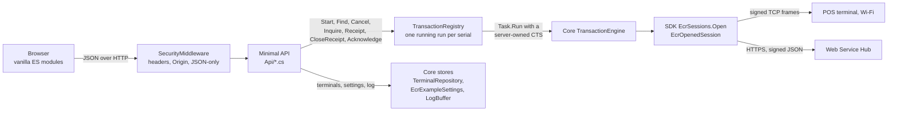
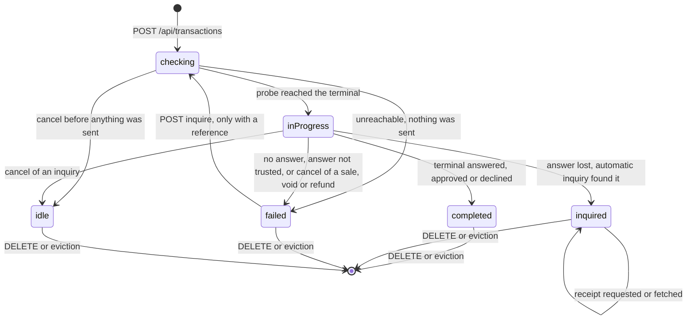
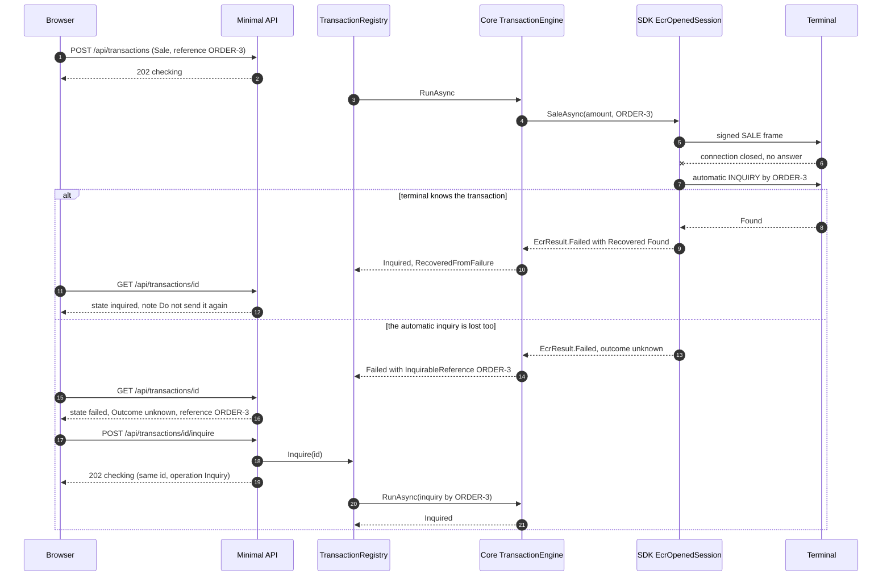

# Implementation guide - the ASP.NET Core web sample

For a .NET web/backend developer who wants to put a POS-terminal payment flow behind a web
application without getting it wrong, and for a maintainer. It explains **why** the code is
shaped the way it is; the [README](../README.md) is how to run and configure it. The shared
rules (form, outcomes, wording) are described in the
[WPF implementation guide](../../Windows-Native-Example/docs/implementation.md); SDK calls in
[operation-examples.md](../../Windows-Native-Example/docs/operation-examples.md).

Contents: [1 Goals and architecture](#1-goals-and-architecture) ·
[2 Hosting and composition](#2-hosting-and-composition) ·
[3 Secrets at rest](#3-secrets-at-rest) ·
[4 Transactions run on the server](#4-the-central-design-transactions-run-on-the-server) ·
[5 The API](#5-the-api) · [6 Validation](#6-validation) · [7 Security model](#7-security-model) ·
[8 Front end](#8-front-end) · [9 Logging](#9-logging) · [10 Tests and tools](#10-tests-and-tools) ·
[11 Extension recipes](#11-extension-recipes) · [12 Deployment](#12-deployment-notes) ·
[13 Known limitations](#13-known-limitations)

---

## 1. Goals and architecture

1. Show the safe way to drive a card terminal from a web app: the payment must not be tied to an
   HTTP request, two sales must never go to one terminal at once, and a lost answer is resolved
   by looking the transaction up, never by selling again.
2. Use the **same logic** as the WPF sample, so there is one implementation of the
   payment-safety rules to read, test and trust.
3. Stay readable: no front-end build, no database, no framework beyond ASP.NET Core minimal APIs.



The web project has a `ProjectReference` to `AmwalECR.Example.Core`, the UI-free `net8.0` library
the WPF app is built on; Core owns the SDK dependency switch, so the web project has none.

| From Core, unchanged                                                            | Why it is not redone                                                                                                                           |
| ------------------------------------------------------------------------------- | ---------------------------------------------------------------------------------------------------------------------------------------------- |
| `TransactionEngine`                                                             | The flow (resolve config, open, probe, execute, classify, close receipt) and the money-safety rules: the app-made reference, `CancelledState`. |
| `TransactionOutcomes`, `ResultPresenter`                                        | An unknown outcome is never a refusal or a retry; the wording a cashier reads.                                                                 |
| `TransactionFormState`, `AmountEntry`, `AmountLimits`                           | Which fields exist, what is required, messages, bounds.                                                                                        |
| `TerminalRepository`, `Terminal`, `TerminalValidator`, `EcrModes`               | Same JSON store and messages as WPF.                                                                                                           |
| `EcrExampleSettings`, `ISecretProtector`, `SelectedTerminalConfig`, `LogBuffer` | Environment and keys behind a seam; the plan before anyone pays; the last 500 log lines.                                                       |

| Added here                                 | Why                                                                                                                                                                          |
| ------------------------------------------ | ---------------------------------------------------------------------------------------------------------------------------------------------------------------------------- |
| `Services/TransactionRegistry.cs`          | WPF holds one transaction in a view-model; a server needs runs that outlive requests, plus a per-terminal guard ([4](#4-the-central-design-transactions-run-on-the-server)). |
| `Hosting/DataProtectionSecretProtector.cs` | DPAPI is Windows-only; the cross-platform `ISecretProtector`.                                                                                                                |
| `Hosting/EcrApp.cs`, `DataPaths.cs`        | The composition root WPF does in `App.OnStartup`.                                                                                                                            |
| `Hosting/SecurityMiddleware.cs`            | A browser-facing app that can take payments needs guards a desktop app does not.                                                                                             |
| `Api/*.cs`, `Api/Dtos.cs`                  | Thin translators from HTTP to Core; the DTOs are the wire contract.                                                                                                          |
| `wwwroot/`                                 | The UI, a port of the WPF views.                                                                                                                                             |

Rule of thumb when extending: a _rule_ (validation, wording, outcome classification) belongs in
Core so both front ends get it; _HTTP, browsers or process lifetime_ belongs here.

---

## 2. Hosting and composition

`Program.cs`, top to bottom:

1. Kestrel `MaxRequestBodySize = 64 KB`.
2. `JsonStringEnumConverter` on the HTTP JSON options (web defaults: camelCase, `null`s are
   emitted).
3. Singletons: `DataPaths` (data folder from `IConfiguration["DataDir"]`),
   `AddDataProtection().SetApplicationName("AmwalECR-WebExample")` (pinned, because the default
   application discriminator is the content-root path and a publish to another folder could not
   read its own ring), a `FileSystemXmlRepository` at `<DataDir>/keys`,
   `ISecretProtector -> DataProtectionSecretProtector` (purpose `AmwalECR.Example.settings.v1`),
   `EcrApp`, `TransactionRegistryOptions`, `TimeProvider.System` (injectable so a test can
   advance the clock) and `TransactionRegistry`.
4. Pipeline: `UseExceptionHandler` -> `UseSecurityHeaders` -> `UseApiGuard` -> `UseDefaultFiles`
   -> `UseStaticFiles` -> endpoint groups -> a fallback `MapFallback("/api/{**rest}")` answering
   `404 {"error":"No such endpoint"}` so a mistyped API path never gets the page. Host filtering
   (`AllowedHosts`) runs before all of it.
5. The exception handler answers `400 {"error":"The request could not be read"}` for a
   `BadHttpRequestException` and `500 {"error":"Unexpected error"}` otherwise, never exception
   text.
6. `EcrApp` is resolved eagerly so an unreadable data folder or file is logged at start-up, and
   an `ApplicationStarted` callback warns for every bound address that is not loopback.
7. `public partial class Program;` lets `WebApplicationFactory<Program>` host the app in tests.

`EcrApp` wires Core as `App.OnStartup` does: a `LogBuffer` (mirrored to `ILogger`
`AmwalPay.Ecr` at Debug), two `EcrLogger.From` loggers tagged `Ecr` and `EcrWebService`,
`TerminalRepository`, `EcrExampleSettings` and `TransactionEngine`.

**Data folder** (`DataPaths`): key `DataDir`; blank means
`Environment.SpecialFolder.LocalApplicationData/AmwalECR-WebExample` (`%LOCALAPPDATA%` on
Windows, `~/Library/Application Support` on macOS, `~/.local/share` on Linux).

| Path             | What                                                                                                              |
| ---------------- | ----------------------------------------------------------------------------------------------------------------- |
| `terminals.json` | Terminal list (camelCase, keyed by serial). A corrupt file is copied to `terminals.json.unreadable` and reported. |
| `settings.dat`   | Environment and both signing keys, encrypted with the protector.                                                  |
| `keys/`          | The Data Protection key ring.                                                                                     |

`Ensure()` creates the root and `keys`. On Unix a root it **created** is `0700`; a `DataDir` that
already existed keeps its mode (it may be shared on purpose). `keys` is **always** tightened to
`0700`, because that folder is what protects the secrets.

**Configuration keys**: `Urls` (`http://127.0.0.1:5080`), `AllowedHosts`
(`127.0.0.1;localhost;[::1]`), `DataDir` (blank), `Logging:LogLevel:*`. Set
`Logging:LogLevel:AmwalPay.Ecr=Debug` to mirror the SDK log to the console. Not configurable: the
64 KB cap and `TransactionRegistryOptions.FinishedRetention` (12 h; change it in code). There is
no `Ecr__...` section: terminals and keys go through the API.

---

## 3. Secrets at rest

The signing keys live in `settings.dat`, encrypted through Core's `ISecretProtector`.

|                     | WPF                                                    | Web                                                                                                       |
| ------------------- | ------------------------------------------------------ | --------------------------------------------------------------------------------------------------------- |
| Implementation      | `DpapiSecretProtector`: `ProtectedData`, `CurrentUser` | `DataProtectionSecretProtector`: `IDataProtector`                                                         |
| Where the key lives | Windows user profile; the app stores none              | An XML key ring in `<DataDir>/keys`, 90-day activation lifetime; old keys kept so old data stays readable |
| Portable            | Windows only                                           | Any OS                                                                                                    |

**The key ring is not itself encrypted.** No `ProtectKeysWith*` is configured, so Data Protection
logs `No XML encryptor configured...` at every start. The effective protection is the filesystem:
on Unix the folder and `keys` are `0700` and the key file `0600`, while `settings.dat` and
`terminals.json` take the default mode (typically `0644`) inside the `0700` folder. On Windows it
is the NTFS ACLs, which this code does not touch. Anyone who can read the folder can decrypt
`settings.dat`; on Windows you can add `.ProtectKeysWithDpapi()`, elsewhere use a certificate or
a key vault (not exercised here).

**A lost key ring** (deleted, or `settings.dat` copied elsewhere): `Unprotect` throws,
`EcrExampleSettings` resets to defaults (**environment back to SIT, both keys empty**) and sets
`LoadWarning`, shown as `notice` in `GET /api/settings`. The notice includes the framework's
exception text (a key id and a docs URL). It clears as soon as a key is saved. Back up `keys/`
together with `settings.dat`, or accept re-keying.

**Why keys are write-only.** The WPF app can show a stored key because the operator is the
Windows user. Here anything the API returns is readable by whoever reaches the port, and there is
no authentication. So `GET /api/settings` returns only `{ configured, label }` per key (not even
the length; `ConfigView` deliberately does not use Core's `HashKeyStatus`), `PUT` accepts a
value, `DELETE` clears it, and the typed value is wiped from the page once the server has it.

---

## 4. The central design: transactions run on the server

### Why not inside the request

A card payment takes as long as the cardholder does, a tab can close at any moment, and proxies
cut requests. If the handler awaited the engine with `HttpContext.RequestAborted`, closing the
tab would cancel the wait after the sale had been sent, leaving an unknown outcome nobody is
looking at. So `POST /api/transactions` **starts** a run and returns `202` with its id; the run
executes in `TransactionRegistry` on a `Task.Run` with a `CancellationTokenSource` **owned by
the run**; nothing looks at `RequestAborted`; the browser watches with `GET
/api/transactions/{id}`.

### The registry

One `lock (_gate)` guards two dictionaries: runs by id and the running run by terminal serial.
The engine call itself is outside the lock.

| Method                                           | Behaviour                                                                                                                                                                                                                                                                                             |
| ------------------------------------------------ | ----------------------------------------------------------------------------------------------------------------------------------------------------------------------------------------------------------------------------------------------------------------------------------------------------- |
| `Start(request, usesWebService, timeoutSeconds)` | Sweeps; if a run is already running on that serial -> `Busy(existingId)` (`409`); else creates the run, claims the serial, begins. Check-and-claim is one critical section, so 8 concurrent POSTs let exactly one through.                                                                            |
| `Find(id)` / `Pending()`                         | Snapshots under the lock, so state and version belong together. `Pending()` is every un-acknowledged run, newest first.                                                                                                                                                                               |
| `Cancel(id)`                                     | `null` (-> 404) if unknown; else `cts.Cancel()` and returns the snapshot at that instant.                                                                                                                                                                                                             |
| `Inquire(id)`                                    | Only for `Failed` **with** an `InquirableReference`; refuses while the terminal is running something else. Replaces `run.Request` with an Inquiry by that reference (blank own `MerchantReference`) and begins it on the **same run id**.                                                             |
| `RequestReceipt(id)`                             | Only for an `Inquired` state without a receipt, not already fetching, not Web Service. Fire-and-forget read; the result is stored on the run.                                                                                                                                                         |
| `CloseReceiptAsync(id)`                          | Only for a `Completed` state. On Web Service takes the result's `MerchantReference` as `originalMerchantReference` (none -> `409 "Close receipt needs the sale / void / refund reference"`). Calls `engine.CloseTerminalReceiptAsync`; does **not** change the run's state, so the dialog stays open. |
| `Acknowledge(id)`                                | `false` (-> 409) while busy; removes the run; unknown id -> `true` (idempotent, 204).                                                                                                                                                                                                                 |

**Single-flight per terminal.** The guard is server-side and per serial, not a disabled button:
a double click, a second tab or a repeated POST must not put two sales on one terminal.
Different serials run side by side.

**Completing a run.** After the engine returns, `run.Cts = null`, the serial is released and the
final state stored in the same lock section: a poller that sees the result may start the next
run at once, and one that still sees "running" must not find the terminal free. `Report` only
updates a run that is still busy. An exception escaping the engine becomes
`Failed("Unexpected error: ...")` (with a fresh reference for money-moving types), so a run is
never left spinning.

**Countdown.** Each run carries `TimeoutSeconds`, the response timeout of the terminal's plan
(`config.EcrConfig.ResponseTimeout`: 120 s Wi-Fi, 130 s Web Service), and `BusySince`, reset
whenever a wait begins (start, a follow-up inquiry, a receipt fetch). A snapshot's
`RemainingSeconds` is `TimeoutSeconds - elapsed` (floored at 0) while the run is busy or a
receipt is being fetched, else `null`. The server counts, so the page needs no clock of its own.

### State model



`busy` is `checking` or `inProgress`; `isResult` is `completed`, `inquired` or `failed`. An
`idle` run means "stopped before anything was sent"; the page drops and acknowledges it.

### Polling contract

`GET /api/transactions/{id}` returns a `TransactionView`:

```json
{
  "id": "76349c6a57cb472a8e9ec650aa2cf294",
  "terminalSerial": "TW1234567890",
  "operation": "Sale",
  "state": "completed",
  "busy": false,
  "isResult": true,
  "statusText": "Waiting for the POS terminal...",
  "version": 3,
  "dialog": {
    "headline": "Approved",
    "tone": "approved",
    "amount": "1.234",
    "message": null,
    "note": null,
    "fields": [
      { "label": "Auth code", "value": "514297" },
      { "label": "Card", "value": "483312******1234" },
      { "label": "Reference", "value": "ORDER-1001" }
    ],
    "hints": [],
    "rawPayload": "{ ... the terminal's full answer, indented ... }",
    "isUnknownOutcome": false,
    "inquirableReference": null,
    "unknownOutcomeWarning": null,
    "offersReceipt": false,
    "receiptNote": null,
    "receipt": {
      "showButton": false,
      "fetching": false,
      "url": null,
      "problem": null
    },
    "canCloseReceipt": true
  },
  "timeoutSeconds": 120,
  "remainingSeconds": null
}
```

| Field                    | Meaning                                                                                                                                                                                                              |
| ------------------------ | -------------------------------------------------------------------------------------------------------------------------------------------------------------------------------------------------------------------- |
| `state`                  | `idle` `checking` `inProgress` `completed` `inquired` `failed`                                                                                                                                                       |
| `operation`              | The **current** request's display name; changes from `Sale` to `Inquiry` when a look-up runs on the same run.                                                                                                        |
| `statusText`             | Spinner text, meaningful only while `busy` (`"Checking the terminal..."` for `checking`, `"Waiting for the POS terminal..."` for every other state).                                                                 |
| `version`                | Starts at 1, increments on every change of that run; a client keeps the highest and discards older responses.                                                                                                        |
| `timeoutSeconds`         | The configured response timeout for this run's terminal.                                                                                                                                                             |
| `remainingSeconds`       | Seconds left of it while busy or fetching a receipt (server-counted); `null` otherwise.                                                                                                                              |
| `dialog`                 | `null` while busy or idle; else Core's `ResultDialogModel` plus the receipt bits. `tone` is `approved` or `declined` (also used for failures and "not found"). `isUnknownOutcome` <=> `inquirableReference != null`. |
| `dialog.canCloseReceipt` | True only for a `completed` state: the page may show **Close receipt**.                                                                                                                                              |

**When to stop polling** (`transaction.js`): keep polling every 500 ms while `busy` or while
`dialog.receipt.fetching`; stop when neither, and on `404`; a network error is **not** a stop
(the run does not depend on the page: show "connection lost" and keep asking); `202` from
`inquire` or `receipt` puts the run back to busy/fetching, so resume polling the same id.

### Cancel = unknown outcome

Cancel means "stop waiting", not "undo". The engine catches cancellation only when its own token
is cancelled and maps it through `TransactionEngine.CancelledState`:

| When cancel lands                                  | Result                                                                                                                                                   |
| -------------------------------------------------- | -------------------------------------------------------------------------------------------------------------------------------------------------------- |
| During the reachability probe (nothing sent)       | `idle`                                                                                                                                                   |
| After the request went out, `Inquiry`              | `idle` (a read; nothing to lose)                                                                                                                         |
| After the request went out, `Sale`/`Void`/`Refund` | `failed` **with the reference**: "You stopped waiting for the terminal. This does not cancel the transaction..." - an unknown outcome, never "cancelled" |
| Run already finished                               | No-op; `200` with the current state                                                                                                                      |

`POST .../cancel` answers with the snapshot at the moment of the call, normally still busy: keep
polling.

### Inquire by reference is the only follow-up

An unknown outcome carries a reference: the one the till chose, or the one the engine generated
with `TransactionEngine.NewReference()` (12 upper-case hex) when the field was blank. A receipt
number is in the answer, which is exactly what was lost, so it cannot be the key. `POST
.../inquire` looks the transaction up by the reference; there is deliberately **no retry**
endpoint. The look-up reuses the run id, so a reloaded page follows one object through
`failed -> checking -> inquired`. A look-up that itself fails keeps the reference
(`TransactionOutcomes.RetryableReference`), so it reads "Outcome unknown" and `inquire` is
offered again.

### A lost answer, with the automatic inquiry



Against `fake_pos_server_signed.py`, `--drop-sale` exercises the first branch and
`--drop-sale --drop-first-inquiry` the second; exactly one `SALE` reaches the terminal in each.

### Acknowledge, eviction, retention

- **Acknowledge** (`DELETE /api/transactions/{id}`) means "the operator has read the result". The
  page sends it when the result dialog closes by any route, Escape included, so closing an
  _Outcome unknown_ dialog discards the run and its reference from the server. The reference is
  still in the debug log and the dialog's Copy button exists for this reason.
- **Eviction.** `Sweep()` drops runs that are not busy and whose last update is older than
  `FinishedRetention` (12 h; an unknown outcome must survive a night away from the till). It
  runs lazily on `Start`, `Find`, `Pending` and `Inquire`; busy runs are never evicted.
- **Restart.** Everything is in memory; a restart forgets every run, including running ones the
  terminal may still complete. Use **Inquire** with a reference from the log or the till.
  Shutdown does not wait for runs and nothing cancels them.

---

## 5. The API

JSON in, JSON out. Rules for every `/api` call (from `SecurityMiddleware`):

- Every mutating call (`POST`, `PUT`, `DELETE`) must send `Content-Type: application/json`, even
  with nothing to say (`{}`); otherwise `415 {"error":"Use Content-Type: application/json"}`.
- A request with an `Origin` other than this host, or `Sec-Fetch-Site` other than
  `same-origin`/`none`, is `403 {"error":"Cross-origin requests are not accepted"}` (preflights
  included; there is no CORS).
- `Cache-Control: no-store` on every `/api` response.

| Error shape                                                 | Used for                                                                                                    |
| ----------------------------------------------------------- | ----------------------------------------------------------------------------------------------------------- |
| `{ "error": "...", "transactionId": null }`                 | 400, 404, 409, 500. `transactionId` is set only on the 409s that name the run already running.              |
| `{ "errors": { "<field>": "<message>" }, "message": null }` | 422. `message` is set only when the terminal's plan is not ready (issues joined with `\n`, `errors` empty). |
| `{ "error": "..." }`                                        | 403 and 415 from the guard.                                                                                 |
| empty body                                                  | 413 (body over 64 KB) and 400 for a `Host` not in `AllowedHosts` (Kestrel's own page).                      |

### Endpoint reference (21 routes)

| Method and path                                      | Request                                                                                                                                                                    | Success                                                                                                                                                                                                                        | Errors                                                                                                                                                                                                 |
| ---------------------------------------------------- | -------------------------------------------------------------------------------------------------------------------------------------------------------------------------- | ------------------------------------------------------------------------------------------------------------------------------------------------------------------------------------------------------------------------------ | ------------------------------------------------------------------------------------------------------------------------------------------------------------------------------------------------------ |
| `GET /api/meta`                                      |                                                                                                                                                                            | `200 Meta`, see [6](#6-validation)                                                                                                                                                                                             |                                                                                                                                                                                                        |
| `GET /api/terminals`                                 |                                                                                                                                                                            | `200 { terminals: TerminalView[], notice }`                                                                                                                                                                                    |                                                                                                                                                                                                        |
| `POST /api/terminals`                                | `name, serialNumber, ecrMode (int), ipAddress, port, terminalId, merchantId` (text but `ecrMode`)                                                                          | `200 TerminalView`                                                                                                                                                                                                             | `422` keys `mode name serial ip port terminalId merchantId`; a duplicate serial, or any save failure, is `serial`                                                                                      |
| `PUT /api/terminals/{serial}`                        | same; changing `serialNumber` replaces the entry                                                                                                                           | `200 TerminalView`                                                                                                                                                                                                             | `404`; `422`                                                                                                                                                                                           |
| `DELETE /api/terminals/{serial}`                     | `{}`                                                                                                                                                                       | `204`                                                                                                                                                                                                                          | `404`; `500` if the file cannot be written                                                                                                                                                             |
| `GET /api/terminals/{serial}/config[?announce=true]` |                                                                                                                                                                            | `200 ConfigView`: `serialNumber, modeLabel, transportLabel, connectionSummary, keyLabel, keyConfigured, keyStatus, issues[], isReady, isSupported, usesWebService`; `announce=true` writes the "selected ..." lines to the log | `404`                                                                                                                                                                                                  |
| `GET /api/settings`                                  |                                                                                                                                                                            | `200 { environment, wifi: {label, configured}, webService: {label, configured}, notice }`, never a key                                                                                                                         |                                                                                                                                                                                                        |
| `PUT /api/settings/environment`                      | `{ environment }` (`SIT` `UAT` `PROD`, case-insensitive)                                                                                                                   | `200` settings                                                                                                                                                                                                                 | `422` under `environment`; `500` on write failure (value stays in memory)                                                                                                                              |
| `PUT /api/settings/keys/{kind}`                      | `{ value }`; `kind` = `wifi` or `webService`                                                                                                                               | `200` settings                                                                                                                                                                                                                 | `404`; `422` under `value`: blank or not even-length hex of at least 16; `500`                                                                                                                         |
| `DELETE /api/settings/keys/{kind}`                   | `{}`                                                                                                                                                                       | `200` settings                                                                                                                                                                                                                 | `404`; `500`                                                                                                                                                                                           |
| `GET /api/transactions`                              |                                                                                                                                                                            | `200 { transactions: TransactionView[] }`, un-acknowledged, newest first                                                                                                                                                       |                                                                                                                                                                                                        |
| `POST /api/transactions`                             | raw form: `terminalSerial, type, amountDigits, receiptNumber, originalTerminalId, originalDate, useOtherTerminal, lookUpByReference, originalReference, merchantReference` | `202 TransactionView` (`state: "checking"`)                                                                                                                                                                                    | `422` (below); `409` `"A transaction is already running on this terminal"` + `transactionId`                                                                                                           |
| `GET /api/transactions/{id}`                         |                                                                                                                                                                            | `200 TransactionView`                                                                                                                                                                                                          | `404 "No such transaction"`                                                                                                                                                                            |
| `POST /api/transactions/{id}/cancel`                 | `{}`                                                                                                                                                                       | `200 TransactionView` (snapshot at the call)                                                                                                                                                                                   | `404`                                                                                                                                                                                                  |
| `POST /api/transactions/{id}/inquire`                | `{}`                                                                                                                                                                       | `202 TransactionView` (`operation: "Inquiry"`, same id)                                                                                                                                                                        | `404`; `409` `"This transaction has no unknown outcome to look up"`; `409` `"Another transaction is running on this terminal"` + `transactionId`                                                       |
| `POST /api/transactions/{id}/receipt`                | `{}`                                                                                                                                                                       | `202 TransactionView`; poll for `dialog.receipt.url`                                                                                                                                                                           | `404`; `409` `"No receipt can be requested for this transaction"` (not an inquiry result, already has one, already fetching, or Web Service)                                                           |
| `POST /api/transactions/{id}/close-receipt`          | `{}`                                                                                                                                                                       | `200 { message, transaction }`: `message` is the engine's text (`Terminal is back on its idle screen`, `Terminal refused: ...`, `Could not reach the terminal: ...`)                                                           | `404`; `409` `"Close receipt is not available for this transaction"` (not a `completed` state) or `"Close receipt needs the sale / void / refund reference"` (Web Service, no reference on the result) |
| `DELETE /api/transactions/{id}`                      | `{}`                                                                                                                                                                       | `204`, also for an unknown id                                                                                                                                                                                                  | `409 "The transaction is still running"`                                                                                                                                                               |
| `GET /api/qr?text=`                                  |                                                                                                                                                                            | `200 image/svg+xml` (QRCoder `SvgQRCode`, level M)                                                                                                                                                                             | `400` blank, over 1024 chars, or too long for a QR                                                                                                                                                     |
| `GET /api/log`                                       |                                                                                                                                                                            | `200 { text, count, capacity }`                                                                                                                                                                                                |                                                                                                                                                                                                        |
| `DELETE /api/log`                                    | `{}`                                                                                                                                                                       | `204`                                                                                                                                                                                                                          |                                                                                                                                                                                                        |
| any other `/api/*`                                   |                                                                                                                                                                            |                                                                                                                                                                                                                                | `404 {"error":"No such endpoint"}`                                                                                                                                                                     |

**`POST /api/transactions` in detail.** `type` is `Sale`, `Void`, `Refund` or `Inquiry`
(case-insensitive, from `EcrTransactionTypes.MenuOptions`). Inputs are normalised the way the
WPF fields normalise typing (`TransactionFormMapper`):

| Field                | Normalisation                                                                                                   |
| -------------------- | --------------------------------------------------------------------------------------------------------------- |
| `amountDigits`       | `AmountEntry.KeyedDigits`: ASCII digits, no leading zeros, cut at 9. Digits are mills: `"1234"` = 1.234 OMR.    |
| `receiptNumber`      | digits only, at most 6                                                                                          |
| `originalTerminalId` | digits only                                                                                                     |
| `originalDate`       | `yyyy-MM-dd` or `yyyyMMdd`; blank or unparseable -> the server's today; a future date -> today. Never an error. |
| `originalReference`  | cut at 32 characters                                                                                            |
| `merchantReference`  | not cut: over 32 or containing space, `&`, `=` or a non-printable -> `422`                                      |
| booleans             | missing means `false`                                                                                           |

Fields the chosen type does not show are ignored. `422` keys: `terminal`, `type`, `amount`,
`receiptNumber`, `originalTerminalId`, `originalReference`, `merchantReference`; or, with empty
`errors`, `message` listing the plan's issues.

### A curl session

Against a scratch instance (`--urls http://127.0.0.1:5091 --DataDir=/tmp/ecr-scratch`) and the
fake terminal on 19100:

```bash
B=http://127.0.0.1:5091
j() { curl -s -H 'Content-Type: application/json' "$@"; echo; }     # JSON is mandatory on POST/PUT/DELETE

j -X POST $B/api/terminals -d '{"name":"Demo","serialNumber":"TW1234567890","ecrMode":2,"ipAddress":"127.0.0.1","port":"19100"}'
j -X PUT  $B/api/settings/keys/wifi -d '{"value":"0123456789ABCDEF0123456789ABCDEF"}'   # response has no key
curl -s $B/api/terminals/TW1234567890/config                                              # isReady true
j -X POST $B/api/transactions -d '{"terminalSerial":"TW1234567890","type":"Sale","amountDigits":"1234","merchantReference":"ORDER-1001"}'   # 202, state checking
curl -s $B/api/transactions/<id>                       # poll: completed, dialog.headline "Approved"
j -X POST $B/api/transactions/<id>/close-receipt -d '{}'
curl -s -X DELETE -H 'Content-Type: application/json' $B/api/transactions/<id>   # 204
```

A second `POST` on a busy terminal returns `409` with the running `transactionId`; `DELETE` while
running returns `409`; `text/plain` returns `415`; a foreign `Origin` returns `403`; a foreign
`Host` returns `400`.

---

## 6. Validation

**The server is the authority.** The page sends the raw form and shows the per-field messages of
a `422`. `TransactionEndpoints.Start` applies, in order, and stops at the first failure:

1. terminal exists -> `422 terminal`
2. `Engine.ResolveConfig(terminal).IsReady` -> `422 { message }` (the line WPF holds by disabling
   Start)
3. `type` is a known operation -> `422 type`
4. `TransactionFormMapper.ToState` normalises -> Core's `TransactionFormState.Validated(serial)`
   -> per-field errors -> `422 errors`
5. `registry.Start(...)` -> `202` or `409`

`Validated` returns a request that carries only the fields the type shows.

**`GET /api/meta` drives the UI**; the page holds no copy of these rules:

- `operations[]`: `value`, `label`, the SDK flags (`requiresAmount`, `requiresOriginalStan`,
  `requiresOriginalDate`, `allowsOtherTerminal`, `movesMoney`), `amountHelp`, `startButtonText`
  and `layouts`, a map keyed `"<otherTerminal><byReference>"` as `0/1` (so `"10"` is "different
  terminal on, by-reference off") to a `FieldLayout` of booleans, each produced by instantiating
  Core's own `TransactionFormState`.
- `modes[]`: `value`, `label`, `ipBased`, `supported`, `hint`, `note`.
- `environments[]`, `amount { min, max, fractionDigits, maxDigits }`,
  `merchantReferenceMaxLength` (32), `receiptNumberMaxLength` (6), `defaultPort` (9100),
  `today` (`yyyy-MM-dd`, server date).

To change a rule, change Core and the page follows; the only client-side rules are cosmetic input
filters, which the server re-applies.

---

## 7. Security model

No authentication. The app can take payments, register terminals, replace keys and show a log
with masked card numbers, for whoever can reach it. The controls make a _local, single-operator_
deployment reasonable; they do not make it a service.

| Control                 | Detail                                                                                                                                                                                                                                                               |
| ----------------------- | -------------------------------------------------------------------------------------------------------------------------------------------------------------------------------------------------------------------------------------------------------------------- |
| Loopback binding        | `Urls = http://127.0.0.1:5080`; a start-up warning for any non-loopback address.                                                                                                                                                                                     |
| Host filtering          | `AllowedHosts = 127.0.0.1;localhost;[::1]`; defeats DNS rebinding.                                                                                                                                                                                                   |
| Security headers        | `X-Content-Type-Options: nosniff`, `X-Frame-Options: DENY`, `Referrer-Policy: no-referrer`, `Content-Security-Policy: default-src 'self'; img-src 'self' data:; object-src 'none'; base-uri 'none'; form-action 'self'; frame-ancestors 'none'`. No `unsafe-inline`. |
| `/api` guard            | Refuses cross-origin requests (`Sec-Fetch-Site` not `same-origin`/`none`, so even `same-site` is refused, or an `Origin` whose authority differs from `Request.Host`) and mutating calls that are not `application/json`.                                            |
| No CORS                 | A preflight gets `403`.                                                                                                                                                                                                                                              |
| Why JSON-only matters   | A cross-site HTML form can send a POST without CORS, but only as `form-urlencoded`/`multipart`/`text/plain`. Requiring `application/json` forces a preflight, which fails.                                                                                           |
| Bounded input, no leaks | 64 KB cap (`413`); the exception handler never returns exception text; keys are write-only.                                                                                                                                                                          |
| Rendering               | Server-supplied text goes through `textContent`/`setAttribute` ([8](#8-front-end)).                                                                                                                                                                                  |

**Deliberately not there:** authentication and authorisation (loopback does not defend against
another local user or process); TLS; CSRF tokens (the JSON-only + Origin + Fetch-Metadata +
no-CORS combination replaces them and is sound _because there are no cookies or ambient
credentials_; if you add cookie auth, keep the guards and add antiforgery); rate limiting, audit
logging, per-user terminal ownership, HSTS.

### Before you expose this

Do not bind to anything but loopback until all of these are done:

1. **Authentication and authorisation on every endpoint**, read-only ones included, with
   separate rights for payments, terminals and keys ([11.5](#115-add-authentication)).
2. **TLS** end to end, `AllowedHosts` set to the real host name(s); behind a proxy follow
   [11.6](#116-host-behind-a-reverse-proxy).
3. **Per-user terminal ownership**: today every visitor drives every terminal and sees the
   shared debug log.
4. **Real persistence and a secret store**: terminals in a database, keys in a KMS/HSM, not a
   local unencrypted key ring.
5. **Decide about state**: runs live in process memory; two instances do not share the
   per-terminal guard ([11.4](#114-replace-the-in-memory-registry-with-a-distributed-one)).
6. **Audit logging** of who started, cancelled and looked up what, and a decision on who may
   read `/api/log`.

---

## 8. Front end

Plain HTML, CSS and ES modules; no build step, bundler, CDN or `package.json`. `index.html` loads
one `<script type="module" src="app.js">`.

| File                                | Owns                                                                                                                                                                                                                                                                          |
| ----------------------------------- | ----------------------------------------------------------------------------------------------------------------------------------------------------------------------------------------------------------------------------------------------------------------------------- |
| `app.js`                            | Boot: fetch `/api/meta` (failure shows the `#fatal` banner), init Transaction and Terminals (settings embedded on Terminals), hash routing (`#transaction`, `#terminals`; `#settings` redirects), Escape-to-go-back, the shared `confirm()` modal, refresh on tab visibility. |
| `js/api.js`                         | The only place that calls `fetch`. `ApiError` (`status`, `body`, `.fields`); always sends JSON on mutating calls; `acknowledge` uses `keepalive` so it survives a reload; includes `closeReceipt(id)`.                                                                        |
| `js/dom.js`                         | `$`, `h()` (element builder), `show()`, `setText()`, `announce()`, `copyText()`.                                                                                                                                                                                              |
| `js/amount.js`                      | Pure amount functions plus `attachAmountInput()`; DOM-free at the top so node can test it.                                                                                                                                                                                    |
| `js/transaction.js`                 | The transaction screen: form state, layout from meta, config card, start, the poll loop, the countdown, result dialog, look-up, receipt and close-receipt actions, reload-resume.                                                                                             |
| `js/terminals.js`, `js/settings.js` | Terminal list and dialog; environment radios and write-only key boxes.                                                                                                                                                                                                        |
| `js/log.js`                         | Debug panel: polls `/api/log` every second only while the `<details>` is open and the tab visible.                                                                                                                                                                            |

**Rendering rule.** Server-supplied text is only set through `textContent`, `setAttribute` or
`h()`. There is no `innerHTML`, `eval(` or inline handler; a test enforces it textually over
every `.html`, `.js` and `.css` file (even a comment containing the word fails it), and also
forbids `style=` attributes, inline `<script>`, and any `http(s)://` URL except the SVG/XML
namespace and `example.invalid`. Visibility uses the `hidden` attribute (`show()`).

**Amount input.** `attachAmountInput` makes a text input behave like the POS field: keyed digits
are the source of truth, digits shift in from the right, Backspace shifts out, capped at
`meta.amount.maxDigits`. All typing goes through `beforeinput`; delete-forward, cut and drop are
refused; the caret is pinned to the end; Space and Delete are swallowed; Escape clears (and
`preventDefault`s so "go back" does not also fire); focusing from another control starts a fresh
amount (`focus()` on the handle sets `keepOnFocus` for the page's own focus moves).
`tools/test-amount.mjs` pins it against Core's vectors.

**Accessibility.** Skip link; headings take focus on a route change; one polite live region;
native `<dialog>` modals (the result dialog focuses **Close**, the confirm dialog's `autofocus`
is the safe button); on a `422` the first invalid field is focused with `aria-invalid` and
`aria-describedby`; the busy `<fieldset>` is disabled and its status takes focus once; status is
never colour-only; light and dark schemes and a reduced-motion rule.

**Polling, countdown and reload-resume.** `adopt(view)` is the single entry for server state: it
ignores a lower `version`, renders and reschedules. `schedulePoll()` polls every 500 ms only
while `busy` or a receipt is `fetching`; `poll()` treats `404` as "gone" and any other failure as
"keep trying" with a "connection lost" note. While busy, `render()` starts a one-second timer
from `remainingSeconds`/`timeoutSeconds` and shows `m:ss` with the caption "remaining of N s
timeout"; it stops when the run is no longer busy. On load, `start()` refreshes terminals and
config, then `GET /api/transactions` and **adopts the newest run**: a running one resumes with the
form disabled; an unread result reopens its dialog. `beforeunload` asks the browser to confirm
leaving while a run is busy; the run survives either way. **Close receipt** is shown from
`dialog.canCloseReceipt`, posts to `close-receipt`, and shows the returned `message`; it does not
close the dialog.

---

## 9. Logging

```
SDK IEcrLogger -> EcrLogger.From(...) -> LogBuffer (500 lines) -> GET /api/log -> debug panel
                  tag "Ecr" / "EcrWebService"       \-> ILogger "AmwalPay.Ecr" at Debug
```

`TransactionEngine` picks the Wi-Fi or Web Service logger per transport; both feed one
lock-protected `LogBuffer` of the last 500 lines, each stamped `HH:mm:ss.fff` in server local
time, no date. It holds the framed request and response JSON, signing steps, probe results and
`[App]` lines; masked PANs appear, a signing key never does. The buffer is process-wide (every
visitor sees it) and lost on restart. The console mirror is at Debug, silent under the default
`Information`.

---

## 10. Tests and tools

### `dotnet test`: `tests/AmwalECR.WebExample.Tests`

```bash
dotnet test tests/AmwalECR.WebExample.Tests -p:EcrSdkDependency=project    # 113 tests
```

xUnit. Each test gets its own **in-process host** (`WebApplicationFactory<Program>`) on a temp
data folder (`DataDir` injected), an in-process **signed loopback terminal**, and, through the
app's own API, one registered Wi-Fi terminal with the key saved (`Harness.cs`). Time-dependent
tests replace `TimeProvider` with `ManualTime`. `FakeTerminal` is a `TcpListener` that speaks the
real protocol (2-byte big-endian length + JSON, echoed `nonce`, `secureHash`), so the whole path
runs against the real SDK; it is a copy of Core's `EngineTests.cs` one, so Core's own tests are
not run twice.

| Class                       | Pins                                                                                                                                                                                                                                                                                                                                                                                                                                         |
| --------------------------- | -------------------------------------------------------------------------------------------------------------------------------------------------------------------------------------------------------------------------------------------------------------------------------------------------------------------------------------------------------------------------------------------------------------------------------------------- |
| `TerminalTests`             | CRUD by serial, persistence across a restart, WPF messages, blank port = 9100, numeric Web Service IDs, USB/Bluetooth unsupported, duplicate serial under `serial`.                                                                                                                                                                                                                                                                          |
| `SettingsTests`             | Starts unconfigured on SIT; a key is never echoed; invalid/blank keys refused; two independent keys; **`settings.dat` is not readable text**; a restart decrypts through the ring; a lost ring is a notice; data folder `0700` on Unix.                                                                                                                                                                                                      |
| `ConfigCardTests`           | Per mode: transport, connection, key state without the key; a missing key is an issue before paying; config follows key changes; `announce` logs.                                                                                                                                                                                                                                                                                            |
| `MetaTests`                 | Operations carry the SDK flags and Core's layouts; modes, environments and limits come from Core.                                                                                                                                                                                                                                                                                                                                            |
| `FormValidationTests`       | Bounds and messages, digit normalisation, reference rules, per-operation requirements, errors equal Core's own answers, hidden fields ignored, date default.                                                                                                                                                                                                                                                                                 |
| `TransactionLifecycleTests` | Approved, generated reference, declined is not an error, partial approval, unreachable is not unknown, lost answer recovered, lost answer + lost follow-up -> `Inquire` (same id, one `SALE`), cancel = unknown outcome, `409` on a second start (8 concurrent -> one `202`), terminals in parallel, a payment survives an aborted poll, reload finds runs, acknowledge rules, 12 h eviction, wrong-key signature not believed, void/refund. |
| `ReceiptTests`, `QrTests`   | Receipt fetch and QR render; failure reported not thrown; receipt only for an inquiry result; QR is SVG, limits.                                                                                                                                                                                                                                                                                                                             |
| `LogTests`                  | Wire traffic visible, no key, bounded to 500, clearable.                                                                                                                                                                                                                                                                                                                                                                                     |
| `SecurityTests`             | Headers, no CORS, non-JSON mutating calls refused and nothing reaches the terminal, foreign `Origin`/`Host`, no inline script/style/handlers/CDN/`innerHTML`/`eval`, no error detail, JSON 404.                                                                                                                                                                                                                                              |

Not covered by any test: the `close-receipt` route, the `timeoutSeconds`/`remainingSeconds`
fields, cancelling before anything is sent (`idle`), the Web Service transport, and anything in
a browser.

### Tools (`tools/`)

| Tool                  | Run                                                                                                                                  | Catches                                                                                                                                                                                                                                                                                 |
| --------------------- | ------------------------------------------------------------------------------------------------------------------------------------ | --------------------------------------------------------------------------------------------------------------------------------------------------------------------------------------------------------------------------------------------------------------------------------------- |
| `check-web-wiring.py` | `python3 tools/check-web-wiring.py`                                                                                                  | A script looks up an id `index.html` does not define; `js/api.js` calls a verb+route the server does not map (it reads `MapGroup("...")` and `Map{Get,Post,Put,Delete}("...")` string literals, so build routes from literals); an `import { x }` of a name the target does not export. |
| `smoke-browser.mjs`   | `PUPPETEER_DIR=/path node tools/smoke-browser.mjs [baseUrl]` against a running app; needs `puppeteer-core` and Chrome (`CHROME=...`) | Console error, uncaught exception, CSP violation, failed or 4xx/5xx request, fatal banner, or a section that does not show.                                                                                                                                                             |
| `test-amount.mjs`     | `node tools/test-amount.mjs`                                                                                                         | Drift of `amount.js` from Core's `AmountEntry`/`AmountLimits`. It hard-codes `MAX_DIGITS = 9`.                                                                                                                                                                                          |

---

## 11. Extension recipes

### 11.1 Add an endpoint

1. `Api/YourEndpoints.cs`: `MapYour(this IEndpointRouteBuilder app)` with `app.MapGroup("/api/your")`
   and **string literals**.
2. `Api/Dtos.cs`: the request/response records.
3. `Program.cs`: `app.MapYour()` **before** the `/api/{**rest}` fallback.
4. `wwwroot/js/api.js`: one method per call.
5. UI if any: `index.html` ids, the screen module, `app.js` for a new screen.
6. A test on the `Harness`; then `check-web-wiring.py`.

### 11.2 Add a form field

A field changes a rule, so start in Core (`TransactionFormState`: property, `Show...` flag,
validation, `TransactionRequest`, `FormErrors`). Then web `TransactionFormBody`,
`TransactionFormMapper.ToState` and `ToDictionary(FormErrors)`; `FieldLayout` and
`MetaEndpoint.BuildOperation`; `index.html` (`data-field` group, `f-<name>` and `e-<name>` ids);
`js/transaction.js` (`els`, `newForm`, `syncForm`, `errorFields`, a listener, a `show(...)`
line); tests in `FormValidationTests` and `MetaTests`.

### 11.3 Add an operation

Add it to the SDK's `EcrTransactionTypes.MenuOptions` with its flags and it appears in
`/api/meta` and the type `<select>`. `TransactionEngine.ExecuteAsync` needs a branch;
`TransactionOutcomes`/`ResultPresenter` decide how it ends; **`MovesMoney()` decides whether it
gets a reference and whether a cancel is an unknown outcome**. The registry does not change.

### 11.4 Replace the in-memory registry with a distributed one

Extract an interface from the public methods. Preserve:

1. **Single-flight per serial, atomically** (a unique constraint, or `SET NX` with a lease and
   owner id renewed while busy). Re-run
   `Concurrent_starts_on_one_terminal_let_exactly_one_through`.
2. **A durable reference before sending.** Today a blank sale's reference is generated inside
   `TransactionEngine.RunAsync` and the registry learns it from the final state, so a crash
   mid-flight loses it. Generate it in the registry (a non-empty `request.MerchantReference` is
   used as-is), persist the run with it, then send.
3. **Result and release together** (one transaction/CAS).
4. **Never tied to a request's lifetime**, and never a retry.
5. **Cancel reaches the owner**: the `CancellationTokenSource` is process-local.
6. **Orphans**: a `Checking`/`InProgress` run whose owner is gone must become `Failed` with its
   reference, not disappear.
7. Retention as a TTL; `version` as a monotonic counter (the page relies on it).

### 11.5 Add authentication

Between `UseApiGuard()` and the endpoints:

```csharp
builder.Services.AddAuthentication(/* cookie, JWT or OIDC */).AddCookie();
builder.Services.AddAuthorization();
// ...
app.UseSecurityHeaders();
app.UseApiGuard();
app.UseAuthentication();
app.UseAuthorization();
// ...
var secured = app.MapGroup("").RequireAuthorization();   // empty prefix: routes stay absolute
secured.MapMeta(); secured.MapTerminals(); secured.MapSettings();
secured.MapTransactions(); secured.MapLogAndQr();
```

`RouteGroupBuilder` is an `IEndpointRouteBuilder`, so the existing `Map*` methods take it
unchanged. Add policies per group; teach `js/api.js` about `401`. Not built or run here.

### 11.6 Host behind a reverse proxy

The guard compares the request's `Origin` authority to `Request.Host`. If the proxy rewrites
`Host`, every `POST` becomes `403`: forward the original `Host`, or enable `UseForwardedHeaders`
(`XForwardedHost | XForwardedProto`, with `KnownProxies`, placed first), and put the public name
in `AllowedHosts`. Polling means no long-lived connections, so proxy read timeouts are not a
payment risk. Not run here.

### 11.7 Another host (MVC, Blazor)

Portable as is: Core, `TransactionRegistry`, `EcrApp`, the protector, `TransactionView.From` and
the DTOs. In Blazor Server a component may call the registry directly and re-render on `Version`;
do not `await` the engine in a component or use the circuit's token, because a circuit dies with
the connection, which is why runs live in the registry.

---

## 12. Deployment notes

- **Run from the publish folder.** `dotnet publish -c Release -o out` produces the app,
  `appsettings.json`, `wwwroot/` and a `web.config`. The content root is the current directory:
  started elsewhere, `/` is `404` and `appsettings.json` (`AllowedHosts`, `Urls`) is not loaded
  (`AllowedHosts` then allows all). `cd` into the folder, set `ASPNETCORE_CONTENTROOT`, or use a
  service manager with the right working directory.
- **Configuration** comes from environment variables (`DataDir`, `ASPNETCORE_URLS`,
  `AllowedHosts`, `ASPNETCORE_ENVIRONMENT`). Signing keys are not configuration: they are entered
  through the API and stored in `settings.dat`. To source them elsewhere, change Core
  (`TransactionEngine` takes the concrete `EcrExampleSettings`) or implement `ISecretProtector`
  as a KMS/Key-Vault envelope.
- **Windows Service:** not wired (no `UseWindowsService()`). To add it, reference
  `Microsoft.Extensions.Hosting.WindowsServices` and call `builder.Host.UseWindowsService()`; set
  `DataDir` explicitly, since the default is the service account's app-data folder.
- **IIS:** the publish output has `web.config` with `hostingModel="inprocess"`. Then IIS, not
  Kestrel, is the server (`Urls` and the 64 KB limit do not apply), and an app-pool recycle or
  idle time-out **drops every in-flight run**: disable idle time-out. `DataDir` must be writable
  by the app-pool identity. Not run here.
- **Multiple instances.** Registry, log and stores are per process: two instances can each accept
  a sale for the same terminal, a poll landing on the other gets `404`, and each has its own
  `terminals.json`, `settings.dat` and key ring. Run one, or do
  [11.4](#114-replace-the-in-memory-registry-with-a-distributed-one).
- **File modes** are set only on Unix; on Windows rely on the data folder's ACLs.

---

## 13. Known limitations

- **No authentication or authorisation, no TLS** ([7](#7-security-model)).
- **Single operator, single process.** State is in memory; one shared terminal list, key set and
  log. A restart drops runs; shutdown does not wait for them.
- **Web Service is not exercised against a real Hub**; only the Wi-Fi path runs against the fake
  terminal, and Web Service is covered by config tests. The fake terminal has no `CLOSE_RECEIPT`
  handler.
- **Browser coverage:** the smoke test drives Chrome only; the clipboard buttons are not tested.
- **Server date** is the default for the original-transaction date and `today` in `/api/meta`; a
  browser in another timezone can differ by a day at the boundary. Log timestamps are
  server-local with no date.
- USB cable runs through `UsbAccessoryEcrChannel` in the process that hosts the site, so the cable has to be plugged into that computer. Windows uses the WinUSB driver. macOS and Linux use libusb. Bluetooth still cannot run. The 12 h retention is a code
  constant.
- **The server guards a running run, not an unread unknown outcome.** While an _Outcome unknown_
  result sits un-acknowledged, `POST /api/transactions` for the same terminal still returns
  `202`; the page prevents it only because the result dialog is modal.
- **Closing the dialog is an irrevocable acknowledge**, including for an unknown outcome
  ([4](#acknowledge-eviction-retention)).
- **Only the newest run is resumed.** A reloaded page adopts `transactions[0]`; an older unread
  unknown outcome on another terminal stays on the server (visible in `GET /api/transactions`)
  but not in the UI until the newer one is acknowledged and the page reloads.
- **The reference is not durable across a crash** ([11.4](#114-replace-the-in-memory-registry-with-a-distributed-one)).
- **Editing or deleting a terminal is not blocked while it has a run.** An `Inquire` after the
  terminal was deleted ends `Failed("Terminal ... is no longer registered")` without a
  reference.
- The receipt fetch cannot be cancelled (it runs with `CancellationToken.None`).
- `statusText` says "Waiting for the POS terminal..." for non-busy states (cosmetic); a terminal
  save that fails on I/O is reported as a `serial` field error.
