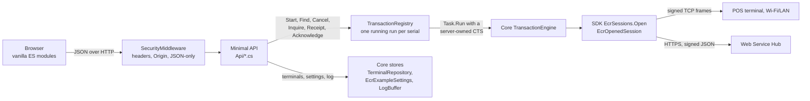
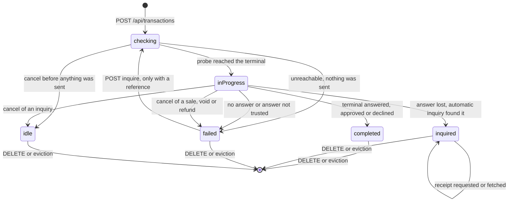
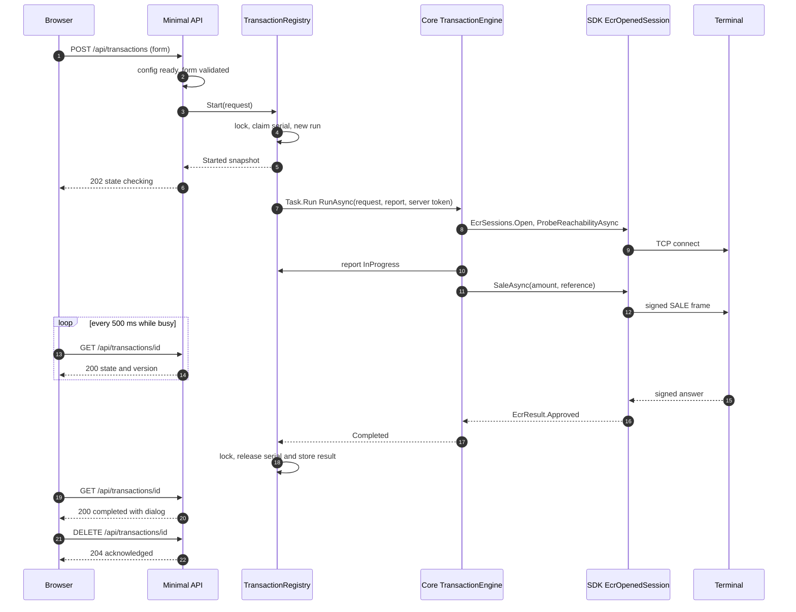
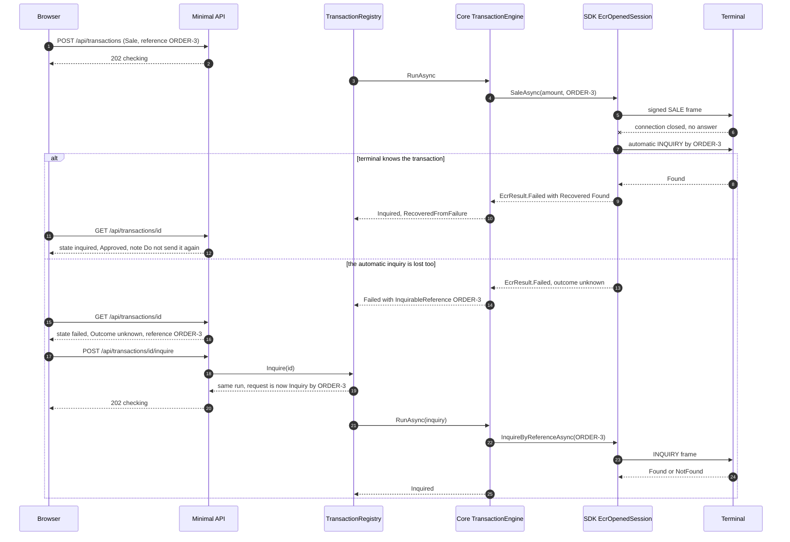

# Implementation guide — the ASP.NET Core web sample

> Aligns with **`AmwalPay.Ecr` 1.0.0** and shared `AmwalECR.Example.Core`: inquiry by STAN or
> merchant reference on LAN and Web Service; by-reference sends a blank date (no synthetic
> “today”).

For .NET web/backend developers who want to learn how to put a POS-terminal payment flow
behind a web application without getting it wrong, and for maintainers extending this
sample. It explains **why** the code is shaped the way it is; the [README](../README.md) is
how to run it.

Everything below was read from the code and, where it says *verified*, exercised on
2026-09-21 against a signed fake terminal (`dotnet build`, `dotnet test` — 110 cases green,
`tools/check-web-wiring.py`, `tools/test-amount.mjs`, the headless-Chrome smoke test, and the
curl session in [section 5](#5-the-api)). Anything I could not run is marked *not verified*.

Contents: [1 Goals and architecture](#1-goals-and-architecture) ·
[2 Hosting and composition](#2-hosting-and-composition) ·
[3 Secrets at rest](#3-secrets-at-rest) ·
[3a Web Service initialization](#3a-web-service-initialization) ·
[4 Transactions run on the server](#4-the-central-design-transactions-run-on-the-server) ·
[5 The API](#5-the-api) · [6 Validation](#6-validation) · [7 Security model](#7-security-model) ·
[8 Front end](#8-front-end) · [9 Logging](#9-logging) · [10 Tests and tools](#10-tests-and-tools) ·
[11 Extension recipes](#11-extension-recipes) · [12 Deployment](#12-deployment-notes) ·
[13 Known limitations](#13-known-limitations)

---

## 1. Goals and architecture

**Goals**

1. Show the safe way to drive a card terminal from a web app: the payment must not be tied
   to an HTTP request, two sales must never be sent to one terminal at once, and a lost
   answer must be resolved by looking the transaction up, never by selling again.
2. Do it with the **same logic** as the WPF sample (validation, wording, outcome
   classification), so that there is one implementation of the payment-safety rules to read,
   test and trust.
3. Stay readable: no front-end build, no database, no framework beyond ASP.NET Core Minimal
   APIs.

**Request flow**



**Reused from Core vs added here**

The web project has a `ProjectReference` to
[`AmwalECR.Example.Core`](../../Windows-Native-Example/src/AmwalECR.Example.Core/), the
UI-free `net8.0` library the WPF app is built on. Core references the SDK (`AmwalPay.Ecr`)
either as the sibling checkout (`EcrSdkDependency=project`, default) or the NuGet package
(`-p:EcrSdkDependency=nuget`); the web project has no SDK switch of its own.

| From Core (unchanged) | Why it is not redone here |
|---|---|
| `TransactionEngine` | The flow: resolve config → open session → probe → execute → classify. Also owns the money-safety rules: the app-made reference, `CancelledState`. |
| `TransactionOutcomes`, `ResultPresenter` | An unknown outcome is never a refusal and never a retry; the wording a cashier reads. |
| `TransactionFormState` (+ `FormErrors`), `AmountEntry`, `AmountLimits` | Which fields exist for an operation, what is required, the message strings, the amount bounds. |
| `TerminalRepository`, `Terminal`, `TerminalValidator`, `EcrModes` | JSON store keyed by serial, the same file format and messages as WPF. |
| `EcrExampleSettings`, `ISecretProtector` | Environment and both signing keys, encrypted at rest through a seam. |
| `SelectedTerminalConfig` | What the SDK plan makes of a terminal *before* anyone pays. |
| `LogBuffer` | The last 500 diagnostic lines. |

| Added by the web sample | Why |
|---|---|
| [`Services/TransactionRegistry.cs`](../src/AmwalECR.WebExample/Services/TransactionRegistry.cs) | WPF holds one transaction in a view-model; a server needs runs that outlive requests, plus a per-terminal guard. See [4](#4-the-central-design-transactions-run-on-the-server). |
| [`Hosting/DataProtectionSecretProtector.cs`](../src/AmwalECR.WebExample/Hosting/DataProtectionSecretProtector.cs) | DPAPI is Windows-only; this is the cross-platform `ISecretProtector`. |
| [`Hosting/EcrApp.cs`](../src/AmwalECR.WebExample/Hosting/EcrApp.cs), [`DataPaths.cs`](../src/AmwalECR.WebExample/Hosting/DataPaths.cs) | The composition root the WPF `App.OnStartup` does by hand. |
| [`Hosting/SecurityMiddleware.cs`](../src/AmwalECR.WebExample/Hosting/SecurityMiddleware.cs) | A browser-facing app that can take payments needs guards a desktop app does not. |
| [`Api/*.cs`](../src/AmwalECR.WebExample/Api/) | Thin translators from HTTP to Core; the DTOs ([`Dtos.cs`](../src/AmwalECR.WebExample/Api/Dtos.cs)) are the wire contract. |
| [`wwwroot/`](../src/AmwalECR.WebExample/wwwroot/) | The UI, a port of the WPF views. |

Rule of thumb when extending: if it is a *rule* (validation, wording, outcome
classification), it belongs in Core so both front ends get it; if it is about *HTTP,
browsers or process lifetime*, it belongs here.

---

## 2. Hosting and composition

[`Program.cs`](../src/AmwalECR.WebExample/Program.cs), top to bottom:

1. `Kestrel MaxRequestBodySize = 64 KB`. No request carries more than a form.
2. `JsonStringEnumConverter` on the HTTP JSON options (System.Text.Json web defaults:
   camelCase, and `null`s are **emitted**, e.g. `"message": null`).
3. DI registrations (all singletons):

   | Registration | Notes |
   |---|---|
   | `DataPaths` | Resolves the data folder from `IConfiguration["DataDir"]`. |
   | `AddDataProtection().SetApplicationName("AmwalECR-WebExample")` | The name is pinned. Data Protection isolates apps by an *application discriminator* that defaults to the content-root path, so without it a publish to another folder would not be able to read its own key ring's payloads (ASP.NET Core documented behaviour; not exercised here). |
   | `KeyManagementOptions.XmlRepository = FileSystemXmlRepository(paths.Keys)` | Set through `AddOptions<KeyManagementOptions>().Configure<DataPaths, ILoggerFactory>` so the folder comes from DI (tests point it at a temp folder) and is created first (`paths.Ensure()`). |
   | `ISecretProtector → DataProtectionSecretProtector` | Purpose string `AmwalECR.Example.settings.v1`. |
   | `EcrApp` | The Core composition root, below. |
   | `TransactionRegistryOptions`, `TimeProvider.System`, `TransactionRegistry` | The registry is built from `EcrApp.Engine`. `TimeProvider` is injectable so a test can advance the clock (eviction test). |

4. Pipeline order: `UseExceptionHandler` → `UseSecurityHeaders` → `UseApiGuard` → `UseDefaultFiles`
   → `UseStaticFiles` → the endpoint groups → a fallback `MapFallback("/api/{**rest}")` that
   answers `404 {"error":"No such endpoint"}` so a mistyped API path is never served the SPA.
   ASP.NET Core's built-in host filtering (`AllowedHosts`) runs *before* all of this.
5. The exception handler answers `400 {"error":"The request could not be read"}` for a
   `BadHttpRequestException` (invalid or empty JSON, wrong types) and `500
   {"error":"Unexpected error"}` for anything else — never the exception text, which can name
   paths.
6. `EcrApp` is resolved eagerly right after `Build()` so an unreadable data folder or file is
   logged at start-up (`LoadWarning`s from the terminal store and settings), and a
   `ApplicationStarted` callback logs a warning for every bound address that is not loopback.
7. `public partial class Program;` at the bottom lets `WebApplicationFactory<Program>` host
   the app in tests.

**`EcrApp`** ([`Hosting/EcrApp.cs`](../src/AmwalECR.WebExample/Hosting/EcrApp.cs)) wires
Core exactly like the WPF `App.OnStartup`:

```
LogBuffer(mirror → ILogger "AmwalPay.Ecr" at Debug)
lan        = EcrLogger.From(m => Log.Append("Ecr", m))
webService = EcrLogger.From(m => Log.Append("EcrWebService", m))
Terminals  = new TerminalRepository(paths.Terminals)
Settings   = new EcrExampleSettings(paths.Settings, protector)
Engine     = new TransactionEngine(Terminals, Settings, lan, webService)
```

**Data folder** ([`DataPaths.cs`](../src/AmwalECR.WebExample/Hosting/DataPaths.cs)): key `DataDir`;
blank means `Environment.SpecialFolder.LocalApplicationData/AmwalECR-WebExample`
(`%LOCALAPPDATA%` on Windows, `~/Library/Application Support` on macOS, `~/.local/share` on
Linux). Contents:

| Path | What |
|---|---|
| `terminals.json` | Terminal list (plain JSON, camelCase, keyed by serial). A corrupt file is copied to `terminals.json.unreadable` and reported, not overwritten. |
| `settings.dat` | Environment + both signing keys, encrypted with the protector. |
| `keys/key-*.xml` | The Data Protection key ring. |

`Ensure()` creates `Root` and `keys`. On Unix a `Root` it **created** is made `0700`; a `DataDir`
that already existed keeps its mode (it may be shared on purpose). The `keys` folder is
**always** made `0700`, because that folder is what protects the secrets. (*Verified*:
`drwx------` root and keys, key file `-rw-------`; an existing `0750` root stays `0750` while its
`keys` folder is tightened — pinned by a test.)

**Configuration keys**

| Key | Default (`appsettings.json`) | Override |
|---|---|---|
| `Urls` | `http://127.0.0.1:5080` | `--urls`, env `ASPNETCORE_URLS` (both *verified* to beat the file; `launchSettings.json` also sets 5080 for `dotnet run`, and `--urls` beats that too) |
| `AllowedHosts` | `127.0.0.1;localhost;[::1]` | env `AllowedHosts`, `appsettings.{Environment}.json` |
| `DataDir` | `""` (per-user folder) | `--DataDir=/path` and env `DataDir` (both *verified*) |
| `Logging:LogLevel:*` | `Default=Information`, `Microsoft.AspNetCore=Warning` | env `Logging__LogLevel__Default`; set `Logging:LogLevel:AmwalPay.Ecr=Debug` to mirror the SDK log to the console |

Not configurable through configuration: the 64 KB body cap, and
`TransactionRegistryOptions.FinishedRetention` (12 h; it is `new TransactionRegistryOptions()` in
`Program.cs`, so change it in code). There is **no** `Ecr__...` section: terminals and keys
are registered through the API and persisted under `DataDir`.

---

## 3. Secrets at rest

The signing keys live in `settings.dat`, encrypted through Core's `ISecretProtector` seam.

| | WPF sample | Web sample |
|---|---|---|
| Implementation | `DpapiSecretProtector`: `ProtectedData`, `CurrentUser` scope, fixed entropy string | [`DataProtectionSecretProtector`](../src/AmwalECR.WebExample/Hosting/DataProtectionSecretProtector.cs): `IDataProtector` for purpose `AmwalECR.Example.settings.v1` |
| Where the key lives | Windows, tied to the user profile; the app stores no key | An XML **key ring** in `<DataDir>/keys`, created on first run, 90-day activation lifetime (`expirationDate` in the file); old keys are kept so old data stays readable |
| Portable | Windows only | Any OS |

**The key ring is not itself encrypted.** No `ProtectKeysWith*` is configured, so Data
Protection logs `No XML encryptor configured. Key {…} may be persisted to storage in
unencrypted form` at every start, and the key file says so (`<!-- Warning: the key below is
in an unencrypted form. -->`, *verified*). Effective protection is therefore the filesystem
permission of `DataDir`: on Unix the folder and the `keys` folder are `0700` and the key file is
`0600` (*verified*), while `settings.dat` and `terminals.json` are written with the process's default
mode, typically `0644` (*verified*) - readable in principle, but unreachable to other accounts
because they sit inside the `0700` folder, and `settings.dat` is encrypted anyway. On Windows it is
NTFS ACLs, which this code does not touch. Anyone who can read the folder can decrypt `settings.dat`. On Windows you can add
`.ProtectKeysWithDpapi()` to wrap the ring; elsewhere use a certificate or a cloud key vault
(*not exercised here*).

**When the key ring is lost** (deleted, or `settings.dat` copied to another machine):
`Unprotect` throws `CryptographicException`, `EcrExampleSettings` catches it, resets the
in-memory values to defaults (**environment back to SIT, both keys empty**) and sets
`LoadWarning`; the app starts. `GET /api/settings` shows it in `notice`, e.g. (*verified*):

> The saved settings could not be read (they are encrypted for the account that saved them):
> The key {3f5db979-…} was not found in the key ring. … Enter the signing keys again.

Data Protection meanwhile creates a fresh ring, the next save overwrites `settings.dat`, and
`terminals.json` is unaffected. Note the notice includes the framework's exception text
(a key id and a docs URL). It **clears as soon as a key is saved**, because that write replaces
the unreadable file (`EcrExampleSettings.Update`; it used to stay until restart, see
[13](#13-known-limitations)).
Back up `keys/` together with `settings.dat`, or accept re-keying.

**Why keys are write-only over the API.** The WPF app can show a stored key because the
operator is the Windows user. Here anything the API returns is readable by whoever can reach
the port, and there is no authentication. So `GET /api/settings` says only
`{ configured: true|false, label }` per key (not even the length — Core's `HashKeyStatus`
would say it, and [`ConfigView`](../src/AmwalECR.WebExample/Api/Dtos.cs) deliberately does not
use it), `PUT /api/settings/keys/{kind}` accepts a value, `DELETE` clears it, and the page has
Replace/Clear instead of Show/Hide. The typed value is wiped from the input the moment the
server has it. The SDK also never logs a key value, only that one is "configured" (a test
pins that).

---

## 3a. Web Service initialization

Operator steps: [README — Web Service initialization](../README.md#web-service-initialization).
This sample does not re-implement init; it exposes Core's path over HTTP.

| Step | HTTP / UI | Core / SDK |
|---|---|---|
| 1. Environment + Web Service key | `PUT /api/settings/environment` with `{ "environment": "UAT" }`, `PUT /api/settings/keys/webService` with `{ "value": "…" }` — write-only; invalid hex refused with `422` | `EcrExampleSettings.Environment`, `WebServiceSecureHashKey` |
| 2. Register terminal | `POST /api/terminals` with `ecrMode: 4`, `serialNumber`, `merchantId`, `terminalId` (numeric; no IP/port) | `TerminalRepository` + `TerminalValidator` |
| 3. Confirm plan ready | `GET /api/terminals/{serial}/config` → `isReady: true`, transport `HTTPS Web Service (JSON HMAC)`, issues empty | `SelectedTerminalConfig.Resolve` → `EcrSessions.Plan` (no Hub call) |
| 4. First operation | `POST /api/transactions` → `202`, then poll | `TransactionEngine` → `EcrSessions.Open` → `SaleAsync` / … |

Typical `issues` when `isReady` is false (same strings as WPF):

- `Merchant ID is required for Web Service` / `Terminal ID is required…`
- `Merchant ID must be numeric` / `Terminal ID must be numeric`
- `Web Service secure hash key is not configured`
- `Secure hash key must be an even-length hex string of at least 16 characters`

Do **not** put the Wi‑Fi/LAN key in the Web Service slot — Hub auth will fail. Hub base URLs
are resolved by the SDK from `SIT` / `UAT` / `PROD`; this app never sets them.

At run time (after init): no probe; a lost money-moving answer is classified as unknown
(`NextStep.InquireByMerchantReference`); receipt is unsupported; by-reference inquiry uses a
blank date. Full SDK checklist:
[integration guide §4](https://github.com/amwal-pay/AmwalpayEcrWindows/blob/main/docs/integration-guide.md#initialization-process).

Example config check after keys and a Web Service terminal exist:

```bash
# after PUT keys/webService and POST terminals with ecrMode 4
curl -s $B/api/terminals/P653200008251/config
# → isReady true, keyLabel "Web Service secure hash key", issues []
```

---

## 4. The central design: transactions run on the server

### Why not inside the request

A card payment takes as long as the cardholder does (tens of seconds), a browser tab can close
at any moment, and proxies, load balancers and mobile networks cut requests. If the handler
did `await engine.RunAsync(request, …, HttpContext.RequestAborted)`, closing the tab would
cancel the wait after the sale had been sent — leaving an *unknown outcome* nobody is looking
at. So:

* `POST /api/transactions` **starts** a run and returns `202` at once with its id.
* The run executes in [`TransactionRegistry`](../src/AmwalECR.WebExample/Services/TransactionRegistry.cs)
  on a `Task.Run`, with a `CancellationTokenSource` **owned by the run**. Nothing in the
  registry or the engine call ever looks at `HttpContext.RequestAborted` (a test aborts a
  poll mid-flight and closes the "tab" and asserts the payment still completes).
* The browser watches it with `GET /api/transactions/{id}`.

### The registry

One `lock (_gate)` guards two dictionaries: runs by id and the running run by terminal serial.
The engine call itself is **outside** the lock.

| Method | Behaviour |
|---|---|
| `Start(request, usesWebService)` | Sweeps; if a run is already running on that serial → `Busy(existingId)` (**409**); else creates the run, claims the serial, `Begin`. Check-and-claim is one critical section, so 8 concurrent POSTs let exactly one through (test). |
| `Find(id)` / `Pending()` | Snapshots read under the lock, so `state` and `version` always belong together. `Pending()` = every un-acknowledged run, newest first. |
| `Cancel(id)` | `null` (→ 404) if unknown; else `cts.Cancel()` and returns the snapshot **at that instant**. |
| `Inquire(id)` | Only for `Failed` **with** an `InquirableReference`; refuses while the terminal is running something else. Replaces `run.Request` with an `Inquiry` by that reference and `Begin`s it on the **same run id**. |
| `RequestReceipt(id)` | Only for an `Inquired` state without a receipt, not already fetching, not Web Service. Fire-and-forget read; result stored on the run. |
| `Acknowledge(id)` | `false` (→ 409) while busy; removes the run; unknown id → `true` (idempotent, → 204). |

**Single-flight per terminal.** The guard is server-side and per *serial*, not a disabled
button: a double click, a second tab, or a client that repeats a POST must not put two sales
on one terminal. Different serials run side by side. What is guarded is a **running** run —
see the gap in [13](#13-known-limitations) about a finished, unread unknown outcome.

**Completing a run.** After the engine returns, `run.Cts = null`, the serial is released and
the final state stored **in the same lock section** — a poller that sees the result may
start the next run immediately, and one that still sees "running" must not find the terminal
free. `Report` (progress) only updates a run that is still busy, so a late report cannot
overwrite a final state. An exception escaping the engine (it answers every failure itself)
becomes `Failed("Unexpected error: …")`, with a fresh reference for money-moving operations, so
a run is never left spinning.

### State model



`busy` is `checking` or `inProgress`; `isResult` is `completed`, `inquired` or `failed`. An
`idle` run is neither: it means "stopped before anything was sent", the page drops it and
acknowledges it.

### Polling contract

`GET /api/transactions/{id}` returns a [`TransactionView`](../src/AmwalECR.WebExample/Api/Dtos.cs):

```json
{
  "id": "76349c6a57cb472a8e9ec650aa2cf294",
  "terminalSerial": "TW1234567890",
  "operation": "Sale",
  "state": "completed",
  "busy": false,
  "isResult": true,
  "statusText": "Waiting for the POS terminal…",
  "version": 3,
  "dialog": {
    "headline": "Approved", "tone": "approved", "amount": "1.234",
    "message": null, "note": null,
    "fields": [ { "label": "Auth code", "value": "514297" }, { "label": "Card", "value": "483312******1234" },
                { "label": "Reference", "value": "ORDER-1001" } ],
    "hints": [],
    "rawPayload": "{ … the terminal's full answer, indented … }",
    "isUnknownOutcome": false, "inquirableReference": null, "unknownOutcomeWarning": null,
    "offersReceipt": false, "receiptNote": null,
    "receipt": { "showButton": false, "fetching": false, "url": null, "problem": null }
  }
}
```

| Field | Meaning |
|---|---|
| `state` | `idle` `checking` `inProgress` `completed` `inquired` `failed` |
| `operation` | The **current** request's display name. Changes from `Sale` to `Inquiry` when a look-up runs on the same run. |
| `busy`, `isResult` | See above. |
| `statusText` | Text for the spinner. Only meaningful while `busy`: it is `"Checking the terminal…"` for `checking` and `"Waiting for the POS terminal…"` for **every other state**, results included (cosmetic; ignore it when not busy). |
| `version` | Starts at 1 and increments on every change of that run (a plain sale ends at 3: checking, inProgress, result; an inquire adds 3 more). A client keeps the highest and discards older responses. |
| `dialog` | `null` while busy or idle; else Core's `ResultDialogModel` plus the receipt bits. `tone` is `approved` or `declined` (also used for failures and "not found"). `isUnknownOutcome` ⇔ `inquirableReference != null`. |

**When to stop polling** (what [`transaction.js`](../src/AmwalECR.WebExample/wwwroot/js/transaction.js) does):

* keep polling every 500 ms while `busy`, **or** while `dialog.receipt.fetching`;
* stop when neither, and on `404` (acknowledged in another tab, or evicted);
* a network error is *not* a stop: the run does not depend on the page, so show "connection
  lost" and keep asking;
* `202` from `inquire` or `receipt` puts the run back to busy/fetching: resume polling the
  same id.

### Cancel = unknown outcome

Cancel means "stop waiting", not "undo". The engine catches the cancellation only when *its own
token* is cancelled and maps it through `TransactionEngine.CancelledState`:

| When cancel lands | Result |
|---|---|
| During the reachability probe (nothing sent) | `idle` |
| After the request went out, `Inquiry` | `idle` (a read; nothing to lose) |
| After the request went out, `Sale`/`Void`/`Refund` | `failed`, **with the reference**: "You stopped waiting for the terminal. This does not cancel the transaction…" — an *unknown outcome*, never "cancelled" |
| Run already finished | No-op; `200` with the current (result) state |

`POST …/cancel` answers with the snapshot **at the moment of the call**, which is normally
still busy: the engine finishes asynchronously, so keep polling (*verified*: response `state`
was `inProgress`, the next poll `failed / Outcome unknown` with the reference).

### Inquire by reference is the only follow-up

An unknown outcome carries a reference — the one the till chose (or the engine generated with
`TransactionEngine.NewReference()`, 12 upper-case hex chars, when the field was blank). A
receipt number is *in the answer*, which is exactly what was lost, so it cannot be the key.
`POST …/inquire` looks the transaction up by the reference; there is deliberately **no
retry** endpoint. The lookup reuses the run id, so the page and any reloaded page follow one
object through `failed → checking → inquired`.

### Sequence: a normal sale



### Sequence: a lost answer, with the automatic inquiry



Both branches were *verified* against `fake_pos_server_signed.py --drop-sale` (first branch)
and `--drop-sale --drop-first-inquiry` (second): exactly one `SALE` reached the terminal in
each.

### Acknowledge, eviction, retention

* **Acknowledge** (`DELETE /api/transactions/{id}`) means "the operator has read the result".
  The page sends it when the result dialog closes **by any route, including Escape** — so
  closing an *Outcome unknown* dialog discards the run and its reference from the server. The
  reference is still in the debug log (`Sending SALE <reference> to …`) and the operator can
  key it into an Inquiry-by-reference; the dialog's Copy button exists for this reason.
* **Eviction.** `Sweep()` drops runs that are *not busy* and whose `Updated` is older than
  `FinishedRetention` (12 h by default — an unknown outcome must survive a night away from
  the till). It runs lazily on `Start`, `Find`, `Pending` and `Inquire`; there is no timer, so
  an idle server holds them until the next call. Busy runs are never evicted.
* **Restart.** Everything is in memory. A restart forgets every run — running ones (the
  terminal may still complete them) and unread results. Use **Inquire** with a reference from
  the log or the till.
* **Shutdown.** Runs are fire-and-forget `Task.Run`s: shutdown does not wait for them, and
  nothing cancels them.

---

## 5. The API

JSON in, JSON out. Rules for every `/api` call (from [`SecurityMiddleware`](../src/AmwalECR.WebExample/Hosting/SecurityMiddleware.cs)):

* **Every mutating call** (`POST`, `PUT`, `DELETE`) must send `Content-Type: application/json`,
  even with nothing to say (send `{}`) — otherwise `415 {"error":"Use Content-Type: application/json"}`.
* A request with an `Origin` other than this host, or `Sec-Fetch-Site` other than
  `same-origin`/`none`, is `403 {"error":"Cross-origin requests are not accepted"}` (this
  includes `OPTIONS` preflights; there is no CORS).
* `Cache-Control: no-store` on every `/api` response.

**Error shapes**

| Shape | Used for |
|---|---|
| `{ "error": "…", "transactionId": null }` ([`ErrorBody`](../src/AmwalECR.WebExample/Api/Dtos.cs)) | 400, 404, 409, 500. `transactionId` is non-null only on the 409s that name the run already running. |
| `{ "errors": { "<field>": "<message>" }, "message": null }` ([`FieldErrors`](../src/AmwalECR.WebExample/Api/Dtos.cs)) | 422. `message` is set only when the terminal's plan is not ready (issues joined with `\n`, `errors` empty). |
| `{ "error": "…" }` | 403 and 415 from the guard. |
| empty body | 413 (body over 64 KB, *verified*), and 400 for a `Host` not in `AllowedHosts` (Kestrel's own HTML page, *verified*). |

### Endpoint reference (20 routes)

| Method and path | Request | Success | Errors |
|---|---|---|---|
| `GET /api/meta` | — | `200` [`Meta`](../src/AmwalECR.WebExample/Api/Dtos.cs), see [6](#6-validation) | — |
| `GET /api/terminals` | — | `200 { terminals: TerminalView[], notice }`; `notice` = terminal-store `LoadWarning` | — |
| `POST /api/terminals` | `TerminalForm`: `name, serialNumber, ecrMode (int), ipAddress, port, terminalId, merchantId` (all text but `ecrMode`) | `200 TerminalView` | `422` keys `mode name serial ip port terminalId merchantId`. A duplicate serial is `serial`. **Any** save failure, including an I/O error, is reported under `serial` too. |
| `PUT /api/terminals/{serial}` | `TerminalForm`. Changing `serialNumber` replaces the entry (the serial is the key) | `200 TerminalView` | `404` unknown; `422` as above |
| `DELETE /api/terminals/{serial}` | `{}` | `204` | `404`; `500` if the file cannot be written |
| `GET /api/terminals/{serial}/config[?announce=true]` | — | `200 ConfigView`: `serialNumber, modeLabel, transportLabel, connectionSummary, keyLabel, keyConfigured, keyStatus, issues[], isReady, isSupported, usesWebService`. `announce=true` writes the WPF "selected …" lines to the log | `404` |
| `GET /api/settings` | — | `200 { environment, wifi: {label, configured}, webService: {label, configured}, notice }` — never a key | — |
| `PUT /api/settings/environment` | `{ environment }`, case-insensitive `SIT` `UAT` `PROD` | `200` settings | `422` under `environment`; `500` if the file could not be written (value stays in memory) |
| `PUT /api/settings/keys/{kind}` | `{ value }`; `kind` = `wifi` or `webService` | `200` settings | `404` other kind; `422` under `value`: blank ("Enter the key, or use Clear…") or not an even-length hex string of ≥16 chars; `500` on write failure |
| `DELETE /api/settings/keys/{kind}` | `{}` | `200` settings | `404`; `500` |
| `GET /api/transactions` | — | `200 { transactions: TransactionView[] }`, un-acknowledged, newest first | — |
| `POST /api/transactions` | Raw form: `terminalSerial, type, amountDigits, receiptNumber, originalTerminalId, originalDate, useOtherTerminal, lookUpByReference, originalReference, merchantReference` | `202 TransactionView` (`state: "checking"`) | `422` (below); `409` `{error:"A transaction is already running on this terminal", transactionId}` |
| `GET /api/transactions/{id}` | — | `200 TransactionView` | `404 "No such transaction"` |
| `POST /api/transactions/{id}/cancel` | `{}` | `200 TransactionView` (snapshot at the call, usually still busy) | `404` |
| `POST /api/transactions/{id}/inquire` | `{}` | `202 TransactionView` (`operation: "Inquiry"`, same id) | `404`; `409` `"This transaction has no unknown outcome to look up"`; `409` `"Another transaction is running on this terminal"` + `transactionId` |
| `POST /api/transactions/{id}/receipt` | `{}` | `202 TransactionView`; poll for `dialog.receipt.url` | `404`; `409` `"No receipt can be requested for this transaction"` (not an inquiry result, already has one, already fetching, or Web Service) |
| `DELETE /api/transactions/{id}` | `{}` | `204`, also for an unknown id | `409 "The transaction is still running"` |
| `GET /api/qr?text=` | — | `200 image/svg+xml` (QRCoder `SvgQRCode`, ECC level M) | `400` blank, over 1024 chars, or too long for a QR |
| `GET /api/log` | — | `200 { text, count, capacity }` | — |
| `DELETE /api/log` | `{}` | `204` | — |
| any other `/api/*` | — | — | `404 {"error":"No such endpoint"}` |

**`POST /api/transactions` in detail**

`type` is `Sale`, `Void`, `Refund` or `Inquiry` (case-insensitive, from
`EcrTransactionTypes.MenuOptions`). Inputs are normalised the way the WPF fields normalise
what is typed ([`TransactionFormMapper`](../src/AmwalECR.WebExample/Api/TransactionEndpoints.cs)):

| Field | Normalisation |
|---|---|
| `amountDigits` | `AmountEntry.KeyedDigits`: ASCII digits only, leading zeros dropped, cut at 9 digits. Digits are **mills**: `"1234"` = 1.234 OMR. |
| `receiptNumber` | digits only, at most 6 |
| `originalTerminalId` | digits only |
| `originalDate` | `yyyy-MM-dd` or `yyyyMMdd`; blank/unparseable → **server's today**; a future date → today. No error is ever raised for it. |
| `originalReference` | cut at 32 characters |
| `merchantReference` | **not** cut: over 32 or containing space, `&`, `=` or a non-printable → `422` |
| booleans | missing means `false` |

Fields the chosen type does not show are ignored, not rejected. `422` keys: `terminal`
("Choose a POS terminal" / "Terminal X is no longer registered"), `type`, `amount`,
`receiptNumber`, `originalTerminalId`, `originalReference`, `merchantReference`; or, with an
empty `errors`, `message` listing the plan's issues (missing key, USB/Bluetooth "not supported
in this sample").

### A curl session (verified)

Run against a scratch instance so as not to touch the one on `:5080`. From
`AmwalECR-Web-Example/`:

```bash
# terminal (signed fake) and web app, each in its own shell
python3 -u ../Windows-Native-Example/tools/fake_pos_server_signed.py \
    --key 0123456789ABCDEF0123456789ABCDEF --port 19100
dotnet run --project src/AmwalECR.WebExample -- --urls http://127.0.0.1:5091 --DataDir=/tmp/ecr-scratch

B=http://127.0.0.1:5091
j() { curl -s -H 'Content-Type: application/json' "$@"; echo; }     # JSON is mandatory on POST/PUT/DELETE
```

```text
$ j -X POST $B/api/terminals -d '{"name":"","serialNumber":"","ecrMode":2,"ipAddress":"999.1.1.1","port":"70000"}'
  -> 422 {"errors":{"name":"Enter a terminal name","serial":"Enter the terminal serial number",
          "ip":"Enter a valid IPv4 address, for example 192.168.1.50","port":"Port must be between 1 and 65535"},"message":null}

$ j -X POST $B/api/terminals -d '{"name":"Demo terminal","serialNumber":"TW1234567890","ecrMode":2,"ipAddress":"127.0.0.1","port":"19100"}'
  -> 200 {"serialNumber":"TW1234567890","name":"Demo terminal","ecrMode":2,"modeLabel":"Wi‑Fi","ipAddress":"127.0.0.1",
          "port":19100,"terminalId":"","merchantId":"","displayName":"Demo terminal (TW1234567890)",
          "connectionSummary":"127.0.0.1:19100","supported":true}

$ curl -s $B/api/terminals/TW1234567890/config           # before a key is set
  -> {"…","keyConfigured":false,"keyStatus":"not configured — set in Settings",
      "issues":["Wi-Fi/LAN secure hash key is not configured"],"isReady":false,…}

$ j -X PUT $B/api/settings/keys/wifi -d '{"value":"xyz"}'
  -> 422 {"errors":{"value":"Must be an even-length hex string of at least 16 characters"},"message":null}
$ j -X PUT $B/api/settings/keys/wifi -d '{"value":"0123456789ABCDEF0123456789ABCDEF"}'
  -> 200 {"environment":"SIT","wifi":{"label":"Wi-Fi/LAN secure hash key","configured":true},
          "webService":{"label":"Web Service secure hash key","configured":false},"notice":null}     # no key echoed

# Web Service init (real Hub — skip if you only have the fake LAN terminal):
# $ j -X PUT $B/api/settings/environment -d '{"environment":"UAT"}'
# $ j -X PUT $B/api/settings/keys/webService -d '{"value":"<WEB_SERVICE_HEX_KEY>"}'
# $ j -X POST $B/api/terminals -d '{"name":"Hub terminal","serialNumber":"P653200008251","ecrMode":4,"merchantId":"13593","terminalId":"101311"}'
# $ curl -s $B/api/terminals/P653200008251/config   # isReady true before first sale

$ j -X POST $B/api/transactions -d '{"terminalSerial":"TW1234567890","type":"Sale","amountDigits":"5"}'
  -> 422 {"errors":{"amount":"minimum amount allowed is 0.010"},"message":null}

$ j -X POST $B/api/transactions -d '{"terminalSerial":"TW1234567890","type":"Sale","amountDigits":"1234","merchantReference":"ORDER-1001"}'
  -> 202 {"id":"76349c6a…","terminalSerial":"TW1234567890","operation":"Sale","state":"checking","busy":true,
          "isResult":false,"statusText":"Checking the terminal…","version":1,"dialog":null}

$ curl -s $B/api/transactions/76349c6a…                  # poll: state "completed", version 3, dialog.headline "Approved"
$ curl -s -X DELETE -H 'Content-Type: application/json' $B/api/transactions/76349c6a…    -> 204
$ curl -s $B/api/transactions/76349c6a…                                                    -> 404 {"error":"No such transaction",…}
```

Other things exercised the same way: a second `POST` on a busy terminal → `409` with the
running `transactionId`; `DELETE` while running → `409`; `cancel` on a `--delay 8` terminal →
`200` (still `inProgress`), then `failed / Outcome unknown` with the generated reference
(`8AC96A097966`), then `inquire` → `202` and, after the delay, `inquired / Approved`;
`POST` with `text/plain` → `415`; with `Origin: http://evil.example` → `403`; a foreign
`Host` → `400`; `{not json` → `400`; a 70 KB body → `413`; `GET /api/nope` → `404` JSON.

---

## 6. Validation

**The server is the authority.** The page never decides what is valid; it sends the raw form
and shows the per-field messages of a `422`. [`TransactionEndpoints.Start`](../src/AmwalECR.WebExample/Api/TransactionEndpoints.cs)
applies, in this order, and stops at the first failure:

1. terminal exists → `422 terminal`
2. `Engine.ResolveConfig(terminal).IsReady` (key configured and valid, transport supported,
   SDK plan has no issues) → `422 { message }` — the same line WPF holds by disabling Start
3. `type` is a known operation → `422 type`
4. `TransactionFormMapper.ToState(body)` normalises → Core's
   [`TransactionFormState.Validated(serial)`](../../Windows-Native-Example/src/AmwalECR.Example.Core/Transaction/TransactionFormState.cs)
   → per-field `FormErrors` (amount bounds 0.010–100000.000, receipt number, original
   terminal, reference, merchant reference rule) → `422 errors`
5. `registry.Start(...)` → `202` or `409`

`Validated` returns a `TransactionRequest` that only carries the fields the type shows — a
terminal id left over from a previous form cannot travel with the next operation.

**`GET /api/meta` is the contract that drives the UI**
([`MetaEndpoint`](../src/AmwalECR.WebExample/Api/MetaEndpoint.cs)); the page holds no copy of
these rules:

* `operations[]`: `value`, `label`, the SDK flags (`requiresAmount`, `requiresOriginalStan`,
  `requiresOriginalDate`, `allowsOtherTerminal`, `movesMoney`), `amountHelp`, `startButtonText`,
  and `layouts` — a map keyed `"<otherTerminal><byReference>"` as `0/1` (so `"10"` is
  "different terminal on, by-reference off") to a `FieldLayout` of booleans (`amount`,
  `merchantReference`, `referenceSwitch`, `originalReference`, `receiptNumber`, `originalDate`,
  `otherTerminalSwitch`, `originalTerminal`). Each layout is produced by instantiating Core's
  own `TransactionFormState` for that combination, so "shown" and "required" cannot drift.
* `modes[]`: `value`, `label`, `ipBased`, `supported`, `hint`, `note` (USB and Bluetooth are
  registrable but unsupported here).
* `environments[]`, `amount { min, max, fractionDigits, maxDigits }`,
  `merchantReferenceMaxLength` (32), `receiptNumberMaxLength` (6), `defaultPort` (9100),
  `today` (`yyyy-MM-dd`, **server** date).

To change a rule, change Core and the page follows; the only client-side rules are cosmetic
input filters (digits only, hex only), which the server re-applies.

---

## 7. Security model

The app has **no authentication**. It can take payments, register terminals, replace or clear
signing keys and show a log with masked card numbers, for whoever can reach it. The controls
that exist make a *local, single-operator* deployment reasonable; they do not make it a
service.

**What exists** ([`SecurityMiddleware.cs`](../src/AmwalECR.WebExample/Hosting/SecurityMiddleware.cs), `Program.cs`, `appsettings.json`)

| Control | Detail |
|---|---|
| Loopback binding | `Urls = http://127.0.0.1:5080`. A start-up warning is logged for any non-loopback address. |
| Host filtering | `AllowedHosts = 127.0.0.1;localhost;[::1]`. Any other `Host` is refused by ASP.NET Core before the app runs; this is what defeats DNS rebinding (a foreign name pointing at 127.0.0.1). |
| Security headers, every response | `X-Content-Type-Options: nosniff`, `X-Frame-Options: DENY`, `Referrer-Policy: no-referrer`, and `Content-Security-Policy: default-src 'self'; img-src 'self' data:; object-src 'none'; base-uri 'none'; form-action 'self'; frame-ancestors 'none'`. No `unsafe-inline`: the page has no inline script or style. Static files are not `no-store` (they carry an ETag). |
| `/api` guard | Refuses cross-origin requests (`Sec-Fetch-Site` not `same-origin`/`none` — so even `same-site` is refused — or an `Origin` whose authority differs from `Request.Host`); refuses mutating calls that are not `application/json`. |
| No CORS | Nothing sends `Access-Control-Allow-*`; a preflight gets `403`. |
| Why JSON-only matters | A cross-site HTML form can *send* a POST without CORS, but only as `form-urlencoded`/`multipart`/`text/plain`. Requiring `application/json` forces a preflight, which fails. |
| Bounded input | 64 KB body cap; `413` beyond it. |
| No detail leaks | The exception handler never returns exception text. Keys are write-only. |
| Rendering | Everything server-supplied is set through `textContent`/`setAttribute` (see [8](#8-front-end)). |
| Data folder | Folder and `keys` folder `0700`, key file `0600`, `settings.dat`/`terminals.json` default mode (typically `0644`) inside the `0700` folder. |

**Deliberately not there**

* **Authentication and authorisation.** Loopback is not a defence against another *local* user
  or process on a shared machine: anything running as anyone can call `127.0.0.1:5080`.
* **TLS.** Plain HTTP on loopback.
* **CSRF tokens.** The JSON-only + Origin + Fetch-Metadata + no-CORS combination replaces
  them, and is sound *because there are no cookies or ambient credentials to abuse*. If you
  add cookie authentication, that reasoning changes: keep the guards and add antiforgery.
* Rate limiting, audit logging (who started/cancelled/looked up what), per-user terminal
  ownership, HSTS.

### Before you expose this

Do not bind to anything but loopback until all of these are done:

1. **Authentication and authorisation on every endpoint**, read-only ones included (the log
   and the terminal list are sensitive), with separate rights for taking payments, editing
   terminals and changing keys. Where it goes: see [11.5](#115-add-authentication).
2. **TLS** end to end; set `AllowedHosts` to the real host name(s). Behind a proxy, follow
   [11.6](#116-host-behind-a-reverse-proxy) — the guard compares `Origin` to the `Host` the
   app sees.
3. **Per-user terminal ownership.** Today every visitor sees and drives every terminal and
   sees the shared debug log.
4. **Real persistence and a secret store.** Terminals in a database rather than one JSON
   file; signing keys in a KMS/HSM/secret store rather than a local, unencrypted key ring.
5. **Decide about state.** Runs live in process memory: a restart forgets them, and two
   instances do not share the per-terminal guard ([11.4](#114-replace-the-in-memory-registry-with-a-distributed-one)).
6. **Audit logging** of who started, cancelled and looked up what.
7. Decide who may read `/api/log`: it contains request and response frames with masked card
   numbers.

---

## 8. Front end

Plain HTML, CSS and ES modules. **No build step, no bundler, no CDN, no package.json**; the
files under [`wwwroot/`](../src/AmwalECR.WebExample/wwwroot/) are served as they are.
[`index.html`](../src/AmwalECR.WebExample/wwwroot/index.html) loads one
`<script type="module" src="app.js">` and everything else is `import`ed relative.

### Module map

| File | Owns |
|---|---|
| [`app.js`](../src/AmwalECR.WebExample/wwwroot/app.js) | Boot: fetch `/api/meta` (a failure shows the `#fatal` banner), init the four screens, hash routing (`#transaction` `#terminals` `#settings`), title and `aria-current`, Escape-to-go-back, the shared `confirm()` modal, refresh on tab visibility. |
| [`js/api.js`](../src/AmwalECR.WebExample/wwwroot/js/api.js) | The only place that calls `fetch`. `ApiError` (`status`, `body`, `.fields` = a 422's `errors`); always sends JSON on mutating calls; `acknowledge` uses `keepalive` so it survives a reload; `qrUrl()`. |
| [`js/dom.js`](../src/AmwalECR.WebExample/wwwroot/js/dom.js) | `$`, `h()` (element builder), `show()`, `setText()`, `announce()`, `copyText()`. |
| [`js/amount.js`](../src/AmwalECR.WebExample/wwwroot/js/amount.js) | Pure amount functions (`keyedDigits`, `format`, `append`, `backspace`) plus `attachAmountInput()`. DOM-free at the top so node can test it. |
| [`js/transaction.js`](../src/AmwalECR.WebExample/wwwroot/js/transaction.js) | The transaction screen: form state, layout from meta, config card, start, the poll loop, result dialog, look-up and receipt actions, reload-resume. |
| [`js/terminals.js`](../src/AmwalECR.WebExample/wwwroot/js/terminals.js) | Terminal list and the add/edit dialog. |
| [`js/settings.js`](../src/AmwalECR.WebExample/wwwroot/js/settings.js) | Environment radios and the write-only key boxes. |
| [`js/log.js`](../src/AmwalECR.WebExample/wwwroot/js/log.js) | The debug panel: polls `/api/log` every second **only while the `<details>` is open and the tab visible**; Copy, Clear. |

### Rendering rule

Server-supplied text (terminal names, references, raw responses, error messages) is only ever
set through `textContent`, `setAttribute`, or `h()` (which builds nodes and text nodes). There
is **no `innerHTML`**, no `eval(`, no inline handlers. A test enforces it textually over every
`.html`, `.js` and `.css` file — see `SecurityTests.The_page_has_no_inline_script_no_inline_style_and_no_cdn`
in [10](#10-tests-and-tools). Because the check is textual, even a *comment* containing the
word would fail it (which is why `dom.js` says "markup parsing"). The same test forbids
`style=` attributes, inline `<script>`, and any `http(s)://` URL other than the SVG/XML
namespace and `example.invalid`.

Visibility uses the `hidden` attribute (`show()`; the stylesheet has `[hidden]{display:none!important}`),
not the `hidden` property, because SVG elements have none.

### Amount input

`attachAmountInput` makes a plain text input behave like the POS amount field. The keyed
digits are the source of truth; the box always renders `0.000`-style text derived from them.

* Digits shift in from the right (1 → `0.001`, 12 → `0.012`, 1234 → `1.234`); Backspace shifts out; capped at `meta.amount.maxDigits`.
* All typing goes through `beforeinput` (hardware keys, on-screen keyboards, paste, IME share one path); everything else that would edit the derived text (delete-forward, cut, drop) is refused; `input` re-renders anything that slipped past.
* The caret is pinned to the end on every select/click/keyup/touch.
* Space and Delete are swallowed; Escape clears a non-empty amount (and `preventDefault`s, so the "go back" shortcut does not also fire); Enter is left alone so the form submits.
* **Focusing from another control starts a fresh amount** (like the WPF field). `focus()` on the returned handle sets a `keepOnFocus` flag so the page can move focus here itself (to an error) without discarding what was typed.

`tools/test-amount.mjs` pins all of it against Core's vectors.

### Focus and accessibility

* Skip link; each screen heading is `tabindex="-1"` and receives focus on a route change (not on first load).
* One polite live region (`#announcer`) for outcomes ("One field needs attention. …", "Stopped. No money was moved."). It is cleared before being set so an identical message is read twice.
* Modals are native `<dialog>` + `showModal()`: the browser traps focus and handles Escape. Result dialog focuses **Close**; the confirm dialog's `autofocus` is the *safe* button (Cancel).
* On a `422` the first invalid field is focused (the amount through `amountInput.focus()`), `aria-invalid` and `aria-describedby` link the error and help text, and editing a field clears its own error.
* While a run is busy the whole `<fieldset>` is `disabled` and the busy status (`role=status`) takes focus once.
* Closing the result dialog acknowledges, clears amount/references, and focuses the amount (or the type select when the amount is disabled). Terminal and confirm dialogs return focus to where they were opened.
* Status is never colour-only (words and differently shaped icons); light and dark schemes and a reduced-motion rule are in `app.css`.

### Polling loop and reload-resume

`adopt(view)` is the single entry for server state: it ignores a response with a lower
`version` than the run it holds, renders, reschedules the poll, and asks the log to refresh on
each *state change*. `schedulePoll()` polls every 500 ms only while `busy` or a receipt is
`fetching`. `poll()` treats `404` as "gone" (forget it) and any other failure as "keep trying"
with a visible "connection lost" note.

On load, `start()` refreshes terminals and config, then `GET /api/transactions` and **adopts
the first (newest) run**: a running one resumes with the form disabled and polling; an unread
result reopens its dialog. `beforeunload` asks the browser to confirm leaving while a run is
busy; the run itself survives either way. A run in `idle` (cancelled before anything was
sent) is forgotten and acknowledged silently.

---

## 9. Logging

```
SDK IEcrLogger ──► EcrLogger.From(...) ──► LogBuffer (500 lines) ──► GET /api/log ──► debug panel
                   tag "Ecr" (LAN) / "EcrWebService"        └────► ILogger "AmwalPay.Ecr" at Debug
```

* `TransactionEngine` picks the LAN or Web Service logger per transport; both feed the same
  `LogBuffer`, a lock-protected ring of the last 500 lines (`Capacity`), each stamped
  `HH:mm:ss.fff` in **server local time**, no date.
* Content: the framed request and response JSON, the signing steps (payload to sign, nonce,
  hash), probe results, and `[App]` lines from the engine. Masked PANs appear; a signing key
  never does — the SDK says only `signing key (…): configured` (a test pins this).
* `GET /api/log` → `{ text, count, capacity }`; `DELETE /api/log` clears it. The buffer is
  process-wide (every visitor sees it), and is lost on restart.
* The console mirror is at `Debug`, so it is silent under the default `Information`; set
  `Logging__LogLevel__AmwalPay.Ecr=Debug` to see it.

---

## 10. Tests and tools

### `dotnet test` — [`tests/AmwalECR.WebExample.Tests`](../tests/AmwalECR.WebExample.Tests/)

xUnit, 110 cases (69 facts, 12 theories). Each test gets its own **in-process host**
(`WebApplicationFactory<Program>`, via `partial class Program`) on a **temp data folder**
(`DataDir` injected through `AddInMemoryCollection`), an in-process **signed loopback
terminal**, and — through the app's own API, as a user would — one registered Wi‑Fi terminal
with the LAN key saved ([`Harness.cs`](../tests/AmwalECR.WebExample.Tests/Harness.cs)).
Time-dependent tests replace `TimeProvider` with `ManualTime`. (The host logs `Now listening
on http://127.0.0.1:5080` because `Urls` is configured, but `TestServer` binds nothing.)

**[`FakeTerminal`](../tests/AmwalECR.WebExample.Tests/FakeTerminal.cs)** is a `TcpListener` on
loopback that speaks the real protocol: 2-byte big-endian length prefix + JSON, replies
carrying the request's `nonce` and a `secureHash` (HMAC-SHA256 over the sorted top-level
`key=value` pairs, hex-decoded key, upper-case hex). So the whole path — plan, probe, sign,
send, verify, classify — runs against the **real SDK**. The handler returns a JSON reply, or
`null` to close without answering (a lost answer); a connect-and-leave is a reachability
probe. It is the C# counterpart of `tools/fake_pos_server_signed.py`, copied from Core's
`EngineTests.cs` rather than referenced, so Core's own tests are not run twice.

| Class | Pins |
|---|---|
| `TerminalTests` | CRUD by serial, persistence across a host restart, the WPF messages, blank port = 9100, web-service ids numeric, USB/Bluetooth flagged unsupported, duplicate serial under `serial`, edit-with-new-serial replaces. |
| `SettingsTests` | Starts unconfigured on SIT; a key is never echoed; invalid/blank keys refused and nothing saved; the two keys independent; environment values; **`settings.dat` is not readable text**; a restart decrypts through the persisted ring and the key still signs; a lost ring is a notice, not a crash; data folder is `0700` on Unix. |
| `ConfigCardTests` | Per mode: transport, connection, key state without the key; a missing key is an issue before paying; config follows key changes; USB/Bluetooth unsupported; `announce` logs. |
| `MetaTests` | Operations carry the SDK flags and Core's layouts; modes, environments and limits come from Core. |
| `FormValidationTests` | Amount bounds and messages, digit normalisation, reference rules, per-operation requirements, **errors equal Core's own answers field for field**, hidden fields ignored, unknown type/terminal, plan issues block Start, date default and never-future. |
| `TransactionLifecycleTests` | Approved, blank reference generated, declined ≠ error, partial approval, unreachable ≠ unknown outcome, lost answer recovered by the automatic inquiry, lost answer + lost follow-up → `Inquire` (same id, one `SALE` ever), `Inquire` only for an unknown outcome, **cancel = unknown outcome**, late cancel harmless, `409` on a second start (also 8 concurrent → exactly 1 `202`), different terminals in parallel, **a payment survives an aborted poll and a gone tab**, reload finds running/unread runs, acknowledge rules, 12 h eviction, not-found and a wrong-key signature not believed, void/refund. |
| `ReceiptTests`, `QrTests` | Receipt fetch and QR render; a receipt failure is reported, not thrown; receipt only for an inquiry result; a second receipt request while fetching is not sent; QR is SVG, blank → 400, the length limit. |
| `LogTests` | Wire traffic visible, no key, bounded to 500, clearable. |
| `SecurityTests` | Headers on `/`, static files, `/api/meta` and a 404; no CORS; non-JSON mutating calls refused and **nothing reaches the terminal**; foreign `Origin` refused; foreign `Host` → 400; no inline script/style/handlers/CDN/`innerHTML`/`eval`; no error detail; JSON 404 for unknown API paths. |

Not covered by any test: cancelling *before* anything is sent (the `idle` path), the Web
Service transport, and anything in a browser (see the tools).

### The extra tools ([`tools/`](../tools/))

| Tool | Run | Catches |
|---|---|---|
| `check-web-wiring.py` | `python3 tools/check-web-wiring.py` (Python only) | The class of bug nothing compiles: a script looks up an id (`$('#x')`) that `index.html` (or a script) does not define; `js/api.js` calls a verb+route the server does not map (it parses `MapGroup("…")` and `Map{Get,Post,Put,Delete}("…")` **string literals** out of the `.cs` files — build routes from literals or it cannot see them); an `import { x }` of a name the target does not export. *Verified*: 8 scripts, 18 API calls, 20 server routes, no errors. |
| `smoke-browser.mjs` | `PUPPETEER_DIR=/path node tools/smoke-browser.mjs [baseUrl]` against a **running** app; needs `puppeteer-core` (`npm i --prefix /path puppeteer-core`) and Chrome (`CHROME=…` to override the macOS default) | A page a user would see broken: console error, uncaught exception, CSP violation, failed or 4xx/5xx request, fatal banner, or a section that does not show — i.e. runtime JS errors the wiring check cannot see. *Verified* against `:5091`. |
| `test-amount.mjs` | `node tools/test-amount.mjs` (no dependencies) | Drift of `amount.js` from Core's `AmountEntry`/`AmountLimits` (vectors from `AmountTests.cs`) and of the DOM behaviour (against a stand-in input). *Verified*: 50/50. It hard-codes `MAX_DIGITS = 9`; if Core's maximum changes, update it (the page itself reads the digits from `/api/meta`). |

---

## 11. Extension recipes

### 11.1 Add an endpoint

1. `Api/YourEndpoints.cs`: `public static void MapYour(this IEndpointRouteBuilder app)`, using
   `app.MapGroup("/api/your")` **with string literals** and returning `Results.*` with the
   shapes in [5](#5-the-api).
2. `Api/Dtos.cs`: the request/response records (the wire contract).
3. `Program.cs`: call `app.MapYour()` **before** the `/api/{**rest}` fallback.
4. `wwwroot/js/api.js`: one method per call (mutating calls must go through `request()`).
5. UI, if any: `index.html` ids, the screen module, and `app.js` if it is a new screen.
6. `tests/…`: a test on the `Harness`; then `python3 tools/check-web-wiring.py` and
   `node tools/…` as relevant.

### 11.2 Add a form field

A field changes a *rule*, so start in Core (and the WPF app gets it too):

1. Core `TransactionFormState`: the property, its `Show…` flag, its validation in `Validated`
   and, if it reaches the engine, `TransactionRequest`. Add its message to `FormErrors`.
2. Web `Api/TransactionEndpoints.cs`: the property on `TransactionFormBody`, its normalisation
   in `TransactionFormMapper.ToState`, and its key in `ToDictionary(FormErrors)`.
3. Web `Api/Dtos.cs` `FieldLayout` and `Api/MetaEndpoint.cs` `BuildOperation`: the layout flag.
4. `index.html`: a `data-field` group with `f-<name>` input and `e-<name>` error ids.
5. `js/transaction.js`: `els`, `newForm`, `syncForm`, `errorFields`, an input listener that
   calls `edit(...)`, and a `show(groups.<name>, shown.<name>)` line.
6. Tests: `FormValidationTests` (compare with Core's answer), `MetaTests`.

### 11.3 Add a new operation

Add it to the SDK's `EcrTransactionTypes.MenuOptions` (with its flags: `RequiresAmount`,
`MovesMoney`, …) and it appears in `/api/meta` and the type `<select>` automatically. Then:
`TransactionEngine.ExecuteAsync` must have a branch (an unhandled type throws "is not run
from here"); `TransactionOutcomes`/`ResultPresenter` decide how it ends; **`MovesMoney()`
decides whether it gets a reference and whether a cancel is an unknown outcome** — get that
flag right. The registry does not change.

### 11.4 Replace the in-memory registry with a distributed one

Extract an interface from the six public methods (the endpoints inject the concrete
`TransactionRegistry` today). **What must be preserved:**

1. **Single-flight per terminal serial, atomically.** Claim with a unique constraint or
   `SET NX` with a lease *and an owner id*, renewed while the run is busy. Re-run
   `Concurrent_starts_on_one_terminal_let_exactly_one_through` against it.
2. **A durable reference before sending.** Today the reference of a blank sale is generated
   *inside* `TransactionEngine.RunAsync`, and the registry only learns it from the final
   state, so a process crash mid-flight loses it (the SDK's lost-answer recovery cannot help
   a process that is gone). In a durable design, generate it in the registry
   (`request.MerchantReference` is used as-is when non-empty), **persist the run with it,
   then** start sending.
3. **Result and release together** (one transaction/CAS), as in `Begin`.
4. **Never tied to a request's lifetime**, and never a retry: the only follow-up to an unknown
   outcome is `Inquire`.
5. **Cancel reaches the owner.** The `CancellationTokenSource` is process-local: route a cancel
   to the owning instance (pub/sub or sticky routing).
6. **Orphans.** On start-up (or lease expiry) a `Checking`/`InProgress` run whose owner is
   gone must become `Failed` **with its reference** (an unknown outcome), not disappear.
7. Retention as a TTL on finished runs; version as a monotonic counter (the page relies on it).

### 11.5 Add authentication

Between `UseApiGuard()` and the endpoints:

```csharp
builder.Services.AddAuthentication(/* cookie, JWT or OIDC */).AddCookie();
builder.Services.AddAuthorization();
…
app.UseSecurityHeaders();
app.UseApiGuard();
app.UseAuthentication();
app.UseAuthorization();
…
var secured = app.MapGroup("").RequireAuthorization();   // empty prefix: the routes stay absolute
secured.MapMeta(); secured.MapTerminals(); secured.MapSettings();
secured.MapTransactions(); secured.MapLogAndQr();
```

`RouteGroupBuilder` is an `IEndpointRouteBuilder`, so the existing `Map*` methods take it
unchanged. Add policies per group (payments vs terminals vs keys). Static files stay
anonymous (or add a login page); teach `js/api.js` about `401`. With cookies, keep the guards
and add antiforgery for anything that is not JSON. *Not built or run here.*

### 11.6 Host behind a reverse proxy

The guard compares the request's `Origin` authority to `Request.Host`. If the proxy rewrites
`Host` to an internal name while the browser's `Origin` is the public one, every `POST`
becomes `403`. Either forward the original `Host` (nginx `proxy_set_header Host $host`), or
enable `UseForwardedHeaders` (`XForwardedHost | XForwardedProto`, with `KnownProxies` set,
placed first). Put the public name in `AllowedHosts`. Terminate TLS at the proxy. Polling means
no long-lived connections, so proxy read timeouts are not a payment risk — the point of
[4](#4-the-central-design-transactions-run-on-the-server). *Not run here.*

### 11.7 Port the logic to MVC, Blazor, or another host

Portable as is: Core, `TransactionRegistry`, `EcrApp`, the protector, `TransactionView.From`
and the DTOs. The `Api/*.cs` files are thin translators.

* **MVC:** controllers calling the same registry and mapping with `TransactionView.From`.
* **Blazor Server:** components may call the registry directly (no HTTP) and re-render when
  `Version` changes instead of polling. Do **not** `await` the engine in a component or use
  the circuit's token: a circuit dies with the connection, which is exactly why runs live in
  the registry.
* **Any host:** keep the four invariants of [11.4](#114-replace-the-in-memory-registry-with-a-distributed-one).

---

## 12. Deployment notes

* **Run from the publish folder.** `dotnet publish -c Release -o out` produces the app,
  `appsettings.json`, `wwwroot/` and a `web.config`. The content root is the *current
  directory*: started from another directory, `/` was `404` (no `wwwroot`) and, by
  inference, `appsettings.json` (`AllowedHosts`, `Urls`) is not loaded either (*verified*
  for the `404`). `cd` into the folder, set `ASPNETCORE_CONTENTROOT`, or use a service
  manager with the right working directory. `AllowedHosts` defaults to allow-all when it is
  not configured.
* **Configuration from the environment.** Everything in [2](#2-hosting-and-composition) can be
  set with environment variables (`DataDir`, `ASPNETCORE_URLS`, `AllowedHosts`,
  `ASPNETCORE_ENVIRONMENT`) or a secret/config provider. The signing keys are *not*
  configuration: they are entered through the API and stored in `settings.dat`. To source
  them from a secret store you must change Core (`TransactionEngine` takes the concrete,
  sealed `EcrExampleSettings`) or implement `ISecretProtector` as a KMS/Key-Vault envelope.
* **Windows Service:** not wired. There is no `UseWindowsService()` and no
  `Microsoft.Extensions.Hosting.WindowsServices` reference in the code. To add it, reference
  that package and call `builder.Host.UseWindowsService()` (it also sets the content root to
  the app directory); set `DataDir` explicitly, since the default is the *service account's*
  local app-data folder. *Not built here.*
* **IIS:** the publish output includes `web.config` with `hostingModel="inprocess"` (*verified*
  in a publish). Under in-process hosting IIS, not Kestrel, is the server: `Urls` and the
  Kestrel 64 KB body limit do not apply (IIS has its own request limit), and an app-pool
  recycle or idle time-out **drops every in-flight run** (registry is in memory) — disable
  idle time-out. `DataDir` must be writable by the app-pool identity. *Not run here.*
* **Multiple instances.** The registry, the log and the stores are **per process**. Behind a
  load balancer two instances can each accept a sale for the same terminal (the guard is
  in-process), a poll landing on the other instance gets `404`, and each instance has its own
  `terminals.json`, `settings.dat` and key ring. Run **one** instance, or do
  [11.4](#114-replace-the-in-memory-registry-with-a-distributed-one).
* **Windows and Linux/macOS.** The app is plain `net8.0` and runs on all three (`dotnet
  test` passes on macOS here). The Data Protection ring is a file either way. File modes are
  set only on Unix; on Windows rely on the ACLs of the data folder. The SDK's Wi‑Fi/LAN path is
  a TCP client and Web Service is HTTPS, so nothing is OS-specific.
* **Fake terminal.** `../Windows-Native-Example/tools/fake_pos_server_signed.py` listens on
  `0.0.0.0` unless you pass `--host 127.0.0.1`. Use a port **outside 9100–9199**: Dart/Flutter
  tooling on developer machines listens there and silently intercepts.

---

## 13. Known limitations

**By design or scope**

* **No authentication or authorisation; no TLS.** See [7](#7-security-model).
* **Single operator, single process.** State (runs, log) is in memory; there is one shared
  terminal list, key set and log. A restart drops runs; shutdown does not wait for them.
* **The Web Service transport is not exercised against a real Hub** — only the Wi‑Fi/LAN path
  runs against the fake terminal here; Web Service is covered only by config tests.
* **Browser coverage:** the smoke test drives Chrome only; no Firefox/Safari run. The
  clipboard buttons (Copy log/reference/raw, `navigator.clipboard`) are not covered by any
  test.
* **Server date** is the default for the original-transaction date and the `today` in
  `/api/meta`; a browser in another timezone can differ by a day at the boundary. The debug
  log's timestamps are server-local with no date.
* No USB or Bluetooth channel (the Windows SDK ships none); those modes register but cannot run.
* The 12 h retention is a code constant, not configuration.

**Found while writing this guide** (items 1 and 3 were fixed afterwards; the rest are open)

1. **A stale load warning — fixed.** `EcrExampleSettings.LoadWarning` used to stay on Settings
   after the keys were re-entered and saved. A successful write now clears it (Core change,
   pinned by `The_unreadable_file_warning_goes_away_once_a_key_is_saved_over_it`). The notice
   text still carries the framework exception (key id, docs URL).
2. **The server guards a running run, not an unread unknown outcome.** While an *Outcome
   unknown* result sits un-acknowledged, `POST /api/transactions` for the same terminal still
   returns `202`. The page prevents it only because the result dialog is modal. The registry's
   own docs promise "one running transaction", and that is what it delivers; a client that
   skips the page can sell again. *(Verified.)*
3. **A failed inquiry lost the reference — fixed.** An `Inquire` that failed (terminal
   unreachable) used to leave the run `Failed` *without* an `InquirableReference`, so the dialog
   offered no further look-up and `POST …/inquire` answered `409`, while the note said "safe to
   try again". The reference is usually app-generated and in no form field, so nothing was left
   to try. `TransactionOutcomes.FromInquiry` now keeps it when the look-up was by reference
   (`RetryableReference`), so the state reads "Outcome unknown" and `inquire` is offered again.
   Pinned in Core (`OutcomeTests`) and end to end here
   (`A_lookup_that_fails_too_can_be_tried_again_because_the_reference_is_kept`).
4. **Closing the dialog is an irrevocable acknowledge**, including for an unknown outcome
   ([4](#acknowledge-eviction-retention)).
5. **Only the newest run is resumed.** A reloaded page adopts `transactions[0]`. If terminal A
   has an unread unknown outcome and terminal B later ran something, the page shows B; A's
   reference stays on the server (visible in `GET /api/transactions`) but is not shown in the
   UI until B is acknowledged and the page reloads.
6. **The reference is not durable across a crash** ([11.4](#114-replace-the-in-memory-registry-with-a-distributed-one)).
7. **Editing or deleting a terminal is not blocked while it has a run.** An `Inquire` after the
   terminal was deleted ends `Failed("Terminal … is no longer registered")` without a
   reference — the same loss item 3 fixed for a failed look-up, still open for this case.
   *(Read from code.)*
8. `statusText` says "Waiting for the POS terminal…" for non-busy states (cosmetic).
9. A terminal **save** that fails on I/O is reported to the client as a `serial` field error.
10. *(Fixed.)* The origin test was named for "same-site" but the guard (correctly, and stricter)
    accepts only `same-origin`/`none`; the test is now
    `Only_the_pages_own_origin_is_accepted_and_every_other_fetch_site_is_refused` and asserts that
    `same-site` and `cross-site` are both refused.
11. The cancel-before-send (`idle`) path has no API-level test.
12. *(Fixed.)* `DataPaths.Ensure()` used to `chmod` an existing `DataDir` to `0700`; it now only
    tightens a root it created (the `keys` folder is always tightened).
