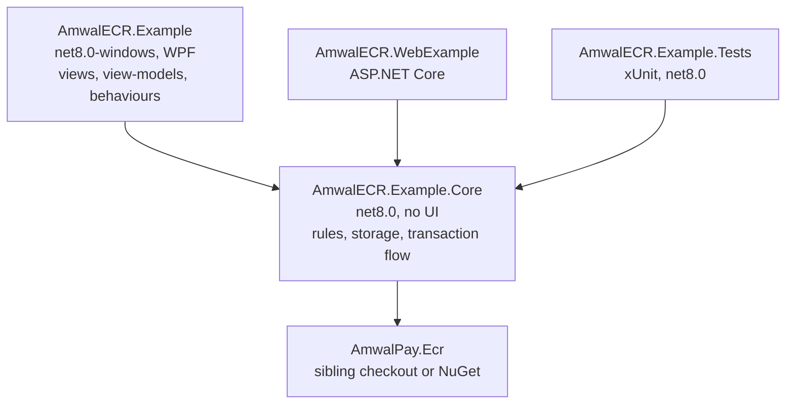
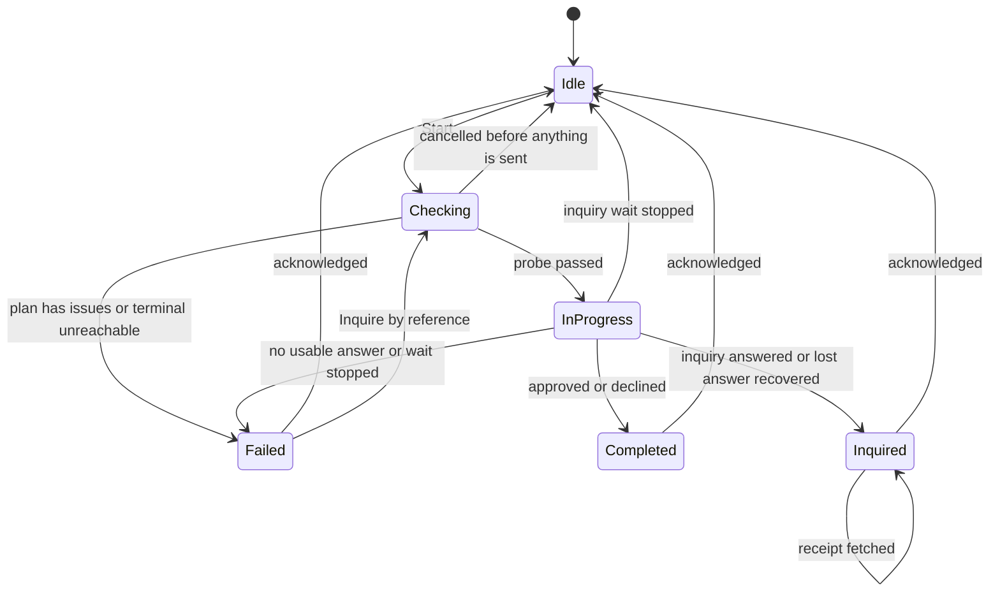
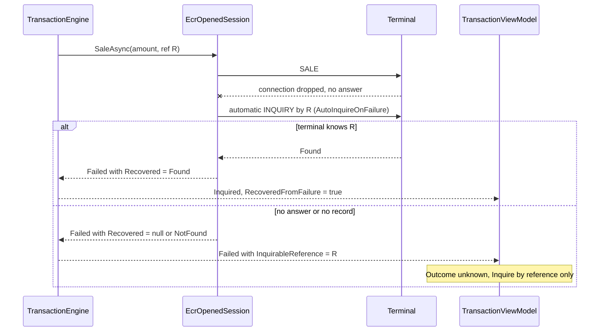
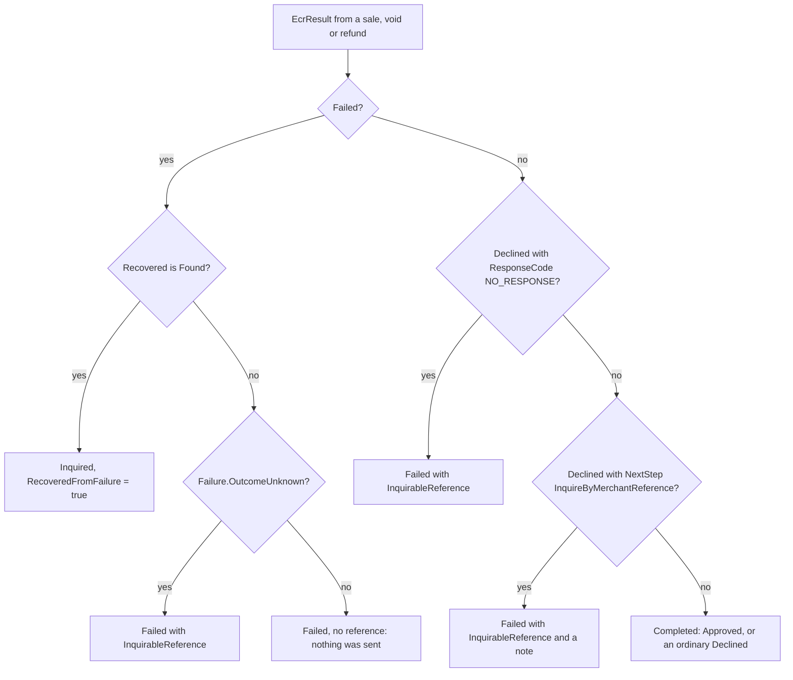

# Implementation guide - Windows (WPF) sample

How the WPF sample is put together, why it is split the way it is, and where to change things.
For a .NET developer copying the SDK integration into their own till, and for a maintainer.

Read the [README](../README.md) first for what the app does and how to run it. For copy-paste
SDK calls see [operation-examples.md](operation-examples.md). The web sample reuses Core; its
host-specific design is in [the web implementation guide](../../AmwalECR-Web-Example/docs/implementation.md).

## Contents

- [a. Goals and layering](#a-goals-and-layering)
- [b. Composition root and wiring](#b-composition-root-and-wiring)
- [c. Terminals and settings persistence](#c-terminals-and-settings-persistence)
- [d. From a terminal to an SDK call](#d-from-a-terminal-to-an-sdk-call)
- [e. The form model](#e-the-form-model)
- [f. Amount entry](#f-amount-entry)
- [g. The transaction engine, state machine and payment-safety rules](#g-the-transaction-engine-state-machine-and-payment-safety-rules)
- [h. Result presentation, Close receipt and the receipt QR](#h-result-presentation-close-receipt-and-the-receipt-qr)
- [i. Logging](#i-logging)
- [j. Threading](#j-threading)
- [k. XAML pitfalls](#k-xaml-pitfalls)
- [l. Tests](#l-tests)
- [m. Extension recipes](#m-extension-recipes)
- [n. Known limitations](#n-known-limitations)

(`Core/` below is `src/AmwalECR.Example.Core/`; `Views/`, `ViewModels/`, `Services/`, `Ui/` and
`Themes/` are under `src/AmwalECR.Example/`.)

## a. Goals and layering

1. Show the correct way to call the SDK from a till: plan before you open, probe before you send,
   never retry a payment, inquire by reference when the answer is lost.
2. Keep the rules testable without Windows: everything that is not a window is in a plain `net8.0`
   library that `dotnet test` runs on macOS and Linux.
3. Be reusable: the web sample is a second front end on the same library.



- **Core is `net8.0`, not `net8.0-windows`**, so a `net8.0` test project can reference it.
  Anything that needs Windows (DPAPI, clipboard, dialogs, `BitmapImage`) is behind an interface
  (`ISecretProtector`, `IDialogService`, `IClipboardService`) or lives in the WPF project.
- **Core owns the SDK dependency.** Only `AmwalECR.Example.Core.csproj` references the SDK
  (`project` or `nuget`, set in `Directory.Build.props`); everything else receives it
  transitively.
- **The rules are records and pure functions** (`TransactionFormState`, `TransactionOutcomes`,
  `ResultPresenter`, `SelectedTerminalConfig.Resolve`, `AmountEntry`), so the two front ends
  cannot disagree about what a void needs or when to say "Outcome unknown".
- Non-goals: no DI container, no ORM, no localisation, no theme switch.

The WPF project adds MVVM plumbing (CommunityToolkit.Mvvm 8.3.2 source generators), XAML views,
three attached behaviours (`AmountInput`, `TextFilter`, `PasswordBoxBinding`), converters, the
DPAPI protector, dialog and clipboard services, and the QR bitmap generator (QRCoder 1.6.0).

## b. Composition root and wiring

`App.OnStartup` builds everything by hand and creates the window in code (no `StartupUri`) so it
can set `DataContext`. In order:

1. A `DispatcherUnhandledException` handler (last line of defence: says an in-progress
   transaction's outcome may be unknown).
2. `LogBuffer` (mirrored to `Debug.WriteLine`) and two `IEcrLogger`s from `EcrLogger.From(...)`,
   tagged `Ecr` (Wi-Fi) and `EcrWebService`.
3. `TerminalRepository` on `%APPDATA%\AmwalECR-Example\terminals.json` and `EcrExampleSettings` on
   `settings.dat` with a `DpapiSecretProtector`.
4. `TransactionEngine(repository, settings, lanLogger, webServiceLogger)`.
5. View-models: `TransactionViewModel`, `TerminalsViewModel` (wraps `SettingsViewModel`),
   `LogViewModel`, all handed to `MainViewModel`.
6. `ResultDialogPresenter`, which stays alive by subscribing to `transaction.PropertyChanged`.
7. `MainWindow` with `DataContext = main`.

**Navigation** is two pages in a `ContentControl`: `MainViewModel.CurrentPage` holds the
transaction or terminals view-model and implicit `DataTemplate`s in `App.xaml` pick the view.
Leaving the Terminals page calls `Transaction.RefreshConfig()` because terminals or keys may
have changed; Escape on the Terminals page goes back. Dialogs are behind `IDialogService`
(`ShowTerminalEdit`, `ShowResult`, `Confirm`); view-models never touch a `Window`.

## c. Terminals and settings persistence

### `TerminalRepository` (`Core/Data/TerminalRepository.cs`)

- JSON `{ "terminals": [ ... ] }`, camel-case, indented, keyed by **serial number**. The
  transaction screen stores only a serial and looks the terminal up when it sends, so a terminal
  that moves to a new IP needs no change elsewhere.
- Read once in the constructor, held in memory; every change writes the whole (small) file under
  one lock. The write goes to `terminals.json.tmp`, then `File.Replace`, so a crash leaves the
  previous list. Memory changes only after a successful write.
- `Save(terminal, originalSerial)` and `Delete` return `SaveResult.Saved` or
  `SaveResult.Failed(message)` (a closed record hierarchy, not exceptions). A duplicate serial is
  `"A terminal with this serial number already exists"`.
- An unreadable file is copied to `terminals.json.unreadable`, the list starts empty and
  `LoadWarning` is set (shown in a red card on the Terminals page); it never silently overwrites
  what it could not read.
- Sorted by name (case-insensitive), then serial. `Changed` is raised on the thread that made
  the change.

### `EcrExampleSettings` (`Core/Data/EcrExampleSettings.cs`)

Holds the environment (`SIT`/`UAT`/`PROD`) and **two** signing keys, because Amwal issues
different secrets per link. Keys are not fields on `Terminal`:

| Setting                   | `SecureHashKeyFor(mode)`        |
| ------------------------- | ------------------------------- |
| `WifiSecureHashKey`       | `Wifi`, `UsbCable`, `Bluetooth` |
| `WebServiceSecureHashKey` | `WebService`                    |

- Setters trim, swap in a cloned values object under a lock, write the file and raise `Changed`
  (outside the lock). `TransactionViewModel` subscribes so the config card and Start button react
  as a key is typed.
- The whole payload goes through `ISecretProtector.Protect`, then the same temp-file-and-replace
  write. A failed write keeps the value in memory and sets `SaveError`
  (`"Could not save settings: ..."`); the next good write clears it.
- `LoadWarning` is set when the file exists but cannot be decrypted or parsed ("encrypted for the
  account that saved them"; values start empty). It clears as soon as a key is saved over the
  bad file. The wording says "account", not "Windows user", because the web sample uses the same
  class with a different protector.

### `ISecretProtector` and DPAPI

`ISecretProtector` is `Protect(byte[])` / `Unprotect(byte[])` (the latter throws
`CryptographicException` on data it cannot read). `DpapiSecretProtector` is `ProtectedData` with
`DataProtectionScope.CurrentUser` and a fixed entropy string (`AmwalECR-Example.settings.v1`).
Only the Windows account that saved the file can decrypt it; there is no key for the app to
store. A file from another user or machine fails to decrypt and the app starts with empty keys
and a warning. Tests use a reversible fake that still throws on garbage.

`Terminal` stores the TMS `ecrMode` as an int (`1` USB cable, `2` Wi-Fi, `3` Bluetooth, `4` Web
Service); an unknown value reads as Wi-Fi. `EcrModes.IsSupportedInExample` is the single switch
for which modes can run. `TerminalValidator` holds the edit form's rules: name and serial always;
IPv4 for Wi-Fi; optional port 1-65535 (blank is stored as 9100); numeric, 64-bit-safe merchant
and terminal IDs for Web Service.

## d. From a terminal to an SDK call

Three SDK calls are the whole integration; the rest of the sample is UI around them:

```
SelectedTerminalConfig.Resolve(terminal, environment, key)    // Core/Services/SelectedTerminalConfig.cs
        |  wraps
EcrSessions.Plan(link, config, rawKey)                         // validates; never throws for bad input
        |  EcrSessionPlan with Issues
EcrSessions.Open(serial, plan, usbChannel, logger)             // throws if the plan has issues
        |  EcrOpenedSession
session.ProbeReachabilityAsync / SaleAsync / VoidAsync / RefundAsync / InquireAsync /
        InquireByReferenceAsync / ReceiptAsync / CloseReceiptAsync   // same shape on Wi-Fi and Web Service
```

`SelectedTerminalConfig.Resolve` does the mapping the SDK leaves to the app:

1. If the mode is not `IsSupportedInExample`, add `"<Mode> is not supported in this sample"`.
2. Map the terminal to an `EcrLink`: Wi-Fi -> `EcrLink.Lan(ip, port)`, Web Service ->
   `EcrLink.WebService(merchantId, terminalId)`, USB -> `EcrLink.UsbCable`, anything else
   (Bluetooth) -> `EcrLink.Lan(ip, 9100)` as a placeholder. An out-of-range port becomes 9100.
3. Build the requested `EcrConfig` with the environment and IDs, and the key only if
   `EcrConfig.IsValidSecureHashKey` accepts it.
4. Call `EcrSessions.Plan(link, requested, trimmedKey)`. Passing the raw key as a third argument
   lets the SDK report a malformed key as an issue.
5. Append the app's own issue to `Plan.Issues`.

The result exposes `IsReady`, `Issues`, `TransportLabel` (`TCP Wi-Fi (sorted key=value HMAC)` or
`HTTPS Web Service (JSON HMAC)`), `HashKeyLabel`, `HashKeyStatus` and `ConnectionSummary`.
Typical issues are produced by the SDK: `Wi-Fi/CABLE secure hash key is not configured`,
`Secure hash key must be an even-length hex string of at least 16 characters`,
`IP address is required for Wi-Fi ECR`, `Merchant ID must be numeric`.

**Wi-Fi vs Web Service at run time.** Same three calls, different link, key and plan fields.
Web Service differs in that `ProbeReachabilityAsync` returns `null` (the engine skips the probe),
a lost money-moving answer arrives as a `Declined` (see [g](#g-the-transaction-engine-state-machine-and-payment-safety-rules)),
`ReceiptAsync` is unavailable, and by-reference inquiry posts `/Ecr/Inquiry` with a blank date.
SDK default response timeouts: 120 s Wi-Fi; a Web Service plan raises the default to 130 s.

**The config card** (`TerminalConfigCard.xaml`) takes a `SelectedTerminalConfig` and shows mode,
transport, connection, key label and status and every issue; `TransactionViewModel.CanStart` is
`!State.IsBusy && SelectedConfig?.IsReady == true`. It re-resolves from four triggers, all into
`RefreshConfig`: the dropdown selection, repository `Changed`, settings `Changed`, and returning
from the Terminals page.

**Resolved again at send time.** `TransactionEngine.RunAsync` does not trust the card: it looks
the terminal up by serial, resolves the config again, and refuses with `Failed` if the terminal is
gone or the plan has issues. `EcrSessions.Open` throws `ArgumentException` for a plan with issues
and `InvalidOperationException` for a USB plan with no channel factory; the engine catches both,
so an SDK precondition never surfaces as an unhandled exception.

## e. The form model

`TransactionFormState` (`Core/Transaction/`) is an immutable record of what the operator typed
plus the errors from the last validation; `Validated(terminalSerial)` returns
`(form-with-errors, request-or-null)`. `TransactionFormViewModel` is the bindable face: it
forwards edits with `with`-expressions and raises `PropertyChanged("")` so a type switch re-reads
every binding.

Which fields exist is decided by the SDK's flags on `EcrTransactionType`:

| Type    | `RequiresAmount` | `RequiresOriginalStan` | `RequiresOriginalDate` | Fields shown                                                   |
| ------- | ---------------- | ---------------------- | ---------------------- | -------------------------------------------------------------- |
| Sale    | yes              | no                     | no                     | Amount; merchant reference (optional)                          |
| Void    | no               | yes                    | no                     | Receipt number; Different terminal                             |
| Refund  | yes              | yes                    | yes                    | Amount; receipt number; date; Different terminal               |
| Inquiry | no               | yes                    | yes                    | Receipt number; date; Different terminal; Look up by reference |

Derived rules:

- The terminal-ID field needs the switch on; a leftover ID from a hidden switch is not sent.
- _Look up by reference_ (inquiry only) hides receipt number and date and shows the **Original
  merchant reference** field: a reference is unique on its own, and after a lost answer there is
  no receipt number to type because it was in the answer.
- `OriginalDate` defaults to today, is clamped to today, and goes on the wire as `yyyyMMdd`.
- Switching type replaces the whole state, so nothing travels into the next operation.
  `ClearAfterResult` clears amount and references but keeps type, date and switches.

`Validated` builds the `TransactionRequest`: `Amount` from `AmountEntry.AmountOf(digits)` if the
type needs one; `ReceiptNumber` blank when looking up by reference; `TransactionDate` only if the
date field is shown; for a by-reference inquiry `OriginalReference` is the typed reference and
`MerchantReference` stays blank; for a sale `MerchantReference` is the typed value.

Error strings (`Validated` / `MerchantReferenceError`): `Required field`;
`minimum amount allowed is 0.010`; `maximum amount allowed is 100000.000`;
`Enter the receipt number of the transaction to act on`;
`Enter the reference the transaction was sent with`;
`Enter the terminal the original was taken on`;
`A merchant reference is at most 32 characters`;
`Use printable ASCII without spaces, '&' or '='`. The merchant-reference rule duplicates the
SDK's so the operator hears it before anything is sent. The XAML `MaxLength` and `TextFilter`
are conveniences; the view-model is the authority.

## f. Amount entry

`AmountEntry` (`Core/Ui/`) keeps the **raw keyed digits** as state and derives the text:
`KeyedDigits` (ASCII digits, leading zeros dropped, capped at `MaxDigits`), `Append`,
`Backspace`, `Format` (three fixed decimals, `0.000` when empty) and `AmountOf`
(`long.Parse(digits) / 1000m`). `AmountLimits`: `Min = 0.010`, `Max = 100000.000`,
`FractionDigits = 3`, `MaxDigits = 9` (derived from `Max`). A tenth digit is ignored; an
over-limit amount such as `999999.999` is rejected on Start with the maximum message rather than
trimmed. The SDK turns the `decimal` into the 12-digit minor-unit string
(`000000001234` for `1.234`).

`AmountInput` makes a plain `TextBox` behave like the terminal's field, through attached
properties `AmountInput.Digits` (bound to `Form.AmountDigits`) and `AmountInput.Active`, which
hooks: `PreviewTextInput` (digits through `Append`), `PreviewKeyDown` (Backspace; Delete and Space
swallowed; Escape clears), `GotKeyboardFocus` (focus from another control starts a fresh
amount), `SelectionChanged`/`PreviewMouseUp` (caret pinned to the end), paste (cancelled and
re-keyed as digits), Cut disabled, and IME, undo and drop disabled. The digits property is the
only source of truth; the `TextBox` never edits itself.

The web sample reimplements this in `amount.js` and checks it against Core's vectors with
`tools/test-amount.mjs`.

## g. The transaction engine, state machine and payment-safety rules

`TransactionEngine` owns the flow; `TransactionViewModel` owns the screen state, the
`CancellationTokenSource` and the countdown. That split is why the flow can be tested against a
real socket without a window.

`RunAsync(request, report, cancellationToken)`, in order:

1. Look up the terminal by serial, re-resolve the plan, refuse on any issue (`Failed`, no
   reference: nothing was sent).
2. Open the session; `ArgumentException`/`InvalidOperationException` become `Failed`.
3. **Reference.** For sale, void and refund (`MovesMoney`), a blank merchant reference is replaced
   by `NewReference()` (12 upper-case hex characters, the SDK's shape). It is made here so it is
   known even if the wait is cancelled: the SDK returns a reference on a result, and a cancelled
   call returns none.
4. **Probe** (`ProbeReachabilityAsync`, Wi-Fi and USB cable). Unreachable returns `Failed` with the
   "Check:" message and **no** reference. Cancellation here returns `Idle`.
5. `report(InProgress)`: the request is about to go out.
6. **Execute** by type. Inquiry calls `InquireAsync` (receipt number and date) or
   `InquireByReferenceAsync` with the form's date as-is (blank for by-reference: a reference is
   not day-scoped, and a synthetic "today" would miss older transactions on Web Service).
7. Classify with `TransactionOutcomes.FromResult` / `FromInquiry`.
8. Catch: cancellation -> `CancelledState`; `ArgumentException` -> `Failed` (nothing sent);
   anything else -> `Failed("Unexpected error: ...")`, with the reference for money-moving types.

### State machine

`TransactionState` is a closed record hierarchy: `Idle`, `Checking`, `InProgress`, `Completed`,
`Inquired`, `Failed`. `IsBusy` is `Checking` or `InProgress`; `IsResult` is `Completed`,
`Inquired` or `Failed`. The view-model sets `Checking`; the engine reports `InProgress`.



`Failed -> Checking` is the one follow-up offered after an unknown outcome: the result dialog
hands off to the look-up instead of closing and resetting the form.

A lost answer, the branch that matters most:



### Classification (`TransactionOutcomes`)



These are the payment-safety rules; each has a test in `OutcomeTests.cs`:

- **Never retry; inquire by reference.** Sending a sale again after an unknown outcome is how a
  customer is charged twice. The only follow-up the dialog offers is **Inquire by reference**
  (`InquireAboutReference`: an Inquiry request with the reference as `OriginalReference` and a
  blank `MerchantReference`, so the SDK mints the inquiry's own id). There is no retry button.
- **`Failed` with `Failure.OutcomeUnknown`** (everything except `Failure.Unreachable`) carries
  the reference. Unreachable means the request never left: no reference, no look-up.
- **`Declined` with `NextStep.InquireByMerchantReference`** means the terminal does not know;
  it is an unknown outcome, not a refusal.
- **Web Service `NO_RESPONSE`.** The Web Service HTTP layer has no exception path for a lost
  answer; a transport error is synthesised as a decline with `ResponseCode == "NO_RESPONSE"`.
  It is an unknown outcome. The same code arriving on an inquiry as `NotFound` becomes a
  `Failed` ("An inquiry only reads and changes nothing, so it is safe to try again"), never
  "Not found", which would read as "it did not happen".
- **Cancel is an unknown outcome.** `CancelledState` for a money-moving type is
  `Failed("You stopped waiting for the terminal. This does not cancel the transaction: ...",
reference)`. Cancelling an inquiry, or anything during the probe, is `Idle`.
- **Auto-inquiry.** With `AutoInquireOnFailure` (SDK default, Wi-Fi), a lost answer is followed
  by an SDK inquiry; if it finds the transaction, `FromFailed` returns `Inquired` with
  `RecoveredFromFailure: true` (the recovered request's own `MerchantReference` stays blank).
  `NotFound` or `Failed` recoveries become a note that this does not prove nothing was charged.
- **A failed inquiry is safe to repeat and says so.** When the look-up was by reference, the
  failed state keeps that reference (`RetryableReference`), so the dialog still reads "Outcome
  unknown" and offers the look-up; the reference is usually one the app generated, so it is in
  no form field.

### Operation countdown

`OperationTimer(RemainingSeconds, TotalSeconds)` drives the countdown on the transaction screen
and in the result dialog while a receipt is fetched. `TransactionViewModel.Start` starts it with
`SelectedConfig.EcrConfig.ResponseTimeout` (120 s Wi-Fi, 130 s Web Service; floor 1 s), restarts
it when the engine reports `InProgress`, ticks once a second and clears it when the run ends. It
is display only: the SDK enforces the timeout. `CanCancel` is true while busy or while a receipt
is being fetched.

## h. Result presentation, Close receipt and the receipt QR

`ResultPresenter` turns a `TransactionState` into a `ResultDialogModel` (headline, tone, amount,
message, fields, hints, note, raw payload, optional `InquirableReference`, receipt flags). It is
pure, so the wording is testable.

| State                     | Headline                           | Notes                                                                                                                                                                               |
| ------------------------- | ---------------------------------- | ----------------------------------------------------------------------------------------------------------------------------------------------------------------------------------- |
| `Completed(Approved)`     | `Approved` or `Partially approved` | Auth code (omitted for a void: the terminal returns a placeholder), card, reference. Partial: `Only 50.000 of 961.100 was approved. Collect the difference by another means.`       |
| `Completed(Declined)`     | `Declined`                         | The terminal's own words, from the raw answer.                                                                                                                                      |
| `Inquired(Found)`         | the **transaction's** status       | Finding a declined sale is a successful inquiry and reads "Declined". Fields: receipt number, type, card, date/time; hints: `Already refunded`, `Can be voided`, `Can be refunded`. |
| `Inquired(NotFound)`      | `Not found`                        | On Web Service a note that this does not prove nothing was charged.                                                                                                                 |
| `Failed` with a reference | `Outcome unknown`                  | Warning, the reference (Copy) and the one action.                                                                                                                                   |
| `Failed` without          | `Not completed`                    | Message and note only.                                                                                                                                                              |

Raw JSON is pretty-printed behind "Show raw response" with a Copy button. Backend timestamps
such as `2026-08-09T16:58:16.804271` are shown as `09 Aug 2026 16:58`.

`ResultDialogViewModel` follows the transaction view-model while open: a new result state
rebuilds the model (the receipt arriving updates it in place); a non-result state (the look-up
the dialog offered has started) closes it. `OnClosed` calls `ResultAcknowledged()` unless the
close was a hand-off. `ResultDialogPresenter` opens the dialog from the dispatcher
(`BeginInvoke`) so the modal loop never runs inside a binding update.

**Close receipt.** `TransactionEngine.CloseTerminalReceiptAsync` calls
`session.CloseReceiptAsync` and returns a message (`Terminal is back on its idle screen`,
`Terminal refused: ...`, `Could not reach the terminal: ...`); it never throws except for
cancellation. Wi-Fi sends `CLOSE_RECEIPT`; on Web Service the SDK posts `/Ecr/closeReceipt` and
`originalMerchantReference` must be the sale/void/refund reference (taken from
`Completed.Result.MerchantReference`), otherwise the app answers
`Close receipt needs the sale / void / refund reference`. The button (`ShowCloseReceipt`) shows
on a `Completed` result for Wi-Fi, USB or Web Service terminals, keeps the dialog open, and is
independent of the dialog's **Close**, which only dismisses.

**Receipt QR.** After an inquiry over Wi-Fi or USB cable the dialog offers **QR receipt**
(`OffersReceipt` and `Inquired { Receipt: null, FetchingReceipt: false }`).
`FetchReceiptAsync` takes the receipt number from the found transaction's `Stan` (falling back
to the typed one) and the day from `TransactionTime` (`DayOf` -> `yyyyMMdd`, falling back to the
typed date), re-resolves the config and calls `ReceiptAsync`. Failures become
`EcrReceipt.Unavailable`; Cancel during the fetch yields "Receipt fetch cancelled". Web Service
has no receipt operation, so the dialog shows "The e-receipt QR is available over Wi-Fi and USB cable."

`QrCodeGenerator` draws the QR on the PC: QRCoder `PngByteQRCode` (managed, no `System.Drawing`),
level M, 8 px per module, a frozen `BitmapImage`. If generation fails the URL is still shown in
a read-only text box.

## i. Logging

`IEcrLogger` is the SDK's one-method seam (`Debug(string)`); the SDK writes each request and
answer, signing details and probe failures to whatever logger it is given.

```
SDK --Debug(msg)--> IEcrLogger --Append(tag, msg)--> LogBuffer --Changed--> LogViewModel --> LogView
                                                        +--mirror--> Debug.WriteLine
```

- `LogBuffer` keeps the last **500** lines under a lock, each stamped `HH:mm:ss.fff <tag>
<message>`. A broken mirror callback is swallowed so it can never break a payment.
- Two tags, one buffer: `Ecr` and `EcrWebService`; `TransactionEngine.LoggerFor(config)` picks by
  transport. The app writes its own `[App]` / `[Wi-Fi]` / `[Web Service]` lines (selected
  terminal and issues, a cancelled wait, an unexpected error, a failed receipt or close receipt).
- **The key is never logged**: the SDK logs only whether a key is present. The log does contain
  requests and answers with the **masked** card number; treat copied logs as transaction records.
- `LogView` is a collapsed `Expander` (auto-scroll, **Copy log** through
  `IClipboardService.TryCopy`, **Clear**).

## j. Threading

- `SubmitCommand` validates and calls `Start`, which sets `Checking`, starts the countdown,
  creates a **new `CancellationTokenSource` per transaction** and fires `RunAsync` (an
  `async Task`, not `async void`) without awaiting it. `RunAsync` has its own `try/catch` so the
  screen cannot be left spinning and disposes its CTS in `finally`. `CancelCommand` is
  `_cts?.Cancel()`.
- **UI-thread marshalling.** The engine uses `ConfigureAwait(true)` on every await in
  `RunAsync`/`ExecuteAsync`/`FetchReceiptAsync`, so `report(InProgress)` and the returned state
  are set on the UI thread. Core relies on the caller's synchronisation context: a WPF dispatcher
  marshals back; under ASP.NET Core (no context) it is a no-op, which the web sample needs.
- `LogBuffer` raises `Changed` on the writing thread; `LogViewModel.QueueRefresh` coalesces
  bursts with an `Interlocked` flag and `Dispatcher.BeginInvoke(Background)`.
- **One transaction at a time**: `Start` returns if `State.IsBusy`, and the form is disabled
  while busy. Inquire-by-reference goes through the same `Start`.
- **Close-window guard**: `MainWindow.OnClosing` asks (default No) while busy. It cancels
  nothing; the result dialog is modal, so the window cannot be closed while one is open.
- Repository and settings events fire on the caller's thread (the UI thread in WPF).

## k. XAML pitfalls

`dotnet build` compiles XAML to BAML but does not run the window, so load-time errors appear only
when a view is first shown. The one that shipped: properties that bind **two-way by default**
(`TextBox.Text`, `ComboBox.SelectedItem`, `CheckBox.IsChecked`, `DatePicker.SelectedDate`, ...)
bound to a **read-only** view-model property throw `InvalidOperationException: A TwoWay or
OneWayToSource binding cannot work on the read-only property ...` when the view loads (it was
`DatePicker.DisplayDateEnd` bound to the get-only `LatestDate`). The fix is `Mode=OneWay`, also
on every `Run.Text`, read-only `TextBox`es and the config card's issue list.

`tools/check-xaml-bindings.py` (Python 3, run by CI) parses every `*.xaml` under
`src/AmwalECR.Example`, finds attribute-syntax bindings on a table of two-way-by-default control
properties, collects property names from `ViewModels/*.cs` and Core, and exits 1 when the last
path segment is read-only and has no `Mode=OneWay`/`OneTime`/`OneWayToSource`.

It does not catch: name collisions (it matches names, not types), `Run.Text`, property-element
syntax or `Style` setters, binding-path typos, missing `StaticResource` keys, converters without
`ConvertBack` used two-way, or focus and layout behaviour.

Conventions: error text is bound to a string plus a `Has...` bool for `Visibility`, with
`AutomationProperties.HelpText` on the field so a screen reader is pointed at it.

## l. Tests

```
dotnet test tests/AmwalECR.Example.Tests -p:EcrSdkDependency=project    # 189 tests, any OS
```

The test project targets `net8.0`, references **Core only** (xUnit 2.9.2) and inherits the SDK
dependency choice.

| File                             | Pins                                                                                                                                                                                                              |
| -------------------------------- | ----------------------------------------------------------------------------------------------------------------------------------------------------------------------------------------------------------------- |
| `AmountTests.cs`                 | `AmountLimits`, three-decimal formatting, minor units, the `AmountEntry` vectors, the digit cap                                                                                                                   |
| `FormStateTests.cs`              | fields per type, the reference swap, other-terminal switch, date default and wire format, amount errors, the request built per type, merchant-reference rules                                                     |
| `SelectedTerminalConfigTests.cs` | readiness; missing, malformed or untrimmed key; missing address; port fallback; Web Service label, transport and numeric IDs; USB cable ready on the Wi-Fi key; Bluetooth "not supported"; the right key per mode |
| `DataTests.cs`                   | `Terminal` and `TerminalValidator`; repository ordering, duplicates, restart, `.unreadable` copy; settings defaults, per-mode keys, encryption at rest, `LoadWarning`; `LogBuffer`                                |
| `OutcomeTests.cs`                | every classification in [g](#g-the-transaction-engine-state-machine-and-payment-safety-rules) and every `ResultPresenter` model                                                                                   |
| `EngineTests.cs`                 | the whole flow against a real socket (below)                                                                                                                                                                      |

`FakeTerminal` in `EngineTests.cs` is a `TcpListener` on loopback that speaks the real protocol (a
2-byte big-endian length, then UTF-8 JSON), echoes the request's `nonce` and signs the answer
(HMAC-SHA256 over the sorted top-level scalar `key=value` pairs joined by `&`, hex-decoded key,
upper-case hex). A handler returns a `JsonObject` to answer or `null` to hang up; a connection
that sends nothing is a probe. So the tests exercise the real SDK (plan, probe, sign, send,
verify, classify) for approval (asserting `000000001234`), a generated reference, unreachable, a
plan with issues, USB refused, an unregistered terminal, a lost answer (exactly one `SALE`), a
recovered answer, a wrong key, cancel before and during the wait, inquiry by receipt and by
reference, void and refund fields, and the receipt fetch. It is the C# twin of
`tools/fake_pos_server_signed.py`, except the Python one also refuses a repeated nonce.

There is no loopback for Web Service; its classification is covered only by `OutcomeTests`.
Nothing tests the view-models or the running window.

## m. Extension recipes

After any change: run the tests and `python3 tools/check-xaml-bindings.py`, and launch the app.

### Add a field to the form

First check the SDK call can carry it (`SaleAsync(amount, merchantReference, ct)` takes only
those). Then, in order:

1. `Core/Transaction/TransactionFormState.cs`: the property, a `Show...` flag if conditional, its
   rule in `Validated`, a slot in `FormErrors`, the mapping into `TransactionRequest`.
2. `Core/Transaction/TransactionState.cs`: the property on `TransactionRequest`.
3. `Core/Services/TransactionEngine.cs` `ExecuteAsync`: use it.
4. `ViewModels/TransactionFormViewModel.cs`: the property, `...Error`/`Has...Error`, and
   `ClearAfterResult` if per-transaction.
5. `Views/TransactionView.xaml`: copy an existing block; bind read-only properties `Mode=OneWay`.
6. Tests in `FormStateTests.cs` and `EngineTests.cs`.
7. The web sample maps its own DTO onto `TransactionFormState` (`Api/Dtos.cs`,
   `TransactionEndpoints.cs`, `MetaEndpoint.cs`); mirror the change there.

### Add a transaction type

`EcrTransactionType` and its flags (`RequiresAmount`, `RequiresOriginalStan`,
`RequiresOriginalDate`, `MovesMoney`, `AllowsOtherTerminal`, `MenuOptions`) live in the SDK; add
the type there first. Then the `switch` in `TransactionEngine.ExecuteAsync` (its default arm
throws), classification in `TransactionOutcomes` if the result shape differs, wording in
`ResultPresenter`, and `TransactionFormViewModel` (`StartButtonText`, `AmountHelp`). Get
`MovesMoney` right: it decides whether the operation gets a reference and whether a cancel is an
unknown outcome. `Receipt` and `CloseReceipt` exist in the enum but are not in `MenuOptions`;
they follow a result.

### USB cable

`TransactionEngine.OpenSession` passes `usbChannel: () => new SerialEcrChannel(CablePort(registered))`
when the plan is USB cable. `CablePort` asks Windows which COM port currently belongs to the
saved device serial. A terminal that was saved as a COM name, such as COM3, is opened on that
name once, and the USB serial of the device on it is stored so the next sale can follow the
device. The same call serves the WPF app and the web app, because both run that engine.
Windows opens the MediaTek USB VCOM port at 115200 8N1.
Core stays `net8.0`; the channel lives in the SDK, so the WPF project does not add a second one.

`EcrMode.UsbCable` is supported. The edit dialog hides the address fields and the config card
uses the Wi-Fi signing key. Bluetooth has no SDK link; `ToLink` maps it to a Wi-Fi link as a
placeholder and the sample refuses to run it.

### Branding and storage

| What                             | Where                                                                                                                                              |
| -------------------------------- | -------------------------------------------------------------------------------------------------------------------------------------------------- |
| Colours                          | `Themes/Colors.xaml` (brushes are referenced by key)                                                                                               |
| Styles, focus and error outlines | `Themes/Styles.xaml`                                                                                                                               |
| Icons, currency glyph            | `Themes/Icons.xaml`                                                                                                                                |
| Window title, app bar            | `MainWindow.xaml`, `MainViewModel.Title`                                                                                                           |
| Executable name, product         | `AmwalECR.Example.csproj`                                                                                                                          |
| Currency                         | `Amount (OMR)` label in `TransactionView.xaml`, symbol in `ResultDialogWindow.xaml`, `AmountLimits`/`AmountEntry` for a non-three-decimal currency |
| Data folder                      | `App.DataDirectory`; changing it orphans existing files                                                                                            |

To swap storage, implement `ISecretProtector` (machine-scope DPAPI, a key vault) and pass it in
`App.OnStartup`; the web sample is the worked example. `TerminalRepository` and
`EcrExampleSettings` are concrete sealed classes: extract an interface (`GetAll`,
`FindBySerial`, `Save`, `Delete`, `Changed`, `LoadWarning`) and update `TransactionEngine`,
`TransactionViewModel`, `TerminalsViewModel`, `TerminalEditViewModel` and `App.xaml.cs`; keep
the serial as the key, the `SaveResult` contract and "write first, then update memory".

## n. Known limitations

- **No tests of the window or the view-models.** They live in the `net8.0-windows` project, which
  the `net8.0` test project cannot reference. Runtime-only behaviour (load-time `StaticResource`
  errors, focus order, `AmountInput` under a real keyboard and IME, DPAPI on a real profile,
  HiDPI, high-contrast) is checked by hand.
- No UI-automation tests; Accessibility (access keys, automation names, live regions) is
  designed in but not verified with Narrator or contrast tools.
- **Bluetooth is not supported.** USB cable is: `TransactionEngine` opens `SerialEcrChannel` on the COM port Windows has assigned to the saved device serial (MediaTek USB VCOM, 115200 8N1). App-to-app is not offered.
- **Web Service has no fake Hub and no loopback test**; it needs the real backend. Receipts are
  not offered over it. The fake terminal has no `CLOSE_RECEIPT` handler.
- **The amount limit is a constant** (`100000.000`); a real terminal takes it from the server.
- **No single-instance guard.** Both files are read once at start-up, so two copies overwrite
  each other's terminal list.
- Not localised; the currency label and symbol are hard-coded to OMR.
- **The SDK dependency.** The default `nuget` build fails until `AmwalPay.Ecr` 1.0.2 is
  published (the samples use `CloseReceiptAsync`); build with `-p:EcrSdkDependency=project`.
- The samples target .NET 8, which Microsoft stops supporting on 10 Nov 2026.
