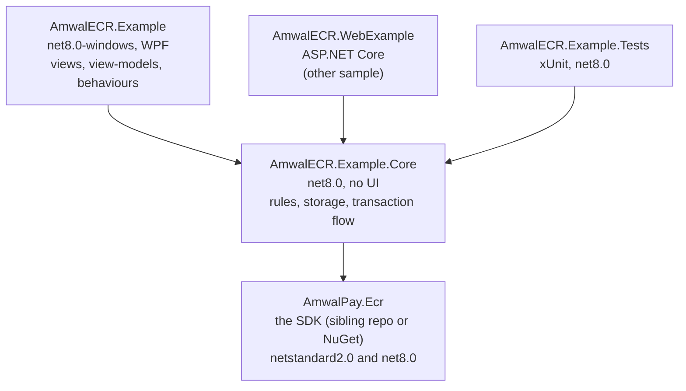
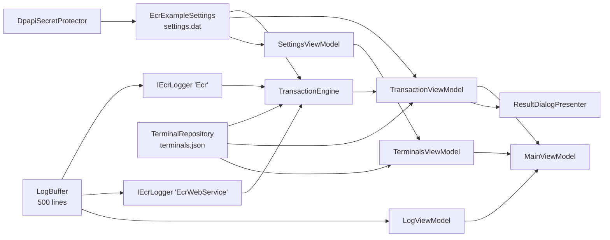
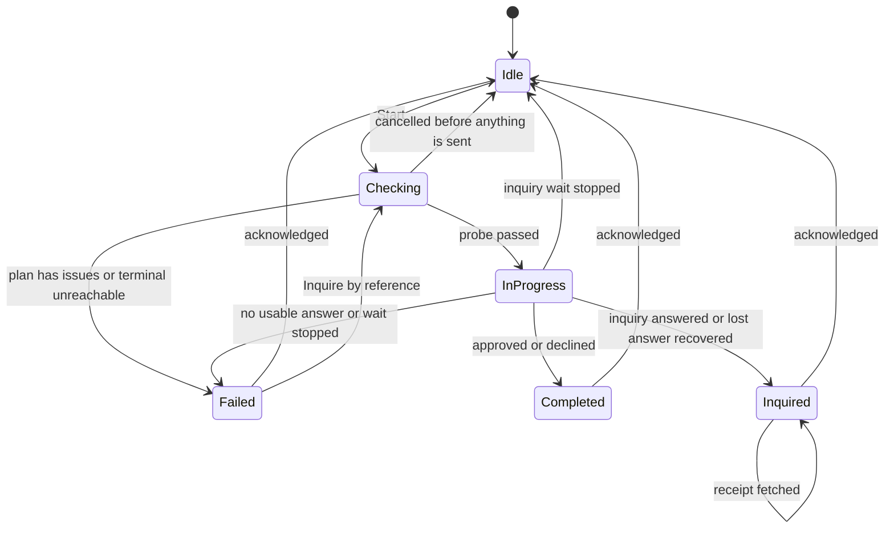
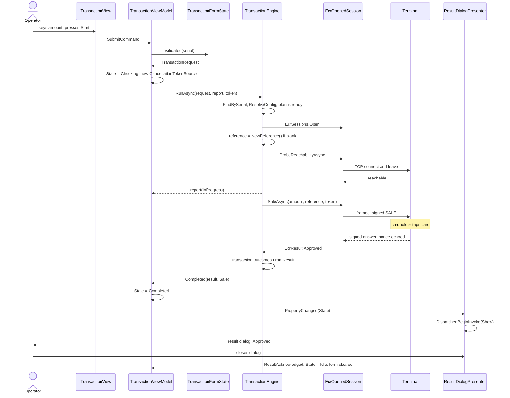
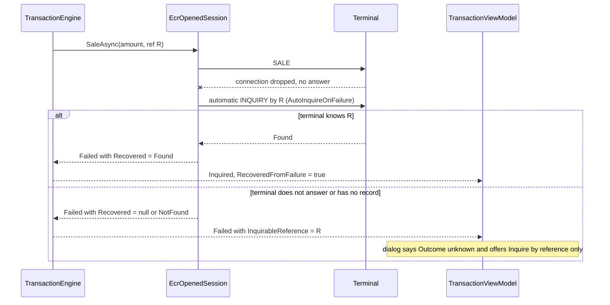
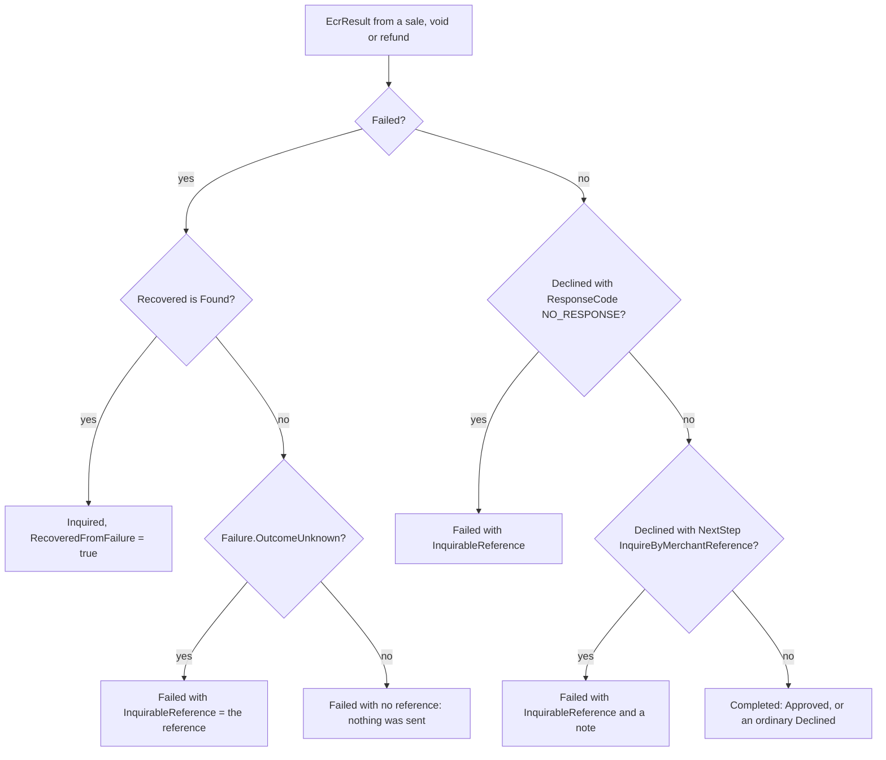

# Implementation guide — Windows (WPF) sample

> Aligns with **`AmwalPay.Ecr` 1.0.0** and the Android ECR-simulator: inquiry by STAN or
> merchant reference on LAN and Web Service; by-reference leaves the date blank.

How the WPF sample is put together, why it is split the way it is, and where to change
things. Written for two readers: a .NET developer copying the SDK integration into their
own Windows till, and a maintainer extending this sample.

Read [README.md](../README.md) first for what the app does and how to run it, and the
[umbrella README](../../README.md) for the repository layout. The SDK itself
(`AmwalPay.Ecr`) is documented in its own repository: `docs/integration-guide.md` and
`docs/api-reference.md` in the SDK checkout.

Everything below was checked against the code at the time of writing. Section (o) lists what
was **not** checked, and the honest limits of this sample.

## Contents

- [a. Goals and layering](#a-goals-and-layering)
- [b. Composition root and wiring](#b-composition-root-and-wiring)
- [c. Terminals and settings persistence](#c-terminals-and-settings-persistence)
- [d. From a terminal to an SDK call](#d-from-a-terminal-to-an-sdk-call) — includes [Web Service initialization](#web-service-initialization)
- [e. The form model](#e-the-form-model)
- [f. Amount entry](#f-amount-entry)
- [g. The transaction engine and state machine](#g-the-transaction-engine-and-state-machine)
- [h. Result presentation and the receipt QR](#h-result-presentation-and-the-receipt-qr)
- [i. Logging](#i-logging)
- [j. Threading](#j-threading)
- [k. XAML pitfalls](#k-xaml-pitfalls)
- [l. Tests](#l-tests)
- [m. Extension recipes](#m-extension-recipes)
- [n. Building, publishing, running](#n-building-publishing-running)
- [o. Known limitations](#o-known-limitations)

---

## a. Goals and layering

Goals, in priority order:

1. **Show the correct way to call the SDK from a till**, including the parts that are easy to
   get wrong: plan before you open, probe before you send, never retry a payment, inquire by
   reference when the answer is lost.
2. **Behave like the Kotlin ECR simulator** (`ECR-simulator/app/` in the Android repo) — same
   screens, form rules, wording, colours — so the two can be compared side by side. Where a
   rule is copied on purpose the source comments say so (for example `AmountLimits` cites the
   POS purchase form, `TransactionFormState` cites the SDK's own reference rule).
3. **Be testable without Windows.** Everything that is not a window lives in a plain `net8.0`
   library that `dotnet test` runs on macOS and Linux.
4. **Be reusable.** The [web sample](../../AmwalECR-Web-Example/README.md) is a second front
   end on the same library, not a second implementation.



| Layer | Project | Knows about | Does not know about |
|---|---|---|---|
| SDK | `AmwalPay.Ecr` | Wire protocol, signing, transports | Any UI, any storage |
| Core | [`src/AmwalECR.Example.Core`](../src/AmwalECR.Example.Core) | The SDK; the sample's rules | WPF, `System.Windows`, DPAPI, the dispatcher |
| WPF | [`src/AmwalECR.Example`](../src/AmwalECR.Example) | Core (and, transitively, the SDK) | — |

Why the split is where it is:

- **Core is `net8.0`, not `net8.0-windows`.** A project that targets `-windows` cannot be
  referenced from a `net8.0` test project, and cannot run on the maintainer's Mac. Anything
  that needs Windows (DPAPI, the clipboard, dialogs, `BitmapImage`) is behind an interface
  ([`ISecretProtector`](../src/AmwalECR.Example.Core/Data/ISecretProtector.cs)) or lives in
  the WPF project ([`IDialogService`, `IClipboardService`](../src/AmwalECR.Example/Services/IDialogService.cs)).
- **Core owns the SDK dependency.** Only
  [`AmwalECR.Example.Core.csproj`](../src/AmwalECR.Example.Core/AmwalECR.Example.Core.csproj)
  references the SDK (`project` or `nuget`, see [n](#n-building-publishing-running)); the app
  and the tests receive it transitively, so the choice is made in exactly one place.
- **The rules are records and pure functions.** `TransactionFormState`, `TransactionOutcomes`,
  `ResultPresenter`, `SelectedTerminalConfig.Resolve` and `AmountEntry` take values and return
  values. The web sample calls the same ones, so the two front ends cannot disagree about what a
  void needs or when to say "Outcome unknown".
- **Non-goals:** no DI container (too few objects), no ORM, no localisation, no theming
  switch. The sample is deliberately small enough to read in an afternoon.

What the WPF project adds on top of Core: MVVM plumbing
([CommunityToolkit.Mvvm](https://learn.microsoft.com/dotnet/communitytoolkit/mvvm/) 8.3.2 source
generators), XAML views, three attached behaviours, converters, the DPAPI protector, dialog and
clipboard services, and the QR bitmap generator.

## b. Composition root and wiring

[`App.xaml.cs`](../src/AmwalECR.Example/App.xaml.cs) `OnStartup` builds everything by hand.
There is no `App.xaml` `StartupUri`; the window is created in code so it can be given its
`DataContext`.



In order, as the code does it:

1. `DispatcherUnhandledException` handler: shows a message that says an in-progress
   transaction's outcome may be unknown, and marks the exception handled. It is the last line
   of defence, not the error strategy.
2. `LogBuffer` with `Debug.WriteLine` as its mirror, then two `IEcrLogger`s from
   `EcrLogger.From(...)` that append to it under the tags `Ecr` (LAN) and `EcrWebService`.
3. `TerminalRepository` on `%APPDATA%\AmwalECR-Example\terminals.json`, and
   `EcrExampleSettings` on `...\settings.dat` with a `DpapiSecretProtector`. `App.DataDirectory`
   is the folder.
4. `TransactionEngine(repository, settings, lanLogger, webServiceLogger)`.
5. View-models: `TransactionViewModel`, `TerminalsViewModel` (which wraps a `SettingsViewModel`),
   `LogViewModel`, all handed to `MainViewModel`.
6. `ResultDialogPresenter` — nobody holds a reference to it; it stays alive because it
   subscribed to `transaction.PropertyChanged`.
7. `MainWindow` with `DataContext = main`, `Show()`, then the selected terminal's config is
   written to the log once.

**Navigation** is two pages and a `ContentControl`.
[`MainViewModel.CurrentPage`](../src/AmwalECR.Example/ViewModels/MainViewModel.cs) holds either
the transaction or the terminals view-model; two implicit `DataTemplate`s in
[`App.xaml`](../src/AmwalECR.Example/App.xaml) pick the matching view. Leaving the terminals
page calls `Transaction.RefreshConfig()`, because terminals or keys may have changed while
away. Escape on the terminals page goes back
([`MainWindow.xaml.cs`](../src/AmwalECR.Example/MainWindow.xaml.cs)).

Dialogs are behind `IDialogService` (`ShowTerminalEdit`, `ShowResult`, `Confirm`); the
view-models never touch a `Window`. A view-model unit test could substitute a fake, but see
[l](#l-tests) and [o](#o-known-limitations): the view-models are not currently tested.

## c. Terminals and settings persistence

Two files under `%APPDATA%\AmwalECR-Example\`, two classes, both registered as concrete types
(there is no `ITerminalRepository`; see the storage recipe in [m](#m-extension-recipes)).

### `TerminalRepository` — [`Data/TerminalRepository.cs`](../src/AmwalECR.Example.Core/Data/TerminalRepository.cs)

- A JSON document `{ "terminals": [ ... ] }`, camel-case, indented. The primary key is
  **`SerialNumber`**; the transaction screen stores only a serial and looks the rest up at the
  moment it sends, so a terminal that moves to a new IP needs no change elsewhere.
- **Read once, held in memory.** The file is read in the constructor; `GetAll` and
  `FindBySerial` answer from the in-memory list. Every change writes the whole (tiny) file
  under one lock. (The class comment says "every call reads and writes it whole"; the code
  reads once. Listed under defects in the hand-off.)
- **Write path:** serialise to `terminals.json.tmp`, then `File.Replace(temp, path, null)` (or
  `File.Move` for the first write). A crash mid-save leaves the previous list plus a stray
  `.tmp`, not half a new list. It is an atomic replace, not a durability guarantee: nothing is
  flushed to disk explicitly.
- **In-memory state changes only after a successful write** (`Write(next); _terminals = next;`),
  so a failed save leaves memory and disk in agreement.
- `Save(terminal, originalSerial)`: `originalSerial == null` inserts. If the serial changed
  and another entry already has it, the result is
  `SaveResult.Failed("A terminal with this serial number already exists")` and nothing changes.
  Changing an existing terminal's serial removes the old entry and adds the new one.
- `Save` and `Delete` return `SaveResult.Saved` or `SaveResult.Failed(message)` — a closed
  record hierarchy, not exceptions. IO, permission and JSON errors are caught and turned into
  `Failed`.
- **Unreadable file:** an `IOException`/`JsonException`/`UnauthorizedAccessException` on load
  copies the file to `terminals.json.unreadable`, starts with an empty list and sets
  `LoadWarning` (`"... A copy was kept at <path>."`). It never silently overwrites what it could
  not read. [`TerminalsViewModel`](../src/AmwalECR.Example/ViewModels/TerminalsViewModel.cs)
  shows the warning in a red card at the top of the Terminals page.
- Sorting is by name, case-insensitive, then serial. A hand-edited duplicate serial keeps the
  first entry.
- `Changed` is raised **on whichever thread made the change**. The WPF app only changes terminals
  from the UI thread, so its handlers can touch UI-bound state; the web sample calls from request
  threads.

### `EcrExampleSettings` — [`Data/EcrExampleSettings.cs`](../src/AmwalECR.Example.Core/Data/EcrExampleSettings.cs)

Holds the environment (`SIT`/`UAT`/`PROD`, default `EcrEnvironments.Default`) and **two**
signing keys, because the SDK needs different secrets for different links:

| Setting | Used for | `SecureHashKeyFor(mode)` |
|---|---|---|
| `WifiSecureHashKey` | Wi-Fi (LAN); USB cable and Bluetooth would share it | `Wifi`, `UsbCable`, `Bluetooth` |
| `WebServiceSecureHashKey` | Web Service JSON HMAC | `WebService` |

The SDK does not store or choose keys; this class is where the app does.

- Setters **trim** the value, swap in a cloned `Values` object under a lock, write the file and
  raise `Changed` (outside the lock). `TransactionViewModel` subscribes to `Changed` so the
  config card and the Start button react the moment a key is typed.
- **Encrypted at rest:** the whole JSON payload goes through `ISecretProtector.Protect`, then the
  same temp-file-and-replace write as above.
- **A failed write does not lose the value.** It stays in memory for the run and
  `SaveError` is set (`"Could not save settings: ..."`); the next good write clears it.
  [`SettingsViewModel`](../src/AmwalECR.Example/ViewModels/SettingsViewModel.cs) surfaces it as
  `Notice`.
- **`LoadWarning`** is set when the file exists but `Unprotect` (or the JSON parse) fails. The
  message says the settings "are encrypted for the account that saved them" and to enter the
  keys again; the values start empty. The word is "account", not "Windows user", because the
  web sample uses the same class with a different protector.

### `ISecretProtector` and DPAPI

[`ISecretProtector`](../src/AmwalECR.Example.Core/Data/ISecretProtector.cs) is two methods,
`Protect(byte[])` and `Unprotect(byte[])`, the latter documented to throw
`CryptographicException` on data it cannot read.
[`DpapiSecretProtector`](../src/AmwalECR.Example/Services/DpapiSecretProtector.cs) is
`ProtectedData` with **`DataProtectionScope.CurrentUser`** and a fixed entropy string
(`AmwalECR-Example.settings.v1`).

- **Scope:** only the Windows account that saved the file can decrypt it. There is no key for
  the app to store, and nothing to back up or lose separately from the account.
- **Entropy** is not a secret. It only stops another program running as the same user from
  decrypting the file by accident.
- **File made by another user** (copied from another account, a different machine, or a
  rebuilt profile): `Unprotect` throws `CryptographicException`, `Load` catches it, sets
  `LoadWarning`, and the app starts with empty keys. The Terminals page shows the warning above
  the key fields.
- **What is not handled:** the unreadable `settings.dat` is *not* set aside the way
  `terminals.json` is; the next key typed replaces it. That is deliberate enough: the file only
  holds keys the operator can type again. The warning itself clears as soon as a key is saved,
  because a successful write has replaced the bad file (`Update` in
  [`EcrExampleSettings.cs`](../src/AmwalECR.Example.Core/Data/EcrExampleSettings.cs); pinned by
  `The_unreadable_file_warning_goes_away_once_a_key_is_saved_over_it`).
- The tests use a reversible fake (`FakeProtector` in
  [`DataTests.cs`](../tests/AmwalECR.Example.Tests/DataTests.cs)) that still throws
  `CryptographicException` on garbage, so the failure path is exercised without Windows.

`Terminal` ([`Data/Terminal.cs`](../src/AmwalECR.Example.Core/Data/Terminal.cs)) stores the TMS
`ecrMode` as an int (`1` USB cable, `2` Wi-Fi, `3` Bluetooth, `4` Web Service —
[`EcrMode`](../src/AmwalECR.Example.Core/Data/EcrMode.cs)); an unknown value reads as Wi-Fi.
`EcrModes.IsSupportedInExample` is the single switch that decides which modes can run.
[`TerminalValidator`](../src/AmwalECR.Example.Core/Terminals/TerminalValidator.cs) holds the edit
form's rules: name and serial always; IPv4 for Wi-Fi; an optional port in 1–65535 (blank is
stored as `9100` — the Android form insists on one, the SDK does not need it); numeric,
64-bit-safe merchant and terminal IDs for Web Service.

## d. From a terminal to an SDK call

Three calls, in this order, are the whole SDK integration. Everything else in the sample is
user interface around them.

```
SelectedTerminalConfig.Resolve(terminal, environment, key)   // Core/Services/SelectedTerminalConfig.cs
        |   wraps
        v
EcrSessions.Plan(link, config, rawKey)                        // SDK: validate, never throws for bad input
        |   yields an EcrSessionPlan with Issues
        v
EcrSessions.Open(serial, plan, usbChannel, logger)            // SDK: throws if the plan has issues
        |   yields an EcrOpenedSession
        v
session.ProbeReachabilityAsync / SaleAsync / VoidAsync / RefundAsync / InquireAsync /
        InquireByReferenceAsync / ReceiptAsync                // same shape over LAN and Web Service
```

[`SelectedTerminalConfig.Resolve`](../src/AmwalECR.Example.Core/Services/SelectedTerminalConfig.cs)
does the mapping the SDK deliberately leaves to the app:

1. If the mode is not `IsSupportedInExample`, add the issue `"<Mode> is not supported in this
   sample"`.
2. Map the persisted terminal to an `EcrLink`: `Wifi` → `EcrLink.Lan(ip, portOrDefault)`,
   `WebService` → `EcrLink.WebService(merchantId, terminalId)`, `UsbCable` → `EcrLink.UsbCable`,
   anything else (Bluetooth) → `EcrLink.Lan(ip, 9100)`. An out-of-range port becomes
   `EcrConfig.DefaultPort` (9100).
3. Build the requested `EcrConfig` with the environment, IDs, port, and the key **only if**
   `EcrConfig.IsValidSecureHashKey` accepts it.
4. Call `EcrSessions.Plan(link, requested, trimmedKey)`. The raw trimmed key is passed as a
   third argument so the SDK can report a *malformed* key as an issue even though the config it
   is handed carries an empty one.
5. Append the app's own issue (step 1) to the plan's `Issues`.

The result is a record wrapping the plan, with UI-facing properties: `IsReady`
(`IsSupported && Plan.IsReady`), `Issues`, `TransportLabel`
(`"TCP LAN (sorted key=value HMAC)"` / `"HTTPS Web Service (JSON HMAC)"`), `HashKeyLabel`,
`HashKeyStatus` (`"configured (32 hex chars)"` or `"not configured — set in Terminals settings"`),
`ConnectionSummary`.

Typical issues, all produced by the SDK: `Wi-Fi/LAN secure hash key is not configured`,
`Secure hash key must be an even-length hex string of at least 16 characters`,
`IP address is required for LAN ECR`, `Merchant ID must be numeric`. The key label differs by
link (`Web Service secure hash key` for Web Service).

### Web Service initialization

Operator-facing steps live in the
[README](../README.md#web-service-initialization). Under the hood the path is the same three
SDK calls as LAN; only the link, key and plan fields differ.

| Step | App | SDK |
|---|---|---|
| 1. Persist credentials | `EcrExampleSettings`: `Environment`, `WebServiceSecureHashKey` (DPAPI); `Terminal`: serial, `MerchantId`, `TerminalId`, mode `WebService` | — |
| 2. Map + validate | `SelectedTerminalConfig.Resolve` → `EcrLink.WebService(merchantId, terminalId)`, `EcrConfig` with environment + Web Service key | `EcrSessions.Plan` — no Hub call |
| 3. Gate UI | Config card / `CanStart` require `IsReady` | Plan issues listed above |
| 4. Open + operate | `TransactionEngine.RunAsync` re-resolves, then | `EcrSessions.Open` → `SaleAsync` / `VoidAsync` / `RefundAsync` / `InquireAsync` / `InquireByReferenceAsync` |

What the plan must satisfy before `IsReady`:

- Mode is `WebService` and `IsSupportedInExample` (true in this sample).
- Merchant ID and terminal ID non-empty and numeric.
- Web Service key present after sanitization (even-length hex, ≥ 16 chars) — **not** the
  Wi‑Fi/LAN key from `WifiSecureHashKey`.
- `Environment` is `SIT`, `UAT`, or `PROD` (Hub base URL is SDK-internal).

Differences from LAN at run time (engine / outcomes, not init):

- `ProbeReachabilityAsync` returns `null` — the engine skips the probe.
- A lost money-moving answer arrives as `Declined` with
  `NextStep.InquireByMerchantReference` (often `NO_RESPONSE`), classified as unknown — never
  retry; offer inquire-by-reference.
- `ReceiptAsync` is unavailable; the result dialog says so.
- Inquiry by reference posts `/Ecr/Inquiry` with a blank date (no synthetic “today”).

SDK checklist (Hub URLs, TLS, signing field `secureHashValue`):
[integration guide §4](https://github.com/amwal-pay/AmwalpayEcrWindows/blob/main/docs/integration-guide.md#initialization-process).

**The config card.** [`TerminalConfigCard.xaml`](../src/AmwalECR.Example/Views/TerminalConfigCard.xaml)
takes a `SelectedTerminalConfig` as its `DataContext` and shows mode, transport, connection, the
active key's label and status, and every issue in red; the card turns from the neutral to the
error-container colour when `IsReady` is false. `TransactionViewModel.CanStart` is
`!State.IsBusy && SelectedConfig?.IsReady == true`, so the operator sees what is missing
**before** paying and the Start button is disabled until it is fixed.

The card re-resolves from four triggers, all funnelled into
[`TransactionViewModel.RefreshConfig`](../src/AmwalECR.Example/ViewModels/TransactionViewModel.cs):
the dropdown selection changes; the repository raises `Changed`; the settings raise `Changed`;
`MainViewModel.Back` returns from the Terminals page.

**Resolved again at send time.** `TransactionEngine.RunAsync` does not trust the card: it looks
the terminal up by serial in the repository, calls `ResolveConfig` again, refuses with
`TransactionState.Failed` if the terminal is gone (`"Terminal X is no longer registered"`) or the
plan has issues (issues joined by newlines), then calls `EcrSessions.Open`. `Open` throws
`ArgumentException` for a plan with issues and `InvalidOperationException` for a USB plan with no
channel factory; the engine catches both and returns them as `Failed`, so an SDK precondition can
never surface as an unhandled exception.

## e. The form model

[`TransactionFormState`](../src/AmwalECR.Example.Core/Transaction/TransactionFormState.cs) is an
immutable record: what the operator has typed plus the errors from the last validation. Its
`Validated(terminalSerial)` returns `(form-with-errors, request-or-null)`. The bindable face is
[`TransactionFormViewModel`](../src/AmwalECR.Example/ViewModels/TransactionFormViewModel.cs),
which forwards edits into the record with `with`-expressions, clears the edited field's own error,
and raises `PropertyChanged("")` (everything) so a type switch re-reads every binding.

**Which fields exist is decided by the SDK's flags on `EcrTransactionType`**, so showing a
field and requiring it cannot disagree:

| Type | `RequiresAmount` | `RequiresOriginalStan` | `RequiresOriginalDate` | Fields shown |
|---|---|---|---|---|
| Sale | yes | no | no | Amount; Merchant reference (optional) |
| Void | no | yes | no | Receipt number; "Different terminal" switch |
| Refund | yes | yes | yes | Amount; Receipt number; Date; "Different terminal" switch |
| Inquiry | no | yes | yes | Receipt number; Date; "Different terminal" switch; "Look up by reference" switch |

Derived rules in the record:

- `ShowOtherTerminalSwitch = Type.AllowsOtherTerminal()` (same as `RequiresOriginalStan`);
  `ShowOriginalTerminal` additionally needs the switch on. A terminal ID left over from a hidden
  switch is not sent (`OriginalTerminalId = ShowOriginalTerminal ? ... : ""`).
- `ShowReferenceSwitch` is Inquiry only. With it on, the receipt number and date fields are
  hidden and replaced by a reference field: a reference is unique on its own, and after a lost
  answer there is no receipt number to type because that number was in the answer.
- `ShowMerchantReference` is Sale only.
- `OriginalDate` defaults to today and goes on the wire as `yyyyMMdd`
  (`OriginalDateOnWire`); the picker's `DisplayDateEnd` (bound to `LatestDate`) stops future
  dates, and the view-model clamps a future value to today.
- Switching type **replaces the whole state** (`new TransactionFormState { Type = value }`), so no
  amount, terminal ID or reference travels into the next operation.
- After a result is acknowledged, `ClearAfterResult` clears amount, merchant reference and
  original reference (the per-transaction fields) but keeps the type, date and switches.

`Validated` mapping from state to `TransactionRequest` (the value the engine consumes):

| Request field | Value |
|---|---|
| `Amount` | `AmountEntry.AmountOf(digits)` if the type needs one, else `null` |
| `ReceiptNumber` | `""` when looking up by reference |
| `TransactionDate` | `yyyyMMdd` only if the date field is shown |
| `OriginalReference` and `MerchantReference` | both the typed reference when looking up by reference; otherwise `MerchantReference` only for a sale |

**Error strings** (all in `Validated` or `MerchantReferenceError`):

| Field | Message |
|---|---|
| Amount, empty | `Required field` |
| Amount, under the minimum | `minimum amount allowed is 0.010` |
| Amount, over the maximum | `maximum amount allowed is 100000.000` |
| Receipt number, empty | `Enter the receipt number of the transaction to act on` |
| Reference (inquiry), empty | `Enter the reference the transaction was sent with` |
| Original terminal, empty while switch is on | `Enter the terminal the original was taken on` |
| Merchant reference, over 32 | `A merchant reference is at most 32 characters` |
| Merchant reference, bad character | `Use printable ASCII without spaces, '&' or '='` |

Validation answers only "is this complete enough to send". Whether the terminal will accept it
needs the payment backend, and only the terminal can ask. The merchant reference rule
(≤ 32 chars, printable ASCII `0x21`–`0x7E`, no `&` or `=`) duplicates the SDK's own so the operator
hears it before anything is sent; the SDK throws `ArgumentException` for a violation, which the
engine also handles.

The XAML sets `MaxLength` on the receipt number (6) and reference (32) boxes and filters digits
with `ui:TextFilter.Mode="Digits"`; the view-model enforces the same limits again
(`ReceiptNumber` keeps up to 6 digits, `OriginalTerminalId` digits only). The view-model is the
authority; the `MaxLength` is convenience.

## f. Amount entry

Two halves: pure functions in Core, a WPF behaviour on top.

[`AmountEntry`](../src/AmwalECR.Example.Core/Ui/AmountEntry.cs) (mirrors the merchant app's
`AmountInputFormatter`) — the state is the **raw keyed digits**, and the text is derived:

| Function | Does |
|---|---|
| `KeyedDigits(text)` | ASCII digits only, leading zeros dropped, capped at `AmountLimits.MaxDigits` |
| `Append(digits, c)` | `KeyedDigits(digits + c)` |
| `Backspace(digits)` | drops the last digit |
| `Format(digits)` | renders with three fixed decimals, `0.000` when empty |
| `AmountOf(digits)` | `long.Parse(digits) / 1000m` |

[`AmountLimits`](../src/AmwalECR.Example.Core/Ui/AmountLimits.cs): `Min = 0.010`,
`Max = 100000.000` (mirroring the POS form; on a real terminal the limit comes from the server, so
this is a constant to change), `FractionDigits = 3`, `MaxDigits = 9` (derived: the digits of
`Max * 1000`). `MaxDigits` lets the operator key up to `999999.999` (a tenth digit is ignored),
which validation then rejects with the *maximum* message on Start, so an over-limit amount is
reported rather than trimmed to something valid. The amount goes to the SDK as a `decimal`; the SDK turns it into the 12-digit minor-unit
string (`000000001234` for `1.234`, pinned in the engine tests).

[`AmountInput`](../src/AmwalECR.Example/Ui/Behaviors/AmountInput.cs) makes a plain `TextBox`
behave like the terminal's own field. It is two attached properties:
`AmountInput.Digits` (two-way by default, bound to `Form.AmountDigits`) and
`AmountInput.Active`, which hooks the events:

- `PreviewTextInput` — marks the event handled and keys each ASCII digit through `Append`.
- `PreviewKeyDown` — Backspace calls `Backspace`; **Delete and Space are swallowed**; **Escape
  clears** a non-empty amount.
- `GotKeyboardFocus` — moving focus **from another control** clears the amount (a half-typed
  figure with no caret to place would only confuse); re-activating the window with focus
  already in the box does not.
- `SelectionChanged` and `PreviewMouseUp` — call `PinCaret`, which forces the selection to the
  end. A click in the middle cannot make the next digit land there.
- `DataObject.AddPastingHandler` — cancels the paste and keys the pasted text's digits in.
- `CommandManager.AddPreviewCanExecuteHandler` — disables **Cut**.
- `InputMethod.SetIsInputMethodEnabled(box, false)`, `IsUndoEnabled = false`, `AllowDrop = false` —
  so an IME, undo or a drop cannot bypass the handlers.

Because `Render` writes `box.Text` from the digits, the digits property is the only source of
truth and the TextBox never edits itself.

| Input | Digits held | Shows | Sent as |
|---|---|---|---|
| (empty) | `` | `0.000` | — |
| `1` | `1` | `0.001` | `000000000001` |
| `1` `2` | `12` | `0.012` | `000000000012` |
| `1` `2` `3` `4` | `1234` | `1.234` | `000000001234` |
| then Backspace | `123` | `0.123` | `000000000123` |
| `0` `0` `5` | `5` | `0.005` | `000000000005` |
| paste `12a3.4` | `1234` | `1.234` | `000000001234` |
| a tenth digit after `999999999` | `999999999` | `999999.999` | rejected: over `100000.000` |
| `9` alone | `9` | `0.009` | rejected: under `0.010` |
| Escape | `` | `0.000` | — |

(The first four rows are pinned by `Keys_1_2_3_4_then_backspace_follow_the_readme_table` in
[`AmountTests.cs`](../tests/AmwalECR.Example.Tests/AmountTests.cs); the attached behaviour itself
has no test, see [o](#o-known-limitations).) The web sample reimplements the same behaviour in
JavaScript and checks it against Core's vectors with `tools/test-amount.mjs`.

## g. The transaction engine and state machine

[`TransactionEngine`](../src/AmwalECR.Example.Core/Services/TransactionEngine.cs) owns the flow;
[`TransactionViewModel`](../src/AmwalECR.Example/ViewModels/TransactionViewModel.cs) owns the
screen state and the `CancellationTokenSource`. That split is why the flow can be tested against a
real socket without a window.

`RunAsync(request, report, cancellationToken)` in order:

1. **Look up** the terminal by serial; **re-resolve** the plan; refuse on any issue (`Failed`,
   no reference: nothing was sent).
2. **Open** the session; `ArgumentException`/`InvalidOperationException` → `Failed`.
3. **Reference.** For sale, void and refund (`MovesMoney`), a blank merchant reference is replaced
   by `NewReference()` (12 upper-case hex characters — the shape the SDK generates). It is made
   *here* so it is known even if the wait is cancelled: the SDK returns a reference on a result,
   and a cancelled call returns none.
4. **Probe** (`ProbeReachabilityAsync`). LAN only — Web Service returns `null` and is skipped. An
   unreachable terminal returns `Failed` with the "Check:" message from
   `TransactionOutcomes.UnreachableMessage` and **no** reference (nothing was sent, so there is
   nothing to inquire about). Cancellation here returns `Idle`.
5. **`report(InProgress)`** — the request is about to go out.
6. **Execute** by type: `SaleAsync`, `VoidAsync`, `RefundAsync`, or (inquiry)
   `InquireAsync` by receipt number and date / `InquireByReferenceAsync` by reference with the
   form's `TransactionDate` as-is (blank for by-reference — same as the Android simulator; do
   not invent today's date for Web Service).
7. **Classify** with `TransactionOutcomes.FromResult` / `FromInquiry`.
8. **Catch:** cancellation → `CancelledState`; `ArgumentException` → `Failed` (nothing sent);
   anything else → `Failed("Unexpected error: ...")` carrying the reference for money-moving
   operations.

### State machine

`TransactionState` is a closed record hierarchy: `Idle`, `Checking`, `InProgress`, `Completed`,
`Inquired`, `Failed`. `IsBusy` is `Checking` or `InProgress`; `IsResult` is `Completed`,
`Inquired` or `Failed` (states the operator must acknowledge). `Checking` is set by the
view-model when it starts a run; the engine only reports `InProgress`.



Notes on the diagram: from `Checking` the only outcomes are `Failed`, `Idle` (cancelled) or
`InProgress`. `Failed --> Checking` is the one follow-up the screen offers after an unknown
outcome: the result dialog hands off to a look-up rather than closing and resetting the form
(`ResultDialogViewModel._handedOff`). `Idle` after a result is set by
`TransactionViewModel.ResultAcknowledged`, which also clears the per-transaction form fields.

### A sale, end to end



The same run when the answer is lost (the branch that matters most):



### Classification of results — [`TransactionOutcomes`](../src/AmwalECR.Example.Core/Transaction/TransactionOutcomes.cs)



The rules this encodes — they are the payment-safety contract of the sample, and each has a test in
[`OutcomeTests.cs`](../tests/AmwalECR.Example.Tests/OutcomeTests.cs):

- **Never retry; inquire by reference.** Sending a sale again after an unknown outcome is how a
  customer is charged twice. The only follow-up the result dialog offers is
  **Inquire by reference** (`InquireAboutReference` builds an Inquiry request with the reference as
  both `OriginalReference` and `MerchantReference`). There is no retry button anywhere.
- **`Failed` with `Failure.OutcomeUnknown`** (everything except `Failure.Unreachable`) carries the
  reference. Unreachable means the request never left, so there is no reference and no look-up.
- **`Declined` with `NextStep.InquireByMerchantReference`** — the terminal answered that it does
  not know — is treated as unknown, not as a refusal, with the note "The terminal reports that it
  does not know whether this completed."
- **Web Service `NO_RESPONSE`.** The Web Service HTTP layer has no exception path for a lost
  answer; a transport error is *synthesised as a decline* with `ResponseCode == "NO_RESPONSE"`.
  It is classified as an unknown outcome. The same code arriving on an inquiry as `NotFound` is
  turned into a `Failed` with "An inquiry only reads and changes nothing, so it is safe to try
  again" — not shown as "Not found", which would read as "it did not happen".
- **Cancel is an unknown outcome.** `CancelledState` for a money-moving operation is
  `Failed("You stopped waiting for the terminal. This does not cancel the transaction: ...",
  reference)`. Cancel only stops the *wait*; if the request already reached the terminal it can
  still complete. Inquiry is read-only, so cancelling it is just `Idle`. Cancelling during the
  probe (nothing sent) is also `Idle`.
- **Auto-inquiry `Recovered`.** With `AutoInquireOnFailure` on (the SDK default), a lost answer is
  followed by an inquiry by the SDK. If it finds the transaction, `FromFailed` returns an
  `Inquired` state with `RecoveredFromFailure: true` and the dialog says the answer was lost but
  the terminal knows the transaction — do not send it again. `Recovered` of `NotFound` or `Failed`
  is turned into a note ("...does not prove nothing was charged — look it up again...").
- **A failed inquiry is safe to repeat and says so**, unlike a failed sale. When the look-up was
  *by reference*, the failed state keeps that reference (`RetryableReference` in
  [`TransactionOutcomes.cs`](../src/AmwalECR.Example.Core/Transaction/TransactionOutcomes.cs)),
  so the dialog still offers "Inquire by reference" and reads "Outcome unknown". The reference
  is usually one the app generated for a lost sale, so it is in no form field: dropping it would
  leave "safe to try again" with nothing to try.

## h. Result presentation and the receipt QR

[`ResultPresenter`](../src/AmwalECR.Example.Core/Transaction/ResultPresenter.cs) turns a
`TransactionState` into a `ResultDialogModel` — headline, tone (`Approved`/`Declined`, which
drives the green tick or red cross), amount, message, fields, hints, note, raw payload, an
optional `InquirableReference` and receipt flags. Pure, so the wording is testable.

| State | Headline | Notes |
|---|---|---|
| `Completed(Approved)` | `Approved`, or `Partially approved` | Fields: Auth code (omitted for a void: the terminal returns a placeholder), Card, Reference. Empty fields are dropped. A partial approval gets a message with both figures (`Only 50.000 of 961.100 was approved. Collect the difference by another means.`). |
| `Completed(Declined)` | `Declined` | The message is the terminal's own words, read from the raw answer by the SDK's `EcrWireResponse.DisplayMessageFromRaw`. |
| `Inquired(Found)` | the **transaction's** status | Not the lookup's: finding a declined sale is a successful inquiry and reads "Declined". Fields: Receipt number, Type, Card, Date/Time. Hints: `Already refunded`, `Can be voided`, `Can be refunded`. |
| `Inquired(NotFound)` | `Not found` | On Web Service, a short note that "not found" does not prove nothing was charged. |
| `Failed` with a reference | `Outcome unknown` | Warning text plus the reference (with Copy) and the one action. |
| `Failed` without | `Not completed` | Message and note only. |

The raw JSON of the terminal's answer is pretty-printed (`Pretty`) behind a "Show raw response"
expander with a Copy button. Backend timestamps such as `2026-08-09T16:58:16.804271` are shown as
`09 Aug 2026 16:58`.

[`ResultDialogViewModel`](../src/AmwalECR.Example/ViewModels/ResultDialogViewModel.cs) wraps the
model for [`ResultDialogWindow.xaml`](../src/AmwalECR.Example/Views/ResultDialogWindow.xaml). It
**follows the transaction view-model while open**: a new `State` that is a result rebuilds the
model (the receipt arriving updates the dialog in place); a state that is *not* a result (the
look-up offered by the dialog has started) closes it. `OnClosed` calls
`Transaction.ResultAcknowledged()` unless the close was a hand-off.
[`ResultDialogPresenter`](../src/AmwalECR.Example/Services/ResultDialogPresenter.cs) opens the
dialog **from the dispatcher** (`BeginInvoke(Normal)`) rather than inside the state change, so the
modal loop never runs inside a binding update, and re-checks afterwards in case a result arrived
while the dialog was closing.

**Receipt QR.** After an inquiry over Wi-Fi the dialog offers **QR receipt**
(`ShowReceiptButton`: `OffersReceipt` and `Inquired { Receipt: null, FetchingReceipt: false }`).
`TransactionViewModel.RequestReceiptAsync` sets `FetchingReceipt`, calls
`TransactionEngine.FetchReceiptAsync`, and stores the `EcrReceipt` on the `Inquired` state.
`FetchReceiptAsync` takes the receipt number from the found transaction's `Stan` (falling back to
the typed one) and the day from its `TransactionTime` (`DayOf` → `yyyyMMdd`, falling back to the
typed date), re-resolves the config, opens a session and calls `ReceiptAsync`. It never throws
except for cancellation: failures become `EcrReceipt.Unavailable`. The Web Service transport has no
receipt operation, so `OffersReceipt` is false there and the dialog shows "The e-receipt QR is
available over Wi-Fi only." instead of a button.

The QR itself is drawn on the PC by
[`QrCodeGenerator`](../src/AmwalECR.Example/Services/QrCodeGenerator.cs): QRCoder 1.6.0,
`PngByteQRCode` (pure managed, no `System.Drawing`), error-correction level M, 8 px per module, a
frozen `BitmapImage`. `QrCodeConverter` feeds it from the `ReceiptUrl` binding. Drawing locally
means it appears the instant the URL arrives and survives the network dropping. If generation
fails (content too long), the converter returns `null` and the URL is still shown in a read-only
text box beneath it. The receipt fetch uses `CancellationToken.None`: there is no way to cancel
it, but closing the dialog discards the result.

## i. Logging

`IEcrLogger` is the SDK's one-method logging seam (`Debug(string)`); the SDK is silent by default
and writes each request and response, the signing details and probe failures to whatever logger it
is given.

```
SDK  --Debug(msg)-->  IEcrLogger  --Append(tag, msg)-->  LogBuffer  --Changed-->  LogViewModel  -->  LogView
                                                            |
                                                            +--mirror--> Debug.WriteLine
```

- [`LogBuffer`](../src/AmwalECR.Example.Core/Logging/LogBuffer.cs): a `LinkedList<string>` of the
  last **500** lines under a lock (`DefaultCapacity`), each stamped `HH:mm:ss.fff <tag> <message>`.
  A mirror callback (a broken one is swallowed: "A broken mirror must never break a payment
  flow") and a `Changed` event raised on the writing thread. `Snapshot()` returns the whole text.
- **Two tags, one buffer.** `App` makes two loggers, `Ecr` and `EcrWebService`;
  `TransactionEngine.LoggerFor(config)` picks by transport. The app writes its own
  `[App]`/`[Wi-Fi/LAN]`/`[Web Service]` lines through the same logger: the selected terminal and
  its config issues (`LogSelectedConfig`, on startup and on every selection), a cancelled wait, an
  unexpected error, a failed receipt.
- **The key is never logged.** The SDK logs only whether a signing key is present
  (`signing key (<label>): configured` / `not configured`, from `EcrDiagnostics.SecretFingerprint`);
  the sample's own log lines contain no key. The screen does show the key's length in the config
  card (`configured (32 hex chars)`) and the Show button reveals it in the settings; that is on the
  operator's own screen, not in the log.
- **What the log does contain:** the requests and answers, including the **masked** card number.
  The panel says so, and so does the README; treat copied logs as transaction records.
- [`LogViewModel`](../src/AmwalECR.Example/ViewModels/LogViewModel.cs) and
  [`LogView.xaml`](../src/AmwalECR.Example/Views/LogView.xaml): a collapsed `Expander` at the
  bottom of the window (200 px box, auto-scroll to the newest line), **Copy log** (through
  `IClipboardService.TryCopy`, which reports failure instead of throwing when another process holds
  the clipboard) and **Clear**. The `Summary` header shows the line count.

## j. Threading

- **Commands.** `SubmitCommand` is a synchronous `[RelayCommand]` that validates and calls
  `Start`, which sets `Checking`, creates a **new `CancellationTokenSource` per transaction**, and
  fires `RunAsync` (an `async Task`, not `async void`) without awaiting it; `RunAsync` has its own
  `try/catch` so the screen can never be left spinning, and disposes its own CTS in `finally`
  (`_cts` is cleared only if it is still that one). `CancelCommand` is `_cts?.Cancel()`.
  `RequestReceiptCommand` and `InquireByReferenceCommand` live on the dialog view-model; the
  receipt one is an async command and disables itself while running.
- **UI-thread marshalling.** `RunAsync` is entered from the UI thread. The view-model awaits
  without `ConfigureAwait(false)`, and the engine uses **`ConfigureAwait(true)`** on every await
  in `RunAsync`/`ExecuteAsync`/`FetchReceiptAsync`, so `report(InProgress)` and the returned state
  are set on the UI thread and the `PropertyChanged` they raise is safe for bindings. This is a
  Core library relying on the *caller's* synchronisation context: under a WPF dispatcher that
  marshals back; under ASP.NET Core (no context) it is a no-op, which is what the web sample
  needs. The SDK itself uses `ConfigureAwait(false)` internally and logs from whatever thread
  its I/O continuation lands on.
- **Logging is the cross-thread case.** `LogBuffer` is locked and raises `Changed` on the writing
  thread; `LogViewModel.QueueRefresh` coalesces bursts with an `Interlocked` flag and
  `Dispatcher.BeginInvoke(Background)`, so a signing exchange that logs a dozen lines causes one
  refresh, and the `TextBox` is only touched from the UI thread.
- **One transaction at a time.** `Start` returns immediately if `State.IsBusy`, and the whole form
  is `IsEnabled="{Binding IsNotBusy}"`. Inquire-by-reference starts through the same `Start`.
- **Close-window guard.**
  [`MainWindow.OnClosing`](../src/AmwalECR.Example/MainWindow.xaml.cs) asks (default **No**) when
  `Transaction.IsBusy`: "Closing now does not cancel it on the terminal, and the outcome will not
  be shown here." It cancels nothing; nothing in the app can cancel a request that has reached
  the terminal. The result dialog is modal, so the main window cannot be closed while one is open.
- **Repository and settings events** fire on the caller's thread. WPF only calls them from the UI
  thread.
- `App.DispatcherUnhandledException` catches anything that escapes a UI-thread callback. Exceptions
  on other threads are not handled there; the async paths above catch their own.

## k. XAML pitfalls

`dotnet build` compiles XAML to BAML, which catches malformed markup and unknown types. It does
**not** run the window, so anything resolved at load time fails only when the view is first shown,
as an exception on the UI thread.

**The one that shipped.** Some control properties bind **two-way by default**
(`TextBox.Text`, `ComboBox.SelectedItem`, `CheckBox.IsChecked`, `DatePicker.SelectedDate`, ...).
Bound to a **read-only** view-model property without `Mode=OneWay`, WPF throws
`InvalidOperationException: A TwoWay or OneWayToSource binding cannot work on the read-only
property ...` when the view loads. The sample shipped once with the picker's `DisplayDateEnd`
bound to the get-only `TransactionFormViewModel.LatestDate`; the window threw when the
transaction view was created. This is not hypothetical: it was reported from a real Windows run
as "A TwoWay or OneWayToSource binding cannot work on the read-only property 'LatestDate' of type
'AmwalECR.Example.ViewModels.TransactionFormViewModel'". The line now reads:

```xml
<DatePicker DisplayDateEnd="{Binding Form.LatestDate, Mode=OneWay}"
            SelectedDate="{Binding Form.OriginalDate, Mode=TwoWay}" ... />
```

The same rule is why every `Run.Text`, the raw-response and receipt-link `TextBox`es (read-only
boxes still bind two-way by default), and `Text="{Binding Mode=OneWay}"` on the config card's
issue list carry an explicit `Mode=OneWay`.

**The guard: [`tools/check-xaml-bindings.py`](../tools/check-xaml-bindings.py).** It needs only
Python 3:

```
python3 tools/check-xaml-bindings.py
```

It parses every `*.xaml` under `src/AmwalECR.Example`, finds attribute-syntax bindings on a table
of two-way-by-default control properties (`TextBox.Text`, `ComboBox.Selected*`, `CheckBox`/
`RadioButton`/`ToggleButton.IsChecked`, `Expander.IsExpanded`, `DatePicker`/`Calendar` dates,
`Slider.Value`, ...), collects property names from `ViewModels/*.cs` and everything in Core
(`[ObservableProperty]` fields and settable properties as settable; get-only and expression-bodied
as read-only), and fails when the last segment of a binding path is read-only and has no
`Mode=OneWay`/`OneTime`/`OneWayToSource`. It prints `<n> two-way-by-default bindings inspected`
(26 at the time of writing) and exits 1 on a violation. The CI workflow
([`codemagic.yaml`](../../codemagic.yaml)) runs it.

What it does **not** catch, and nothing else here does either:

- It matches property **names**, not types: a name that is read-only in one class and settable in
  another counts as settable.
- It sees only attribute-syntax bindings on its table of controls: not `Run.Text`
  (two-way by default), not property-element syntax, not `Style` setters.
- Typos in a binding path (WPF only writes a line to the debugger's Output window), a missing
  `{StaticResource}` key (a `XamlParseException` at load, not a compile error), a converter with
  no `ConvertBack` used two-way, and focus, keyboard and layout behaviour.

The checker's control table is conservative by design: an unnecessary `Mode=OneWay` costs nothing,
a missing one costs a crash on the first screen.

Two smaller conventions used throughout: read-only status text uses `Mode=OneWay` explicitly;
error text is bound to a string plus a `Has...` bool for `Visibility`, and the message sits under
the field with `AutomationProperties.HelpText` on the field so a screen reader is pointed at it.

## l. Tests

Run from `Windows-Native-Example/`:

```
dotnet test tests/AmwalECR.Example.Tests     # any OS, .NET 8 SDK
```

The test project targets `net8.0` and references **Core only** (xUnit 2.9.2), so it runs on
macOS and Linux and inherits the SDK dependency choice.

| File | Pins |
|---|---|
| [`AmountTests.cs`](../tests/AmwalECR.Example.Tests/AmountTests.cs) | `AmountLimits` bounds, `MaxDigits` (9), three-decimal formatting, minor units, the `AmountEntry` vectors, the README key sequence, zero on empty, backspace on empty, the digit cap |
| [`FormStateTests.cs`](../tests/AmwalECR.Example.Tests/FormStateTests.cs) | which fields each type shows, the reference-swap, the other-terminal switch, date default and wire format, the amount errors, the request built for each type, a leftover terminal ID not sent, the merchant-reference rules, errors cleared once fixed |
| [`SelectedTerminalConfigTests.cs`](../tests/AmwalECR.Example.Tests/SelectedTerminalConfigTests.cs) | readiness; a missing, malformed or untrimmed key; missing address; port fallback to 9100; Web Service label, transport and numeric IDs; USB and Bluetooth "not supported"; the LAN key serving Wi-Fi and the other key serving Web Service |
| [`DataTests.cs`](../tests/AmwalECR.Example.Tests/DataTests.cs) | `Terminal` label, summary and mode mapping; every `TerminalValidator` rule; repository ordering, duplicate serials, edit-in-place, serial change, survival across a restart, `Changed`, the `.unreadable` copy; settings defaults, per-mode keys, trimming and encryption at rest, the undecryptable-file `LoadWarning`; `LogBuffer` capacity, mirror, clear and 8-way concurrent writes |
| [`OutcomeTests.cs`](../tests/AmwalECR.Example.Tests/OutcomeTests.cs) | every classification in [g](#g-the-transaction-engine-and-state-machine): unknown outcomes offer a look-up and never a retry, unreachable offers none, recovered findings, `NO_RESPONSE`, inquire-by-reference declines, cancellation wording; and every `ResultPresenter` model: headlines, partial approval, void without auth code, fields, hints, receipt offered over Wi-Fi only, time formatting, pretty JSON |
| [`EngineTests.cs`](../tests/AmwalECR.Example.Tests/EngineTests.cs) | the whole flow against a real socket, below |

**The in-process signed terminal.** `FakeTerminal` in `EngineTests.cs` is a `TcpListener` on
loopback with an ephemeral port that speaks the real protocol: a 2-byte big-endian length, then
UTF-8 JSON; it echoes the request's `nonce` and signs the answer (HMAC-SHA256 over the sorted
top-level scalar `key=value` pairs joined by `&`, key hex-decoded, upper-case hex). A handler
function decides each answer: return a `JsonObject` to answer, or `null` to hang up without
answering. A connection that sends nothing is a reachability probe. So the tests exercise the real
SDK — plan, probe, sign, send, verify, classify — for: approval (asserting the wire fields,
including `000000001234`), a generated reference, unreachable (and that `InProgress` was never
reported), a plan with issues (and that no request reached the terminal), USB refused, an
unregistered terminal, a lost answer (asserting exactly one `SALE`), a lost answer the SDK
recovers, a wrong key, cancel during the wait and before the send, inquiry by receipt and by
reference, void and refund fields, and the receipt fetch. It is the C# twin of
[`tools/fake_pos_server_signed.py`](../tools/fake_pos_server_signed.py), with one difference: the
Python one also verifies the request signature and refuses a repeated nonce; the C# one does not.

There is no loopback for the **Web Service** transport; its classification is covered only by the
pure `OutcomeTests`.

Other checks (not xUnit): `python3 tools/check-xaml-bindings.py` (see [k](#k-xaml-pitfalls)).
The web sample adds its own tests and scripts, listed in the [umbrella README](../../README.md#tests-and-checks).

## m. Extension recipes

Each recipe lists the files in the order to touch them. After any change: run the tests and
`python3 tools/check-xaml-bindings.py`, and **launch the app** (see [o](#o-known-limitations)).

### Add a field to the form

Example: an optional value the operator types for a sale. First check the SDK call can actually
carry it — `SaleAsync(amount, merchantReference, ct)` takes only those; a field the SDK does not
accept can only influence what the app does around the call (for example, composing the
reference).

1. [`Core/Transaction/TransactionFormState.cs`](../src/AmwalECR.Example.Core/Transaction/TransactionFormState.cs)
   — the property, a `Show...` flag if it is conditional, its rule in `Validated`, a slot in
   `FormErrors`, and the mapping into `TransactionRequest`.
2. [`Core/Transaction/TransactionState.cs`](../src/AmwalECR.Example.Core/Transaction/TransactionState.cs)
   — the property on `TransactionRequest`.
3. [`Core/Services/TransactionEngine.cs`](../src/AmwalECR.Example.Core/Services/TransactionEngine.cs)
   `ExecuteAsync` — use it.
4. [`ViewModels/TransactionFormViewModel.cs`](../src/AmwalECR.Example/ViewModels/TransactionFormViewModel.cs)
   — the property with the `Set(_state with { ... Errors = ... })` pattern, the `...Error` and
   `Has...Error` read-only properties, and `ClearAfterResult` if it is per-transaction.
5. [`Views/TransactionView.xaml`](../src/AmwalECR.Example/Views/TransactionView.xaml) — copy an
   existing block (label with access key and `Target`, box, `ui:FieldState.HasError`,
   `AutomationProperties.HelpText`, error text, caption). Bind read-only properties with
   `Mode=OneWay`.
6. Tests in `FormStateTests.cs` and `EngineTests.cs`; run the XAML checker.
7. The web sample maps its own DTO onto `TransactionFormState`
   (`AmwalECR-Web-Example/src/AmwalECR.WebExample/Api/Dtos.cs`, `TransactionEndpoints.cs`,
   `MetaEndpoint.cs`), so a field added here needs a matching change there.

### Add a new transaction type

`EcrTransactionType` and its flags (`RequiresAmount`, `RequiresOriginalStan`,
`RequiresOriginalDate`, `MovesMoney`, `AllowsOtherTerminal`, `MenuOptions`) live in the **SDK**.
The sample's form follows them. `Receipt` already exists in the enum but is deliberately not in
`MenuOptions`: it follows an inquiry result rather than being chosen.

- A type that is new to the SDK: add it there first (each extension method throws
  `ArgumentOutOfRangeException` for an unknown value, so a missed one fails loudly), then here.
- In Core: the `switch` in `TransactionEngine.ExecuteAsync` (its default arm throws
  `InvalidOperationException("... is not run from here")`); classification in
  `TransactionOutcomes` if the result shape differs; the wording in `ResultPresenter`.
- In WPF: `TransactionFormViewModel.TypeOptions` (currently `EcrTransactionTypes.MenuOptions`),
  `StartButtonText`, `AmountHelp`; the display name comes from `TransactionTypeNameConverter`.
- Decide what an unknown outcome means for it (`MovesMoney`): if it moves money it needs a
  reference and the whole unknown-outcome contract in [g](#g-the-transaction-engine-and-state-machine).

### Add a terminal mode or transport (a custom `IEcrChannel` for USB)

The SDK's `EcrLink` is a **closed** hierarchy (`Lan`, `UsbCable`, `WebService`). A new *link kind*
needs an SDK change. A new *channel* under `EcrLink.UsbCable` does not: `EcrSessions.Open` accepts a
`Func<IEcrChannel>` for it. An `IEcrChannel` only moves bytes; signing, verification and response
codes stay in the SDK. Sketch (the framing helpers are `EcrFrames.Wrap` and `EcrFrames.ReadBodyAsync`):

```csharp
public sealed class UsbEcrChannel : IEcrChannel
{
    public string Endpoint => "USB cable";   // shown to the operator when the link fails
    public string Host => "USB cable";
    public int Port => 0;                    // not a socket

    public Task<string?> ProbeAsync(TimeSpan timeout, CancellationToken ct = default)
        => Task.FromResult<string?>(DeviceIsPluggedIn() ? null : "no terminal found on USB");

    public async Task<byte[]> ExchangeAsync(byte[] body, TimeSpan timeout, CancellationToken ct = default)
    {
        using var stream = OpenDeviceStream();
        var frame = EcrFrames.Wrap(body);
        await stream.WriteAsync(frame, 0, frame.Length, ct);
        // Answer within `timeout`, otherwise: throw new EcrChannelTimeout("...") -- an unknown
        // outcome, not a refusal. Any other broken link: throw an IOException.
        return await EcrFrames.ReadBodyAsync(stream, ct);
    }
}
```

Wire it up:

1. [`Core/Data/EcrMode.cs`](../src/AmwalECR.Example.Core/Data/EcrMode.cs) —
   `IsSupportedInExample` returns true for `UsbCable`. The edit dialog's "Not available in this
   sample" hint and the config card's "not supported" issue both derive from it, so they
   disappear on their own. `SelectedTerminalConfig.ToLink` already maps `UsbCable` to
   `EcrLink.UsbCable`, and `Terminal.ConnectionSummary` already prints `USB cable`.
2. [`Core/Services/TransactionEngine.cs`](../src/AmwalECR.Example.Core/Services/TransactionEngine.cs)
   — `OpenSession` passes `usbChannel: null` today. Take a `Func<IEcrChannel>?` in the constructor
   and pass it through (the two call sites, `RunAsync` and `FetchReceiptAsync`, share
   `OpenSession`). Without a factory `Open` throws `InvalidOperationException`, which the engine
   already turns into a `Failed` message.
3. [`App.xaml.cs`](../src/AmwalECR.Example/App.xaml.cs) — supply `() => new UsbEcrChannel()`.
   Put the channel in the WPF project (or its own) if it needs a Windows API; Core must stay
   `net8.0`.
4. Tests: an in-memory `IEcrChannel` in `EngineTests.cs` (the SDK repo's
   `tests/AmwalPay.Ecr.Tests/Support/FakeChannel.cs` is a model), covering probe failure, a
   timeout (`EcrChannelTimeout` must read as an unknown outcome), and a lost answer.
5. `EcrModes.IsIpBased` is `Wifi` only, so the edit form asks for no address; nothing to change.

Bluetooth has no SDK link at all today, and `ToLink` maps it to a LAN link as a placeholder.

### Change branding or theme

| What | Where |
|---|---|
| Colours (brand blue, approved green, declined red, the neutral scheme) | [`Themes/Colors.xaml`](../src/AmwalECR.Example/Themes/Colors.xaml) — brushes are referenced by key everywhere, so edit values here |
| Text, field, button and card styles; focus and error outlines | [`Themes/Styles.xaml`](../src/AmwalECR.Example/Themes/Styles.xaml) |
| Icons and the currency symbol (OMR glyph, tick and cross) | [`Themes/Icons.xaml`](../src/AmwalECR.Example/Themes/Icons.xaml) |
| Window title, app bar | [`MainWindow.xaml`](../src/AmwalECR.Example/MainWindow.xaml) (`Title`), `MainViewModel.Title` (`ECR`, `POS terminals`) |
| Executable name, product, title | [`AmwalECR.Example.csproj`](../src/AmwalECR.Example/AmwalECR.Example.csproj) (`AssemblyName`, `ApplicationTitle`, `Product`) |
| Currency | The label `Amount (OMR)` in `TransactionView.xaml`; the symbol in `ResultDialogWindow.xaml`; `AmountLimits` (`FractionDigits`, `Min`, `Max`) and `AmountEntry` for a currency that is not three-decimal |
| Data folder | `App.DataDirectory` (`AmwalECR-Example` under `%APPDATA%`) — changing it orphans existing files |

### Swap storage

- **Secrets:** implement `ISecretProtector` (machine-scope DPAPI, a key vault, ...) and pass it in
  `App.OnStartup`. The web sample is the worked example: it supplies an ASP.NET Core Data
  Protection implementation.
- **Terminals:** `TerminalRepository` is a concrete, sealed class with no interface. To use a
  database, extract an interface with `GetAll`, `FindBySerial`, `Save`, `Delete`, `Changed` and
  `LoadWarning`, implement it, and change the five consumers: `TransactionEngine`,
  `TransactionViewModel`, `TerminalsViewModel`, `TerminalEditViewModel` and `App.xaml.cs`. Keep the
  serial as the key, the `SaveResult` contract, and "write first, then update memory".
- **Settings:** `EcrExampleSettings` is likewise concrete; extract the same way if the keys must
  come from elsewhere.

## n. Building, publishing, running

Verified minimums:

| | |
|---|---|
| Run the WPF app | Windows 10 1809+ or Windows 11; .NET 8 SDK (framework-dependent) or nothing (the published self-contained build) |
| Build the WPF app on macOS/Linux | an SDK that ships the Windows Desktop targets, e.g. the **.NET 10 SDK**; **not** Homebrew's .NET 8 SDK (`MSB4019`: `Microsoft.NET.Sdk.WindowsDesktop.targets` not found). `EnableWindowsTargeting` is set in [`Directory.Build.props`](../Directory.Build.props) |
| Build and test Core, the tests and the web sample | .NET 8 SDK on any OS |

**Dates to act on.** The samples target .NET 8, and Microsoft ends support for .NET 8 (and .NET 9) on
**November 10, 2026**. Before then, move the projects to `net10.0` (and `net10.0-windows` for the WPF
app); .NET 10 is supported until November 14, 2028. This is a maintenance note, not a code change made
here. The SDK's own support floor, including the .NET Framework 4.6.2 end date of January 12, 2027, is in
its [compatibility guide](https://github.com/amwal-pay/AmwalpayEcrWindows/blob/main/docs/compatibility.md#support-calendar).

```powershell
# Windows: run
dotnet run --project src/AmwalECR.Example

# macOS/Linux with the .NET 10 SDK: compile-check the whole solution
/usr/local/share/dotnet/dotnet build AmwalECR-Example.sln
```

**Publish** a self-contained single-file executable (the command CI uses, from
`Windows-Native-Example/`; it works from macOS with the .NET 10 SDK too):

```
dotnet publish src/AmwalECR.Example/AmwalECR.Example.csproj -c Release -r win-x64 \
  --self-contained true -p:PublishSingleFile=true -p:IncludeNativeLibrariesForSelfExtract=true \
  -p:EnableCompressionInSingleFile=true -p:DebugType=none -o dist/win-x64
```

Repeat with `-r win-arm64`. The result is one `AmwalECR.Example.exe` of about 66 MB. The
[`codemagic.yaml`](../../codemagic.yaml) workflow does this for both runtimes, copies `tools/`
(minus `vm/`) next to the exe and zips each to `AmwalECR-Example-<rid>.zip`; it runs from the
repository root, so its `dist\` is `<repo>/dist`, while a local publish from this folder lands in
`Windows-Native-Example/dist/`. The build is **unsigned**: Windows SmartScreen will warn on first
run ("More info", then "Run anyway"). `dist/` is git-ignored.

**Switching the SDK dependency.** `EcrSdkDependency` is `project` (default: the sibling checkout
`../../AmwalECR-Windows` relative to this folder, override the path with `-p:EcrSdkProjectPath=`)
or `nuget` (`-p:EcrSdkVersion=`, default `1.0.0`). Anything else fails the build with
`EcrSdkDependency must be 'project' or 'nuget'`; a missing checkout fails with an explicit message
from the `EcrSdkProjectExists` target instead of MSBuild's "project file not found". Core, the
WPF app, the tests and the web sample share Core's `obj`: after switching modes, restore again.

**The VM route** (WPF only runs on Windows; a container cannot show a window). [`tools/vm/`](../tools/vm/README.md):
`prepare-on-mac.sh` zips the SDK and both samples (without `bin/`, `obj/`, `dist/`), serves the zip
over HTTP on port 8000 and starts the signed fake terminal; `Setup-And-Run.ps1` inside the VM
installs the .NET 8 SDK with winget if needed, downloads and unpacks to `C:\amwal`, and runs the
app in Release. Layout inside the VM matches a developer machine, so `project` mode resolves the
SDK the same way.

## o. Known limitations

Be sceptical of anything that says "works" without this list.

- **The WPF app has not been exercised in a real WPF session by its authors.** It was written and
  checked on macOS: it compiles (0 warnings, 0 errors, `TreatWarningsAsErrors` is on), Core has an
  automated test suite that passes, and the binding checker passes. The only Windows run on record was
  reported by a user, and it failed at load: a `DatePicker.DisplayDateEnd` bound to a read-only
  property (fixed; see the XAML pitfalls section). That is exactly the class of bug the build cannot
  see, so **runtime-only** behaviour is still unverified: missing
`StaticResource` keys and template errors (a load-time exception), focus order and default
  buttons, `AmountInput` under a real keyboard and IME, the DPAPI round trip on a real profile,
  the result dialog's sizing and access keys, the QR bitmap, dark or high-contrast themes,
  HiDPI. The published executables were built, not launched. First job on a Windows machine:
  run the app, go through the terminals screen, one sale of each outcome against the fake
  terminal, and the receipt.
- **The view-models have no tests.** They live in the `net8.0-windows` project, which the
  `net8.0` test project cannot reference on macOS. `TransactionViewModel` (state, the CTS, the
  receipt hand-off), `ResultDialogViewModel` (follow-and-close), `TerminalEditViewModel` and
  `LogViewModel` are unexercised. The logic that matters most is in Core precisely because of this.
- **No UI-automation tests** (no FlaUI/WinAppDriver), so nothing checks that the screen and the
  view-model agree.
- **USB cable and Bluetooth are not supported.** They can be registered so a terminal list matches
  the Android one, but Start stays disabled. The SDK ships no USB channel, and there is no SDK link
  for Bluetooth (recipe in [m](#m-extension-recipes)).
- **Web Service has no fake terminal and no loopback test.** It needs the real backend
  (environment, merchant and terminal IDs, the Web Service key). Only its result classification
  is unit-tested. Receipts are not offered over it.
- **Amount limit is a constant** (`100000.000`); a real terminal takes it from the server.
- **No single-instance guard.** The locks are in-process, and both files are read once at
  start-up; two running copies would overwrite each other's terminal list.
- **The receipt fetch cannot be cancelled** and uses the SDK's response timeout.
- **Accessibility** is designed in (access keys, `AutomationProperties` names, help text, live
  regions on status and headline, keyboard-only flow, a default button per dialog) but has not
  been checked with Narrator or contrast tools.
- **Not localised**; the currency label and symbol are hard-coded to OMR.
- **NuGet mode** (`-p:EcrSdkDependency=nuget`) was exercised against a locally packed `AmwalPay.Ecr` from a
  samples-only clone (all projects build, 189 tests pass, the SDK resolves as a package, `lib/net8.0`); it has
  not been run against nuget.org because the package is not published. Use
  `AmwalECR-Example.NuGet.slnf`, not the `.sln`, in this mode (the `.sln` lists the SDK project).
